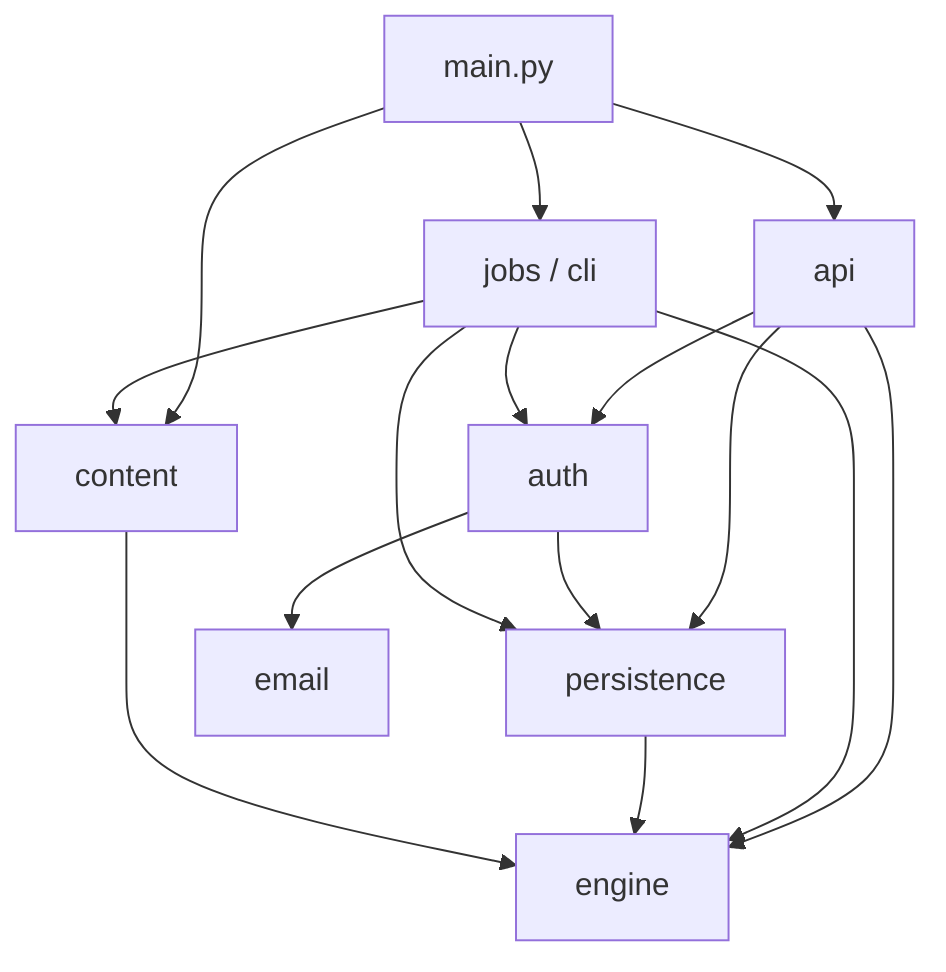
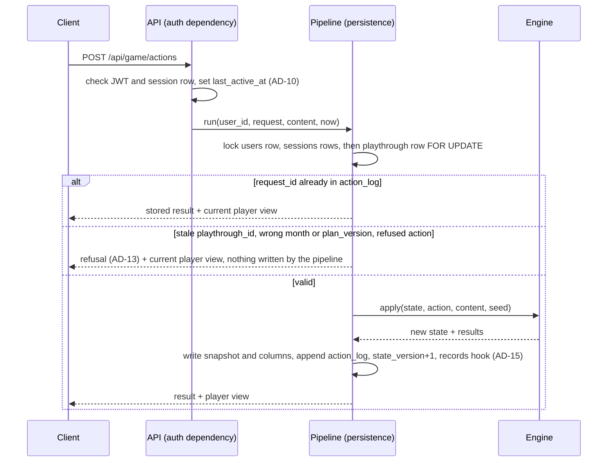
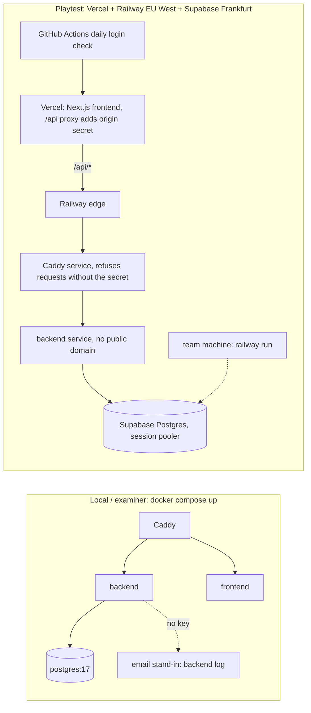
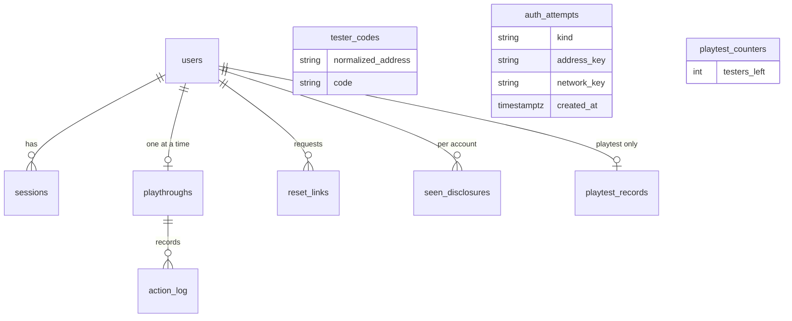

# Architecture Spine — LifeMode MVP

The PRD (final, as it stands on 2026-11-23, after #105, #111, #114, #115 and #116), Rule Set v1 (brief addendum) and the final UX (`ux-IBE160-G13-2026-11-11`) decide *what* the game does. FR-35 is left out of the MVP (#115), and FR-51 (minigames) is moved to V2 (#51); neither is bound. This spine fixes only the calls that keep separately built parts from diverging, in the backend and, since 2026-11-23 (#122), the frontend. The team's reference setup (`architecture/technology.md`) is adapted, not copied: only what the MVP needs is taken. Rationale and rejected alternatives are in `.memlog.md`.

## Design Paradigm

**Functional core / imperative shell.** The engine is pure Python: `(state, action, content, seed) → (new state, results with cause links)`. It has no database, web, clock, network or global random access. Everything else is the shell: it authenticates, loads, calls the engine, saves in one transaction, and responds. The frontend is the outermost shell, a **thin projection**: it renders the player view the backend sends and sends the player's inputs back, and holds no game rule, figure or game text of its own.

| Layer | Directory | Holds |
| --- | --- | --- |
| Core | `backend/app/engine/` | State model and content model (Pydantic), month loop (rule 1), ledger, selection step, draws, wellbeing, endings, cause links, text formatting, player view |
| Shell: content | `backend/app/content/` | YAML loader, YAML validation into the engine's content model, fingerprint, content check (FR-58) |
| Shell: persistence | `backend/app/persistence/` | All SQLAlchemy models on one `Base`, the mutation pipeline, state upgrades, playtest records, account deletion |
| Shell: API | `backend/app/api/` | FastAPI routers, request/response models, the auth dependency's wiring, error handlers |
| Shell: auth | `backend/app/auth/` | Passwords, sessions, attempt limits, reset links |
| Shell: email | `backend/app/email/` | Resend sender, local stand-in, null sender, Jinja2 templates |
| Shell: ops | `backend/app/jobs/`, `backend/app/cli.py` | Daily jobs, CLI commands |
| Leaf | `backend/app/settings.py` | All settings; imports nothing from `app` |
| Composition root | `backend/app/main.py` | Builds the FastAPI app, loads content, starts the daily jobs in the lifespan |
| Frontend: routes | `frontend/src/app/` | App Router layouts and routes, the gate function (AD-17) |
| Frontend: game client | `frontend/src/api/` | Generated API types, the typed fetch client, the game store and `sendAction` (AD-18) |
| Frontend: UI | `frontend/src/components/`, `frontend/src/styles/` | Components with CSS Modules, generated `tokens.css`, the scene SVGs (AD-19) |

Frontend imports go one way: `app` → `components` → `api`. Only `api` calls `fetch`, and nothing in the frontend imports from `backend/`.



Arrows point from the importer to the imported. `main.py` and `cli.py` are the composition roots and may import every layer. Every shell layer may import `settings`, which imports nothing from `app`. `engine` imports nothing outside itself, not even `settings`.

## Invariants & Rules

### AD-1 — The engine is pure and is the only place game rules live

- **Binds:** all backend units; FR-9, FR-12, FR-14, FR-20, FR-22, FR-24, FR-27, FR-52, NFR-4, NFR-9
- **Prevents:** financial rules leaking into routes, SQL or jobs; engine tests that need a database; two places computing the same figure; a content model defined outside the engine.
- **Rule:** Every financial result, wellbeing value, unlock, crisis check and ending is computed in `engine`. `engine` imports none of `sqlalchemy`, `fastapi`, `httpx`, `random`, `secrets`, `time` and `os`, checked by import-linter contracts in CI (with `include_external_packages = true`, so stdlib modules count); `datetime` is allowed for types only, and a ruff banned-api rule scoped to `engine` fails on `datetime.datetime.now`, `datetime.datetime.today`, `datetime.datetime.utcnow` and `datetime.date.today`. `apply` takes no wall-clock time; content and seed are passed in, and only the shell uses `now` (AD-13). The engine owns the content model (`engine/content_model.py`); `content/` only loads YAML into it. A CI import-boundary check fails on any import that breaks the dependency diagram above.

### AD-2 — The server decides; the client sends only inputs [ADOPTED]

- **Binds:** API, frontend boundary; NFR-4, NFR-7, FR-6, FR-7
- **Prevents:** a client computing or submitting a result; trust in client figures; state changes reachable by a cross-site link.
- **Rule:** Requests carry the player's inputs listed in NFR-7, each with the parameters its FR names (an amount, a loan term, a card payment mode, more or fewer hours, yes or no on an offer), the protocol fields in AD-4, and the account and start inputs (auth form fields including the nickname, a nickname change, life goal, avatar, start a new life). Following NFR-7, unknown fields are ignored and a missing or wrongly typed field is refused; the refusal tests cover a JSON `null` and an omitted field separately. A "continue anyway" confirmation for a rule 8 trigger is client-side only; the server never requires it. The client talks only to `/api/*`, including for login. No request changes state on GET. No game result or figure is computed outside the backend. Among state-changing requests, only `POST /api/game/actions` is retried automatically, with the same `request_id`; account, session and disclosure requests are never retried automatically, and after a lost response the client fetches `GET /api/game` or shows the login screen.

### AD-3 — Postgres is storage only, and nothing else can reach it

- **Binds:** DB schema, migrations, infra; NFR-3
- **Prevents:** game rules split between Python and SQL; a second read or write path into the tables (such as Supabase's public Data API); tables split across model bases or migration branches.
- **Rule:** No game logic in the database: no functions, triggers or views carrying rules. The course's Supabase requirement is met by Supabase Postgres alone; Supabase Auth, Edge Functions, Realtime and Storage are not used. In the Supabase project the Data API is switched off, and every table has RLS enabled with no policies, set by one Alembic helper that every table migration uses. The backend and Alembic connect as the table owner, which bypasses RLS, and no table uses `FORCE ROW LEVEL SECURITY`. The backend holds no Supabase URL or API key and reaches the database only through `DATABASE_URL`. All tables are declared on one `Base` in `persistence/models/`, which Alembic uses. Alembic migrations in `backend/migrations/` are the only schema path, for local, CI and playtest alike, and CI fails if `alembic heads` shows more than one head. A CI test on the migrated schema fails if any table in `public` has row level security off.

### AD-4 — One mutation pipeline

- **Binds:** every state-changing endpoint, the seed script; FR-6, FR-8, FR-11, FR-43, FR-49, NFR-7
- **Prevents:** endpoints with their own locking or idempotency; double-applied retries; two devices both winning; two lives from a double tap; a stale device acting on a new life; deadlocks between requests; a read that writes.
- **Rule:**
  - **One endpoint:** every state-changing game request is `POST /api/game/actions` with `{request_id, playthrough_id, month, action}`. `action` is a discriminated union on `type` made of the engine's own action models, with no second union in `api/`. The whole request body is strict and validated in JSON mode: the endpoint reads the raw body and calls `TypeAdapter(GameRequest).validate_json`, so ids, enums and decimals sent as JSON strings pass, unknown fields are ignored, and lax coercion (`"5000"` for an `int`) is refused; the OpenAPI schema comes from the same adapter, and a test posts one valid request per action member through the real app. The state models are lax; starting, ending early and playing again are members of it, and `plan_version` is a required field of the continue member. `GET /api/game` returns the player view, and the read-only `GET /api/game/quote` a quote (AD-13). Account, session and disclosure endpoints are separate.
  - **Protocol fields:** `request_id` is a client-made UUID. `month` is on every request (FR-49): the playthrough's current month, and for a start month 1, the month it opens. `playthrough_id` names the playthrough the request acts on or replaces, and is null only for an account's first start; if it isn't the user's current row, the request is refused with `409 game_changed`. `plan_version` is a counter in the state, raised only by month-plan changes (place, remove, same as last month) and reset at month open; continue sends it back, and a mismatch is `409 plan_changed`. Right after the locks, the pipeline looks up `request_id` in the `action_log` of the user's current playthrough, whatever the request names, and returns the stored result on a hit; the `playthrough_id`, `month` and `plan_version` checks run only on a miss.
  - **One pipeline:** every such request runs through one pipeline function, and nothing else writes game state. It takes the authenticated `user_id` (the auth dependency runs before it), the loaded content, the transaction time `now`, and for a start an optional `(seed, library_version)` pair, whose config version follows the library manifest. Routes never pass it; only the CLI seed command does, and seed scripts submit each stored action through the pipeline in-process.
  - **Lock order:** every state-changing transaction (game request, life request, account deletion, password change, logging out everywhere, reset) locks the `users` row first (`FOR UPDATE`), then that user's `sessions` rows, then the playthrough row, then the playtest record. No code locks them in another order. After the `users` lock the pipeline re-reads the session row and the user row and answers `401 not_logged_in` if either is gone; a foreign-key violation on a user-keyed insert is answered the same way.
  - **Life requests:** ending early sets `status = ended` and keeps the row. Only a start deletes the previous row, in the same transaction. A life request's `request_id` and result are stored as an `action_log` row of the playthrough it ends or creates, and a repeat is looked up there.
  - **Months:** continue is one engine action that closes month M and opens M+1 in the same transaction. It is composed of `apply_plan(state, content)` (the planned activities with their eligibility, payment and drops, then wellbeing; no draws and no month change), then in December the December step (BSU deduction, FR-12), then the rule 8 evaluation and `ledger.close_month(M)` (AD-9). After month 60 the rule 13 check and the ending follow; otherwise `ledger.open_month(M+1)` and M+1's opening steps (rule 1 up to the event, the crisis-month re-check and the AD-8 selection step). The view runs `apply_plan`, in December the December step, and the rule 8 evaluation on a copy for every after-the-plan figure (score, parts, bands, trigger status, goal and target progress); none of them draws, and no other code computes these figures. A start opens month 1, and setup steps before the first choice are game requests for month 1. No read path opens a month.



- **Database session discipline:** one `AsyncSession` per request (`expire_on_commit=False`), opened and closed by one dependency and shared by the auth check and the pipeline. Handlers and the pipeline never call `rollback()` or `commit()`: the request-session dependency commits on every normal exit and on an `AppError` refusal, and on any other exception closes the session without committing. The pipeline raises every refusal before its first write, and the `action_log` insert is its last write. A refusal builds its response from the state already loaded and writes nothing. Expected conflicts (sign-up email, `request_id`) use `INSERT … ON CONFLICT DO NOTHING … RETURNING` and check the result.

### AD-5 — Snapshot plus append-only action log

- **Binds:** persistence, engine state model; FR-12, FR-40, FR-43, NFR-7, NFR-11
- **Prevents:** replaying a whole playthrough per request; engine fixes rewriting results the player already saw; 10-15 joined tables per request; per-account data lost on a new life; indexed columns drifting from the state; an upgrade written by a read overwriting a confirmed choice.
- **Rule:** One `playthroughs` row per user (unique on `user_id`). It holds indexed columns (`id`, `user_id`, `status`, `current_month`, `state_version`, `seed`, `config_version`, `library_version`, `state_schema`, `last_played_at`) and the whole engine state as one JSONB document. `status` is `active`, `completed` (the ending is calculated, FR-49) or `ended` (ended early, FR-43); only a `completed` life is shown again. The document's shape is the engine's Pydantic model, not the database's, and the document is the authority: one persistence function copies the indexed columns from the new state on every write, and no game logic reads them. `state_schema` versions the shape. Old documents are upgraded in memory on every load by one upgrade function per version step; read paths never write the playthrough row, and the upgraded document is saved only by the pipeline's own write. `action_log` rows (`playthrough_id`, `request_id` unique per playthrough, `month`, action payload, the structured result (AD-13), `state_version`, `created_at`) are never updated or deleted while their playthrough exists; they store the result, not the whole state. The state document and `action_log` payloads are written with `model_dump(mode="json")`, so every `Decimal` is stored as a string and validated back by the lax state model; a test writes a state with every `Decimal` field to the database and reads it back. Data that lives per account and survives a new life (disclosures seen, FR-40) is in its own table keyed by `user_id`, written by an idempotent upsert outside the game pipeline.

### AD-6 — Determinism and exact money

- **Binds:** engine, content loader, persistence, API; FR-11, FR-12, FR-24, FR-27, FR-47, NFR-4
- **Prevents:** results that change on reload, retry or replay; float rounding errors (NOK 8,151 vs 8,152); kroner converted twice; one random result with two creators.
- **Rule:**
  - **Seed and draws:** the shell makes one seed per playthrough with `secrets`. Every draw is derived from `(seed, month, draw key)` by one draw function, independent of request order, with SHA-256 over a canonical encoding of the three, never `hash()` or `random`. The loader returns every collection sorted by content id, and the selection step sorts each eligible list by content id before indexing into it. Draw keys are built only by `engine/draws.py`, one function per draw kind (`<kind>:<content id or slot>`). Each drawn result has one owner, the unit that applies its effect; any other unit (the selection step, a message) reads it from the state's draw store and never draws it. A result is stored the first time and read back after that. Tests force a draw by pre-filling the draw store, never by patching the draw function.
  - **Money:** amounts are `int` whole kroner everywhere: engine, state document, actions, player view. Rates, hourly wages and hours are `Decimal`, written as quoted strings in content YAML (the loader fails on any float). A `Decimal` result becomes `int` again through the one rule 2 rounding function, at the points Rule Set v1 names: a year's tax once on the sum (rule 3), each job's pay on its own (rule 10), and each one-off shift's pay on its own when the shift is placed, at the rate for the player's age in the month it is worked (FR-47). The engine stores that integer with the shift, the view shows it, and the next income step pays exactly that. The only other roundings are the ones Rule Set v1 and the PRD name: rounded down for the monthly hour cap (rule 10), the loan cap (FR-25) and activity slots (FR-52), and largest remainder for cause shares (AD-9). No `float` anywhere in game arithmetic.
  - **Replay:** replay checks run in CI on action logs made by the same build; live playthroughs are never replayed against a newer engine.

### AD-7 — Content as versioned, frozen YAML

- **Binds:** content authors, content loader, engine, CI; FR-10, FR-17, FR-19, FR-34, FR-48, FR-58, NFR-4, NFR-9
- **Prevents:** mechanics changing under running playthroughs; tuning breaking the answer key; a permanently red CI, or a freeze that never bites; config and library pinned in a pair nobody checked; content kinds placed differently by authors and engine builders.
- **Rule:**
  - **Layout:** content lives in the repo, never in database tables. `content/config/vN/` holds Rule Set figures, each with source and date. `content/library/vN/` holds `events/`, `activities/`, `messages/`, `room/`, `shifts/` (one-off shifts, FR-47; never an activity, since they pay), `options/` (each open option defined once, referenced by id from its offer message and listed in the money and job views, FR-48), `expenses/`, `texts/` (endings, system causes, example purchases, disclosures, teasers) and `lists.yaml` (flags, mechanisms, activity kinds, senders, LK20 codes, avatar looks for FR-10), one YAML file per item, mechanics and Norwegian text together.
  - **Manifest:** each version folder has a manifest with a fingerprint over all non-text fields, including each item's `version`, which rises on mechanics changes only. A library manifest names the config version it is built for. Versions are ordered by the integer after `v`, and `test-vN` folders are never candidates. A new playthrough pins the newest frozen library version and its named config version. In `local`/`ci`, and in the playtest while no version is frozen (the sprint-1 spike), it pins the newest library. The content check validates each library against its named config.
  - **Freeze:** each manifest has `frozen: true|false`. While `false`, the version may change freely, no fingerprint gate applies, and only the schema gate and the open-option gate fail CI (FR-58); the schema gate is every check in the addendum's schema tables, references included, and fails a game text (events, messages, results, cause lines, endings, room) that writes a four-digit year or a month name outside the month placeholder (AD-13); disclosure texts and `source` fields name real dates and are exempt. While a seeded user's pinned library is unfrozen, its seed-state assertions (AD-14) warn; they fail from the freeze on, like the other FR-58 gates. The other FR-58 hard gates warn. The PR that opens the playtest sets `frozen: true`. From then on CI allows text-only edits, fails if the fingerprint changes, and fails on every FR-58 gate; a mechanics change means a new version folder. CI fails if a frozen version folder is removed, and no version folder is deleted in the MVP. When `v1` is frozen, the playtest database's game data (playthroughs and action log; accounts, records and codes are kept) is cleared once with `cli clear-game-data`, before testers arrive.
  - **Loading:** all versions are loaded and checked against their fingerprints once at startup, and startup fails on any error. A content-model field added after any version is frozen is optional in the model, and `content/config/backfill.yaml` gives its value for each older version, with source and date; the loader fills it before validation, the frozen folder's fingerprint is unchanged, and the content check fails if a frozen version lacks a value for a field with no backfill, or an unfrozen version leaves out a backfilled field. A frozen version's fingerprint includes its backfill values; entries are append-only, and CI fails if an existing (version, field) entry changes. The engine never supplies a default for a game figure. The backend image is built from the repo root and copies `content/`.
  - **Worked examples:** worked-example and engine unit tests read only `content/config/test-vN/` and items defined in the test code. The content check, the seed-state check and the replay check are the only CI steps that load a play library.

### AD-8 — One selection step

- **Binds:** engine; FR-18, FR-46, FR-47, FR-48, FR-55
- **Prevents:** event choice and message choice drifting apart; V2 needing a rewrite to plug in generated content.
- **Rule:** One engine unit decides what arrives when a month opens: the event, the messages (including the triggered answer to an hours request, FR-55) and the month's one-off shifts (FR-47). Seed-drawn items and state-triggered items are produced separately and merged under FR-55's cap and fill order. It reads draws through the draw store (AD-6). The result is stored in the state.

### AD-9 — One ledger for every balance

- **Binds:** engine; FR-15, FR-21, FR-23, FR-26, FR-32, FR-36, FR-38, FR-39, FR-42, FR-45, FR-47, FR-53, FR-57, rule 16
- **Prevents:** the payment order coded differently for options, activities, costs and card bills; income, interest, transfers and loans each updating balances their own way; cause shares that don't add up; an ending ranking built from data the engine can't see; the hub, the month summary, the year view and the year end each counting in and out their own way; a loan month looking like income.
- **Rule:**
  - **One writer:** every change to any balance (current account, savings, BSU, card, each loan or payment plan) goes through `engine/ledger.py`, and no other code changes a balance. `pay()` implements the FR-45 payment-order table, and `transfer()` moves money between the player's own accounts. `receive()` puts money into the current account, where it first covers a negative balance (FR-45). Each money action maps to exactly one ledger function and FR-45 row: moving money between the current account and savings, and BSU deposits, are `transfer()`; extra card payments and early payoff are `pay()` on their FR-45 row; a sale and a BSU withdrawal are `receive()`. In a crisis month, the rule 8 money-in order (a negative current account, then overdue card minimums) runs after every money action, crisis choice or open option (such as a consumer loan payout) that raises the current account, whichever function made the call (FR-32b). Wages and other income never pay the card outside the debt step.
  - **Causes:** every ledger call carries its cause, a choice id or a system cause, and updates that balance's per-cause parts using the addendum's rules (interest split in proportion, payments reducing every part in proportion, largest-remainder rounding).
  - **Choice ids:** each applied choice gets a sequence number from the state, in confirmation order. Cause links and FR-42's tie-break use it, never `request_id` or log order. Event options, open options, crisis options, applied activities, placed one-off shifts, accepted extra-shift and hours offers, and the moped sale are choices; transfers, BSU deposits and withdrawals, card and loan payments, a no to an offer, quitting, the card switch and payment mode, levels, pins and plan changes are not, and their ledger calls carry a system cause.
  - **Totals:** the state keeps a running total of money and wellbeing effects per choice, which FR-42's ranking reads. A choice's money total is `in − out + earned − charged` of the ledger calls caused by it; `internal` and `tax` calls never count.
  - **Flow classes (#116):** every ledger call also carries one flow class and a part within it. The calling step passes the payment-order row, the flow class and the part explicitly, from one engine table keyed by what is being paid (cost step, spending step, option, activity, instalment, money action); the cause is used only for cause parts and cause links:
    - `in`: money from outside into the player's balances. Parts: `wage` (gross, including summer jobs and one-off shifts), `bsu_deduction` (rule 9) and `other` (gifts, the pengegave, family money, sales).
    - `out`: money leaving to the outside. Parts: `spending` (rule 16), `costs` (fixed and everyday), `unexpected`, `activities` (by activity kind) and `purchases` (options, licences, moped, experiences). A card purchase counts when it is made. Deductions taken back at a BSU withdrawal are `out` under `bsu_deduction`.
    - `tax`: only rule 3's monthly tax step. It is never negative, and the BSU deduction stays a separate payment (rule 9, FR-21).
    - `interest`: parts `earned` (savings, BSU) and `charged` (card, consumer loan, payment plan). Each month the interest on the card, a consumer loan or a payment plan is its own `interest` call that raises that balance, before any instalment or bill.
    - `internal`: transfers between the player's own accounts, cover from savings (part of the payment it covers), loan payouts, instalments, early payoff, card bill payments, and a card balance turned into a payment plan. Borrowed money is never `in` or `out`.
    - A thing given (a gift moped, a car licence) and the parents' insurance share move no money and make no ledger call. Every part is a non-negative `int`, and the formatting function adds the sign the UI shows.
  - **Month totals (#116):** a flow belongs to the month whose totals are open when its ledger call is made. Only `engine/ledger.py` writes the totals. The month loop calls `close_month(M)` as the last step of closing M (after the planned activities, wellbeing and, in December, the BSU deduction), which appends M's totals by class and part to a per-month list in the state that is never rewritten, together with the month summary's lines (automatic transfers, applied and dropped activities with their notes). `ledger.open_month` starts an empty results list for the new month; continue's result is its first entry and refers to M's stored summary lines. It then calls `open_month(M+1)` before M+1's income step. A start calls `open_month(1)` before any setup step, and month 60 is closed like any other. A one-off shift's pay therefore belongs to the month it is paid (FR-47). Every surface that shows in, out, interest or tax reads these totals. They are for display only, and no game rule reads them: rule 8, rule 16 and FR-25 read the wage figures their rules name, and rule 12's debt-interest row reads the month's interest steps. A test asserts, for every month of every worked example, seed run and replay, that `in − tax − out + earned − charged` equals the change in current account + savings + BSU − card − consumer loan − payment plan − family loan. A state document upgraded to this schema starts the list empty.

### AD-10 — Own login with revocable sessions [ADOPTED in part]

- **Binds:** auth, every authenticated endpoint, DB schema, Caddy; FR-1 to FR-5, FR-44, NFR-3
- **Prevents:** tokens that can't be revoked (FR-4, FR-5 failing; shared school PCs staying logged in); a player logged out while playing; endpoints checking auth their own way; limits that reveal whether an address has a user, count every user as one network, or can be spoofed by a header.
- **Rule:**
  - **Passwords:** login is built in the backend (reference setup). Email is normalized per FR-1 by one function. A password (8-128 characters, settings) is stored as `bcrypt(base64(sha256(password)))`.
  - **Sessions:** a session is a row in `sessions` (`id`, `user_id`, `created_at`, `last_seen_at`, `stay_logged_in`, `expires_at`). Sign-up and login each create one, with the player's "stay logged in" choice (FR-1, FR-5). The client holds a JWT (HS256, `JWT_SECRET`) carrying only `sid` and `exp`, in an `httpOnly`, `SameSite=Lax` cookie, `Secure` everywhere except `APP_ENV=local` and `ci`. Without "stay logged in" the cookie has no `Max-Age`, and the row's idle limit is 30 minutes. With it, the cookie and the row last 30 days from the last authenticated request. One FastAPI dependency checks the JWT *and* the row on every authenticated request, and the row is the authority. It slides `last_seen_at` and `expires_at` at most once a minute, and whenever it does, it re-issues the cookie with a new JWT whose `exp` equals the new `expires_at`. It is the only writer of `users.last_active_at`, which is NOT NULL and set to the creation time at sign-up; the dependency writes it before the session row, and only when it slides; when its slide `UPDATE` changes no row, it answers `401 not_logged_in`. The client never calls the API from a timer: FR-8's idle and tab-return fetches run on the player's next input after the idle time or the return, and no request is made without a player input, a page load, a login, the connection coming back, or a retry of the player's pending action (AD-18) (FR-5).
  - **Revocation:** session rows are deleted as FR-3, FR-4, FR-5 and FR-44 say. A completed reset also logs this device in with a new row, with "stay logged in" off, and clears the address's failed-login count.
  - **Limits:** attempts are counted in an `auth_attempts` table (`kind`, `address_key` or null, `network_key`, `created_at`) with no link to `users`, so unknown addresses are counted the same way. `address_key` and `network_key` are HMAC-SHA256 under `HASH_SECRET`, computed by one auth function that every writer and reader uses. Failed logins are keyed by (address, network). Unknown addresses do the same work as known ones: login checks a dummy hash, and reset requests write the same rows and return the same response. The failed-login pause never applies to reset. A reset request held back by a limit gets the same response as one that was sent (FR-3); only sign-up and login answer `429`. Every "a day" limit in auth is a rolling 24 hours, except the total reset cap below, which follows Resend's UTC day. With the Resend sender, the daily total reset cap (default 80, settings) counts `reset_sent` rows in the current UTC day, matching Resend's quota; auth writes one only when the sender reports the email accepted.
  - **Network:** the network key is built from the client IPv4 address or IPv6 /64. The backend reads the client address only from `X-Client-IP`, which Caddy always overwrites with `{client_ip}`; without it, `local`/`ci` use a fixed placeholder network, `playtest` answers `500` and logs it, and limit tests set the header explicitly. One `CADDY_MODE` (`local` or `playtest`) sets the trusted proxies, the client-IP header and the origin-secret check together, and Caddy's entrypoint refuses `playtest` unless all three are set and valid. In the playtest, Caddy trusts every peer (`trusted_proxies static {$TRUSTED_PROXIES}`, the word `static` literal) and reads the client address from the header named in `CLIENT_IP_HEADERS`. The sprint-1 spike sets that header: `x-vercel-forwarded-for` if it arrives, else the leftmost `X-Forwarded-For` if Railway's edge keeps Vercel's value (Railway may overwrite it). If neither carries the visitor's address, the AD-14 fallback applies: a Next.js route handler proxies `/api/*`, forwards `Cookie` and `Set-Cookie` unchanged, fetches with `cache: 'no-store'`, sets `x-origin-secret` and overwrites `x-client-origin-ip`, which `CLIENT_IP_HEADERS` then names; the `vercel.json` `/api` route is then removed, and the handler is the only frontend server code on the `/api` path. Locally no proxy is trusted. The backend service has no public domain.
  - **Reset links:** one auth function creates them for both the endpoint and the CLI. Only the token's SHA-256 is stored, and a new link cancels older ones.
  - The login-hardening items on the PRD's cut list follow these rules if they're built. A player only ever reaches rows with their own `user_id`.

### AD-11 — Email through one module, off in the playtest

- **Binds:** email, auth, ops; FR-3, NFR-3, NFR-6, NFR-11, OQ-4
- **Prevents:** reset paths that differ between environments; email text built in several places; email addresses and reset links in the playtest logs; a sync email call blocking the server.
- **Rule:** One email module picks its sender by key and `APP_ENV`. Resend: when `RESEND_API_KEY` is set, through `resend[async]` and `send_async`. Local stand-in: only in `local`/`ci` without a key; it writes the rendered email, marked `[email:mock]`, to the backend log, and the README says how to find it. Null sender: in `playtest` without a key; it sends nothing and logs only the template name and `user_id`. All senders render the same Jinja2 template, and each reports whether the email was accepted. In the playtest the team creates one-time reset links with a CLI command (AD-14) that prints the link and writes no address to the log. Go-live turns Resend on by key plus a verified domain.

### AD-12 — One origin for the browser: Vercel in front, Caddy before the backend [ADOPTED, amended 2026-11-22]

- **Binds:** infra, backend route prefix, session cookie, frontend boundary, frontend `vercel.json`
- **Prevents:** cross-origin cookie and CORS differences between local and playtest; backend coupling to the frontend build; the backend being reachable around Vercel and Caddy; a stripped or doubled `/api` prefix; API responses cached by a CDN; reset tokens in logs.
- **Rule:**
  - **Playtest:** the frontend is a Next.js app on Vercel Hobby (chosen 2026-11-22; the frontend's own rules are AD-17 to AD-20), with its functions in `fra1` (Frankfurt). The Vercel domain is `PUBLIC_BASE_URL` and the only address the browser uses. A `routes` entry in the frontend's `vercel.json` proxies `/api/(.*)` to Caddy's Railway domain with the path unchanged. It sets `x-origin-secret` from the `ORIGIN_SECRET` environment variable with a `request.headers` `set` transform (the route lists `env: ["ORIGIN_SECRET"]`), so a visitor can't supply their own, and turns rewrite caching off for `/api/*` (`x-vercel-enable-rewrite-caching: 0`). `vercel.json` also sets `regions: ["fra1"]`; the Vercel project's Root Directory is `frontend`. `ORIGIN_SECRET` is set only for Vercel's Production environment, so preview deployments get Caddy's `403` on `/api`. `next.config` defines no `rewrites`, `redirects` or `headers` for `/api`, since Vercel would run them too. Every `/api` request is made by the browser through this proxy; Next.js server code (server components, `proxy.ts`, route handlers other than the AD-10 fallback) never calls `/api`, so every `Set-Cookie` reaches the browser and no game data passes through a Next.js cache. The backend also sends `Cache-Control: no-store` on every `/api` response. The browser sees one origin: the session cookie is first-party, `SameSite=Lax` holds, and no CORS is enabled.
  - **Caddy:** the only way into the backend in every environment, from one Caddyfile with upstreams, listen address, trusted proxies and the origin secret from environment variables. On Railway its site address is `:{$PORT}` with no hostname, behind the edge, and it answers `403 {"code":"origin_refused"}` to every request whose `x-origin-secret` doesn't equal `ORIGIN_SECRET` (at least 32 bytes, set in both Vercel and Railway, never a placeholder), and `503 {"code":"unavailable"}` when the backend can't be reached. Caddy's entrypoint refuses to start if trusted proxies are set and `ORIGIN_SECRET` is shorter than 32 bytes or equals the `.env.example` placeholder, and the daily check asserts the `403`. There it serves only `/api/*`. `/api/*` and `/openapi.json` go to the backend with the path unchanged, and the backend's routes carry the `/api` prefix. `/docs` goes to the backend only in `local`/`ci` (the Swagger page loads third-party assets, NFR-3).
  - **Local and the examiner run (NFR-6):** Caddy serves `http://localhost:<port>` and routes everything outside `/api/*` and `/openapi.json` to the frontend's Next.js server, its own compose service. The frontend upstream is an environment variable that defaults to that service and can point at a `next dev` on the host (websockets passed through for hot reload), so local development uses the same single origin. The examiner gets the same single origin without Vercel, and no origin secret is required.
  - The backend never serves frontend files and enables no CORS.
  - **Reset link:** `{PUBLIC_BASE_URL}/nytt-passord#token=<token>`, agreed with the frontend team 2026-11-22. The token is in the fragment, so the browser never sends it to Vercel, Railway or any log. The page reads it, removes it from the address bar, and posts the token and the new password to the API.
  - **Player information (NFR-3):** a static page in the frontend at `/personvern`, reachable before any account exists, since it must be read before sign-up and needs nothing from the backend. Its contents are NFR-3's list, with the processors and log notes from AD-14 and FR-5's note that some browsers keep a session through a restart. `/ny-bruker` shows the short version above its submit button, from the same frontend source, and `/meny` links to the page (FR-1).

### AD-13 — The API contract, the player view, and errors

- **Binds:** API, engine, CI, frontend boundary; FR-1, FR-6, FR-8, FR-12, FR-13, FR-15, rule 11, FR-16, FR-21, FR-25, FR-26, FR-33, FR-34, FR-37 to FR-40, FR-42, FR-43, FR-47, FR-49, FR-52, FR-54, FR-56, FR-57, FR-9, FR-32, NFR-4, NFR-7, NFR-8
- **Prevents:** undocumented API changes breaking the separately built frontend; hidden draws and unpicked effects reaching the client; a frontend text catalog that can't follow pinned content versions; figures put into text outside the backend; the client comparing server time with the device clock; each endpoint inventing its own errors; the frontend hard-coding wellbeing bands, computing the calendar year or summing months; the timeline and the game text showing different years.
- **Rule:**
  - **Contract:** the OpenAPI schema FastAPI generates is the contract. It is committed to the repo, and CI fails if it is stale. Every route declares its non-2xx responses with the shared error envelope model, whose `code` is the enum of stable codes, and a contract test fails on a route without them.
  - **One view function:** responses carry a **player view** built by one engine function, `view(state, content, last_action_at, seen_disclosure_ids, nickname) → PlayerView`; the raw state document is never sent. The view reads only the visible parts of the state, never the draw store, and resolves content only for items the player can currently see. It leaves out the seed, future schedule data (drawn or scheduled events, messages and draws not yet revealed; FR-18's unlock ages and prices and FR-15's teaser text may be shown), the wellbeing effects of event options not yet picked (FR-13), and a test fails if it holds any of them. A planned or available activity shows its cost and effects (FR-53). No endpoint serves library or config files or their parsed form; the disclosure texts ("Om tallene", FR-40) and quotes are the only content served outside the view.
  - **Results:** an action's result is engine state, not a separate response. The engine appends it to the open month's results as ids, integers, cause links and text parameters, with no rendered text. The view renders the open month's results under the same exclusion test, so `GET /api/game` shows the last result after a reconnect (FR-6). The envelope's `result` is only a reference `{result_id, replayed}` to an entry in `state`'s results, never rendered text. A repeated `request_id` returns the current view with that reference marked `replayed`; when the entry is no longer in the open month, it returns `result: null, replayed: true`, and NFR-7's same result is met by the action having been applied once.
  - **No playthrough:** with no playthrough, or an `ended` one, `GET /api/game` answers `200` with a view whose `status` is `none` or `ended` and whose `playthrough_id` is the current row's (null only with no row). It carries the start screens' texts and figures from the versions a start would pin now, chosen by one shell function that the start action also uses; a `completed` view carries them too, beside the ending, for «Spill på nytt». `view` takes an optional state, and the exclusion test covers these views too. The start action carries the library version the view showed, and a mismatch is `409 game_changed`. "Om tallene" renders from the shown playthrough's pinned library, or, with no playthrough or an `ended` one, from those start versions; disclosure ids keep their meaning across library versions, and the content check enforces it.
  - **Identity and time:** the view carries `playthrough_id`, `state_version` and `plan_version`; the pair `playthrough_id` + `state_version` identifies a state (FR-8). `last_action_at` is `playthroughs.last_played_at`, which the pipeline sets from `now`; the same `now` goes to `records.on_action` and `action_log.created_at`. Every game response is `{result?, state, server_time, recap_threshold, client_times}`, where `state` is the player view, and the recap threshold and `client_times` (`saving_notice_s` for FR-6, `idle_refetch_s` for FR-8) come from settings; the client measures the gap as `server_time − last_action_at` (FR-16), never against the device clock. The pair identifies the game state, not the view: the client always replaces its view with the latest response.
  - **Game text:** the backend renders all game text. The view carries finished Norwegian strings with the engine's figures filled in and formatted by one engine formatting function, plus raw integers where the UI needs a number (balances, wellbeing, slots). Every money figure the UI shows as text, signed flows included, is a string from that function next to its raw integer, with U+00A0 as the group separator, U+2212 as the minus sign and «kr» after the number; the frontend uses raw integers only for bar lengths and comparisons. The view carries no `Decimal`: hours and rates are formatted strings. Every figure a text shows is captured as a named parameter when its item enters the state (a message arrives, a result or cause line is created), and the function renders text from the content template plus those stored parameters; only the nickname and the month placeholder are resolved when the view is built. Captured parameters apply to texts of past items (arrived messages, results, closed-month lines). Figures of open items (offer previews, cause shares of a current balance, quotes, teasers, available activities) are view statuses shown next to the text, never placeholders in its template. The content check fails a template whose placeholders its item kind doesn't supply, or that uses such a live figure as a placeholder. The player's nickname (FR-1) is a placeholder that the same formatting function fills in when the view is built. It is never written into the state document, the action log or a stored text, so a changed nickname shows in all text from then on and replay is unaffected. The view also carries the nickname as its own field, which the UI may show on its own (settings, the hub marker, the menu link's name), never inside a sentence. The one exception is the sign-up preview: a fixed frontend sentence, not from the content library, with the typed nickname inserted. The frontend owns only UI chrome text (buttons, labels, offline and saving notices, form error texts keyed by `fields[].code` and the account codes, worded as in EXPERIENCE) and the player information page (AD-12). It checks only `required` and `type=email` before sending; every limit is checked by the server. The only money text it formats is the player's own typed amount, through one `formatKroner(int)` that follows the rules above and is tested against the engine's output.
  - **Derived figures (#116):** the view carries every figure the UI shows as a status, a date or a sum, computed in the engine; the frontend never derives one.
    - **Bands:** these wellbeing figures are `{value, band}`, with `band` one of `good`, `warn` (FR-33's "ok") and `bad`: the open month's score and three parts (this month's rule 12 result with the planned activities applied, FR-33), the average so far (null until month 19 is calculated), the current calendar year's average (shown on the year end), and the ending average. `value` is the integer shown; averages are rounded under rule 2 before banding. One engine function sets the band on that integer: `bad` if v < threshold, `good` if v ≥ threshold + offset, else `warn`. For stress, v is 100 − stress, while `value` stays the raw stress. The usual stress and social life are plain integers with no band. The threshold and the offset are game figures in `content/config/vN/`.
    - **Calendar:** `start_year` is a game figure in `content/config/vN/` (2026, matching D6's 2026 rates). One engine function maps a game month to `year = start_year + (month - 1) // 12`, `calendar_month = (month - 1) % 12 + 1` and the age, and the view carries all three. After month 60 the ending view carries age 20 and year `start_year + 5`. Game text names a month only through one placeholder kind that takes a game month. The formatting function writes it as the month name in the current year, "<month> i fjor" for the year before, and "<month> <year>" otherwise and always on the ending. Content authors never write a year.
    - **Money per month:** after month 60, money per month, the year so far and the year's average refer to game year 5. The view carries twelve entries for the current calendar year: closed months from AD-9's list, the open month from the running totals marked `open: true`, and later months as null. It also carries the year so far, summed by the engine over the closed months and the open month. The year end also carries the expected BSU deduction (FR-21), which is not yet in the totals.
    - **Other statuses:** the rule 8 trigger status with its month (FR-49); each offer and job action's preview (kroner left after spending, next month's slots, the free-time warning; FR-47, FR-56); the month a change or a shift's pay applies; free slots left; whether an offer is open; and each message's arrival month with a `new` flag. Reading a message is never stored (#112). The view carries `pending` (`none`, `setup_avatar`, `setup_gift`, `event`, `crisis_step`), set by the engine function that also decides `cannot_continue`. It also carries `year_end`, true in December once `pending` is `none` and until continue (FR-15), and `continue_warning` (`none`, `trigger`, `month_59`, `month_60`) with its rendered text (FR-49). A crisis month skipped at its opening re-check adds a `crisis_skipped` entry to that month's results (FR-32a). Each amount action carries its `min`, `max` and `step` as raw integers with formatted strings. Each room layer carries its state id, and the scene carries its rendered text alternative and marker text (FR-34, NFR-2). The place action's `slot` is optional; when it is omitted, the engine picks the first free evening.
    - **Quotes:** the consumer loan's terms are a list in `content/config/vN/` (12, 24 and 36 months). The view carries the engine's quote for each term at the amount the player can borrow (FR-25), and the read-only `GET /api/game/quote?kind=loan&amount=&term=` returns one for another amount through the same engine function and formatting. Its parameters are query-string integers; a term outside the config list, or an amount outside NOK 5,000 to the cap in steps of NOK 1,000, is `422 invalid_input`. The response is `{quote, server_time}` with no `state`; it writes nothing, it is not an action, and the frontend never computes a quote.
  - **Errors:** engine refusals are one enum of stable codes, each tagged turn (409) or input (422). Errors are raised only as one `AppError(code, status)`. The handlers for it, for `RequestValidationError`, for Starlette's `HTTPException` and a catch-all for any other exception (`500 internal_error`, traceback logged) all emit the envelope with `code` and `message` added. `code` is a stable string listed in the schema, `message` is plain Norwegian (NFR-8), and `state` is the current player view when the pipeline refuses a game request, and null otherwise. A body that fails validation on `POST /api/game/actions` gets `422 invalid_input` with `state: null`, and the client then fetches `GET /api/game`; no exception handler reads the database. Every account-form refusal carries `fields: [{field, code}]`, whatever its status: `409 email_in_use` and `403 wrong_password` carry their one field, and `422 invalid_input` lists every failing field (`too_short`, `invalid_chars`, `invalid_email`); the one FR-1 validation function raises `AppError`, and the `RequestValidationError` handler maps type errors to `fields` too. The client classifies by `code`: `unavailable`, `internal_error` and any response without a JSON `code` are transport failures, retried with the same `request_id` (`internal_error` at most once) and never shown as a refusal; every other code is a refusal. Caddy's bodies also carry a fixed Norwegian `message`.

| Status | Codes |
| --- | --- |
| 401 | `not_logged_in` (session missing, expired or revoked); `login_failed` (neutral) |
| 403 | `wrong_password` (password change, account deletion); `origin_refused` (Caddy, AD-12) |
| 404 | `not_found` (no such resource for this user) |
| 409 | Turn and month refusals (NFR-7): `wrong_month`, `plan_changed`, `game_changed`, `already_chosen`, `cannot_continue` (real choice or crisis unfinished), `game_ended`, `request_pending` (an hours request or offer already open, FR-47), `offer_not_open` (an answer to an hours offer that isn't open). Sign-up: `email_in_use` (FR-1) |
| 410 | `reset_link_invalid` (used, expired or replaced) |
| 422 | `invalid_input` and the other NFR-7 input refusals |
| 429 | `rate_limited`, with the neutral message (sign-up and login only) |
| 500 | `internal_error` (catch-all handler) |
| 503 | `unavailable` (Caddy, backend unreachable) |

### AD-14 — Environments, configuration and operations [ADOPTED in part]

- **Binds:** infra, CI, README, backend config, ops; NFR-5, NFR-6, NFR-10, NFR-11
- **Prevents:** local and playtest drifting; the examiner needing team keys or a copied `.env`; seed users with published passwords on the playtest; a playtest host that sleeps, leaves the EU/EEA unannounced, or keeps billing; deploy config in a format Railway stops reading.
- **Rule:**
  - **One image, one settings file:** one backend image in every environment. All settings are pydantic-settings fields in `backend/app/settings.py`, read from environment variables and listed in `.env.example`. `APP_ENV` (`local | ci | playtest`) has no default, and the app refuses to start without it. `compose.yaml` sets `APP_ENV=local` and every local default inline, including `PUBLIC_BASE_URL` as Caddy's local origin (settings refuse another value in `local`), so `.env` is optional. The backend runs one Uvicorn worker per instance; the pool sizing and the in-process daily jobs assume it. `JWT_SECRET` and `HASH_SECRET` are never empty; the `.env.example` placeholders are at least 32 bytes. Outside `local`/`ci` the app also refuses a placeholder or a secret shorter than 32 bytes, and requires `PUBLIC_BASE_URL`.
  - **No secrets locally:** every external service falls back to a local stand-in when its key is missing, so `docker compose up` runs the full stack with no secrets.
  - **Migrations and seeding:** `python -m app.cli schema upgrade` runs Alembic before the app starts: on Railway as the pre-deploy command (`preDeploy` in `.railway/railway.ts`, which declares both services with EU West replicas and every secret with `preserve()`, and is applied with `railway config apply` (in a single-file project Railway deletes any service, variable or domain the file leaves out); Serverless stays a dashboard toggle; no `railway.json`/`railway.toml`, which Railway stops reading on 2026-12-01), and in the compose entrypoint after the database is ready. The app never migrates inside its own startup. In `local`, the entrypoint then runs `cli seed --if-empty`. Seeding refuses outside `local`/`ci`. Seeded users are made by scripted play from month 1 through the pipeline (AD-4), each with a fixed seed and pinned content versions, and CI runs the seed script and asserts each target state (NFR-6).
  - **Database:** `DATABASE_URL` is one URL for the app and Alembic. Settings normalize `postgres://` and `postgresql://` to `postgresql+asyncpg://` and rewrite `sslmode=` to `ssl=` (asyncpg's name). In the playtest it is Supabase's session pooler (port 5432, host copied from the Connect dialog, `?ssl=require`). The Free pooler allows 15 clients: the app pool is 5 per instance with no overflow (two instances during a deploy overlap), and Alembic and CLI commands use `NullPool`. Local Postgres uses the same major version as Supabase.
  - **Playtest host:** Railway Hobby in EU West (Amsterdam), Serverless (sleeping) off for every service. The backend service's healthcheck is `/api/health`; Caddy's service has none, since Caddy refuses requests without the origin secret. Supabase Free Postgres in Frankfurt, a neighbouring region as the addendum allows. Railway stores all logs, including its own HTTP logs with client IPs, in US West for 90 days under Railway's DPA (Railway staff answer, 2026-10-08; the docs show Hobby 7 days in the dashboard); this is accepted. The frontend runs on Vercel Hobby, which is for non-commercial use, as a school project is. Its functions run in `fra1` (Frankfurt, set explicitly; the default is `iad1`), and Hobby keeps runtime logs for 1 hour. The playtest deploys from a `playtest` branch; `main` is the working branch. Data processors named in the player information (NFR-3): Vercel (the frontend and the `/api` proxy; edge network, functions in Frankfurt), Railway (services in EU West, logs in US West) and Supabase (Frankfurt); no email relay.
  - **Speed and fallback:** the course's Supabase requirement wins over speed. If the spike is slow, cut database round trips first. Switch to Railway Postgres 17 in EU West (image tag checked when switching) only if Supabase pauses or fails, by changing `DATABASE_URL`, and record it as a deviation from the course requirement in the delivery report. On the fallback, ops commands run with `railway ssh -- python -m app.cli …` or use the database's public URL.
  - **Cost:** about USD 5-8 a month while the environment exists, from the sprint-1 spike to the analysis (about two billing months). The frontend on Vercel Hobby costs nothing. A usage alert is set at USD 6 and a hard limit at USD 10 (Railway's minimum; hitting it takes the playtest offline). After the analysis, both projects are deleted and the Hobby plan is cancelled.
  - **Ops commands** (reset link, tester codes, test-account marking, export) run from a team member's machine with `railway run`, from a checkout of the commit deployed on the `playtest` branch, so their output stays local.
  - **Deploys during the playtest:** migrations and `state_schema` steps only add, and so do `openapi.json` changes (new optional fields, action members and codes). The backend deploys before the frontend, and the frontend treats an unknown code as a refusal and an unknown `status` or `pending` value as a reload notice. Rollback means redeploying the previous image, and only if the deploy had neither.
  - **CI end-to-end:** the `ci` environment raises the sign-up and login limits from settings, except in the limit tests, since every Playwright request comes from one address (AD-20).
  - **Sprint-1 spike:** verifies the assumptions in AD-3, AD-10, AD-12 and this AD: server time per month process+save, no sleeping or cold start, usage, peak pooler clients during a deploy, the Data API off and RLS on, the header that carries the visitor's address through Vercel and Railway's edge (forged `X-Forwarded-For`, `X-Real-IP` and `x-vercel-forwarded-for` ignored), cookies passed through, no `/api` caching, the origin-secret refusal, `railway config plan` changing neither region nor Serverless and deleting no variable or domain, Supabase counting the daily check as activity, and `server_version`. The checklist lives in #92. On a failure, the fallbacks in AD-10 and above apply.

**Playtest limits (NFR-11):**

| Limit | Value |
| --- | --- |
| Sleeping when idle | None: Railway sleeping is off |
| Database pause | Supabase Free pauses after 1 week without database activity; the daily login check prevents it |
| Storage | 500 MB on Supabase Free; expected use is under 100 MB for 10-20 testers |
| Database clients | 15 on the Free session pooler (sizing in AD-14) |
| Users | No Supabase Auth, so no user limit applies; 10-20 testers expected |
| Logs | Railway keeps all logs in US West for 90 days; Vercel Hobby keeps runtime logs for 1 hour; both named in the player information |
| Email | None sent in the playtest; Resend Free at go-live allows 100 a day (UTC), reset cap 80 a day |

### AD-15 — Playtest data stays separate

- **Binds:** persistence, ops, CLI, daily jobs; FR-44, FR-50, NFR-3, SM metrics
- **Prevents:** records leaking into the examiner run; tester codes joined to email in exports or stored in several places; records lost when a playthrough is deleted; records rebuilt in different ways; two account-deletion paths; "playtest only" read as two different settings.
- **Rule:**
  - **One switch:** everything playtest-only (the records hook, the tester-code table and loader, the `testers_left` counter) is gated by `PLAYTEST_RECORDS` alone (default off; on only in the playtest), never by `APP_ENV`.
  - **Records:** the pipeline calls one `records.on_action(user, before, after, action, now)` in the same transaction after the engine step; starting a new life updates the record before the old playthrough is deleted. Records are never rebuilt from `action_log`. They live in their own table keyed by account and survive playthrough deletion (FR-43).
  - **Account deletion:** every deletion, by the player or by the inactivity job, goes through one `delete_account(user_id)`, which follows AD-4's lock order and deletes the account's records in the same transaction. It adds one to `testers_left` only when its `DELETE … RETURNING` removed the row, `PLAYTEST_RECORDS` is on, the account isn't `users.is_test`, and its normalized address is in `tester_codes`. The counter row is created by its migration.
  - **Tester codes:** a CLI command loads the email-to-tester-code list into its own table, normalizing each address with the FR-1 function. The code is resolved once, at export, by joining the user's normalized address to that table; records hold no code, and nothing else stores codes or matches them, apart from `delete_account`'s check above. The export skips accounts with no code. A re-created account with the same address therefore counts as the same tester.
  - **Test accounts:** team and check accounts carry `users.is_test`, set by a CLI command, and records and the export skip them.
  - **Export and cleanup:** the export writes tester codes, never email addresses or nicknames, and records never hold the nickname (NFR-3). Codes, records and playtest accounts are deleted after the analysis, no later than the December delivery.

### AD-16 — Typed facts have one owner; content sees them as derived flags

- **Binds:** engine, content authors, content check; FR-28 to FR-30, FR-34, FR-46, FR-48, FR-55
- **Prevents:** a moped (licence, job, card, loan) held both as a typed field and as a content flag, so that selling clears one and the room or the draws still follow the other.
- **Rule:** A fact the engine holds as a typed field (belongings, licences, job, BSU, card, loans, payment plan) is visible to content only as a derived flag, computed from that field by one engine function. Content may require or block a derived flag but never set or clear it; an option changes such a fact only through its typed effect. `lists.yaml` marks which flags are derived, and the content check rejects an option that sets or clears one.

### AD-17 — The game state decides the gate screens; the URL decides the area

- **Binds:** frontend routes and layouts, every screen; FR-5, FR-6, FR-8, FR-11, FR-13, FR-15, FR-16, FR-31, FR-32, FR-40 to FR-44, FR-49, FR-54, NFR-1, NFR-2, NFR-10
- **Prevents:** each screen checking the game state its own way; a deep link, a reload or a second device showing a screen the game doesn't allow; the bank locked during a crisis; the menu locked during a crisis or on the ending; a year end shown before December's event or crisis; a recap or year end that can't be closed or comes back after every response; focus and the page title left behind when a gate swaps; hash routes clashing with `/nytt-passord`.
- **Rule:**
  - **One gate function:** `gateFor(envelope, session)` is pure over the latest envelope and the page-session record (AD-18), and returns the first match in this order: start screens (`status` `none` or `ended`, or `playAgain`), ending (`completed`), recap (`recapDue`), setup step (`pending`), result, event (the card warning is the month's event), crisis step, year end (`year_end`). It reads `pending` and `year_end` from the view and never infers a step from the month.
  - **Two kinds of gate:** full-screen gates (start screens, setup steps, recap, ending) replace the whole game layout with no tabs or rail; `/meny`, `/om-tallene` and `/personvern` stay reachable over them. Hjem gates (result, year end, event, crisis step) replace only Hjem's content, the centre on desktop; every other area route stays reachable, the tabs mark Hjem, and the server's `cannot_continue` alone keeps the month from closing (FR-32b). A gate has no URL of its own.
  - **Raise and close:** setup steps, the event and the crisis step close by their action. The recap shows while the session record's `recapDue` is set. A login or a completed reset sets it, and so does the first envelope after a page load (a `pageshow` restored from the back-forward cache counts) or a tab-return fetch whose `server_time − last_action_at ≥ recap_threshold`; the idle, `online` and other fetches never do. «Fortsett» clears it. The year end closes with «Fortsett» into the session record, keyed by (`playthrough_id`, month), so a reload may show it once more. The result shows only the entry named by a success response's `result.result_id`, `replayed` or not, after the pengegave choice, an event option and every crisis step (the crisis end is the last step's result); «Fortsett» clears it, and it is skipped when that id is no longer in the open month's results. A refusal, a `null` result or a reload never shows it, and after a reload the open month's results, including a `crisis_skipped` note, stay in Hjem's «Denne måneden». «Spill på nytt» sets `playAgain`. «Nytt liv» in the menu sends the end-early action on an active life, and only sets `playAgain` on a `completed` or `ended` one. Only the life-goal screen sends the start.
  - **Areas:** with no full-screen gate, App Router path routes pick the area: `/hjem`, `/plan`, `/mobil` (a thread at `/mobil/[id]`), `/jobb`, `/penger`, `/aaret`, `/meny` (a route, so its sheets stay one level deep), `/om-tallene`; outside the game `/`, `/logg-inn`, `/ny-bruker`, `/glemt-passord`, `/nytt-passord` (AD-12) and `/personvern`. A logged-in visit to `/`, `/logg-inn` or `/ny-bruker` goes to `/hjem`. From 1100 px one game layout shows Hjem in the centre and `/mobil`, `/jobb` and `/penger` in the right pane; the breakpoint is CSS on that layout, never JavaScript before hydration. The toast and the offline bar are page states, not routes. The mockups' hash routes are not used.
  - **Screen changes:** a gate entering or leaving counts as a route change. One focus manager in the game layout moves focus to the new screen's `h1` and sets `document.title` («<screen> · LifeMode»), and the screen change goes to the one polite live region the root layout mounts (`announce()`, AD-19). Before the first envelope the layout shows a static «Laster …» (NFR-10). `error.tsx`, `global-error.tsx` and `not-found.tsx` show Norwegian chrome text with a link to `/hjem`; render errors go to no third party.

### AD-18 — One game client owns the protocol

- **Binds:** frontend data access, every screen, CI; FR-6, FR-8, FR-49, AD-2, AD-4, AD-10, AD-13
- **Prevents:** screens fetching or retrying their own way; a background request sliding an idle session past its 30 minutes; a retry with a new `request_id` applying a choice twice; a choice sent with the fields of a view the player never saw; an older response overwriting a newer one; a refusal blanking the screen; page-session state kept in several places; one player's game left in the store after logout; hand-written types drifting from the contract.
- **Rule:**
  - **Types and fetch:** `frontend/src/api/` is the only frontend code that calls `fetch`. Its TS types are generated by `openapi-typescript` from the committed `openapi.json` and its calls are made with `openapi-fetch`; types are never written by hand. The generated file is committed and regenerated by one npm script in the PR that changes `openapi.json`, and CI fails if it is stale.
  - **One store:** the game store (`useSyncExternalStore`, with a `getServerSnapshot` that returns the empty store) holds the latest envelope and one page-session record: `recapDue`, `playAgain`, dismissed gates, `shownResult`, opened message ids, seen disclosure ids, toast closed, and the pending action. Only `api/` writes it. The record survives envelope replacement, is cleared when `playthrough_id` changes, and is never persisted. Components read the view through selectors and never derive a figure (AD-13). Every request gets a client sequence number. The store accepts an envelope only if its request was sent after the request of the held envelope and, for the same `playthrough_id`, its `state_version` is not lower; a response with `state: null` never touches it. `reset()` aborts requests in flight and pending retries, drops everything and starts a new epoch, so no older response enters the store. Logout, logging out everywhere and account deletion call it after a `2xx`; a lost logout response is never taken as done: the client fetches `GET /api/game` and stays in the menu with «Prøv igjen» unless it gets a `401`. A `401 not_logged_in` on a game route calls `reset()` and goes to `/logg-inn`; `401 login_failed` is a form refusal. The routes outside the game never fetch the game.
  - **Actions:** `sendAction(action, shown)` builds `{request_id, playthrough_id, month, action}` (`plan_version` on continue) from the view the player acted on. It is single-flight: while a game request is pending, every game control is locked (`aria-disabled`, «Lagrer …») and a `GET` waits until it settles. Every request has a timeout. Transport failures (`unavailable`, `internal_error` at most once, any response without a JSON `code`, a request aborted at the timeout) are retried with the same `request_id` 2, 5 and 10 s after each failure, then every 30 s while the page is visible, until it settles; these are the only timed requests (AD-10). «Prøver fortsatt …» shows after `saving_notice_s` with a «Prøv igjen» button, and `online` retries at once. Every other code is a refusal. The turn refusals `wrong_month`, `plan_changed` and `already_chosen`, and `game_changed` when the `playthrough_id` changed, also show «Spillet ble oppdatert på en annen enhet.»; a start refused for changed versions shows the start screens again with a chrome line. While offline (`navigator.onLine` false or a transport failure) options are locked and nothing is queued (FR-8); the next successful response clears it.
  - **Fetches:** `GET /api/game` runs on page load; after login, sign-up and a completed reset (after `reset()`); on `online`; after a game refusal with `state: null`; after a lost account, session or disclosure response (AD-2); after a nickname change; and before the player's next input after `idle_refetch_s` or a return to the tab. In that last case, if (`playthrough_id`, `state_version`) changed, the input is dropped and the notice above shows; otherwise it is sent. A failed `GET` is a transport failure: it is retried the same way, the offline bar (with «Prøv igjen») replaces «Laster …», and an input waiting on it is dropped. There are no other timers and no fetch on focus. A disclosure's «Skjønner» adds its id to the session record, with no refetch.
  - **Announcements:** the game client sends to `announce()`: saving, saved, «Prøver fortsatt …», offline and back online, the other-device notice, and on a month's opening the number of new messages; a gate's screen change carries its heading, so the card warning is announced by its headline (NFR-2).
  - **Other calls:** account, session and disclosure forms are single-flight with their submit locked, and never retried automatically. Quotes (`GET /api/game/quote`) are plain typed reads made when the player confirms an amount, never retried, kept in the sheet's own state and never in the store.
  - **Tests:** unit tests cover the same `request_id` on retry, the retry schedule, the error classes, the fetch triggers, single flight, the stale-response check, `reset()` with requests in flight, and the lost logout.

### AD-19 — Design tokens have one source; styles are CSS Modules

- **Binds:** every frontend component, CI; NFR-2, NFR-3, `DESIGN.md`
- **Prevents:** hard-coded colours, in CSS or in SVG; two names for one token; the mockups' variable names (`--in`, `--hair`, `--yellow`) leaking into the code; a status colour used on money or coral used for a warning; fonts loaded from a third party; shared pieces (sheet, live region) built twice.
- **Rule:**
  - **Tokens:** `frontend/src/styles/tokens.css` is generated by `frontend/scripts/` from the frontmatter of `.docs/planning-artifacts/ux-designs/ux-IBE160-G13-2026-11-11/DESIGN.md` (the path changes only with a new UX version), committed, and never regenerated in Vercel or Docker builds; CI fails if it is stale. Mapping: `colors.x` → `--color-x`, except `scene-*` → `--sc-*` only; `rounded.x` → `--radius-x`; `spacing.x` → `--space-x`; each typography token → `--font-<name>-{family,size,weight,line-height,letter-spacing}`, with the family as `var(--font-bricolage)` or `var(--font-kalam)`; `components` are not emitted. Shadows and the scrim use `color-mix()` on token variables.
  - **Only one file has colours:** outside `tokens.css`, stylelint refuses hex, named colours and every colour function (`color-no-hex`, `color-named: never`, `function-disallowed-list`), and an ESLint rule fails on colour literals in `.tsx` and `.svg` under `src/`.
  - **Components:** CSS Modules, one `.module.css` per component. No component library. Shared primitives live in `components/ui/` and are built in the first frontend story, before any screen story: the sheet on native `<dialog>`, the locked control, the one polite live region with `announce()` (no other element carries `aria-live`, `role="status"` or `role="alert"`), the money figure and the bar.
  - **Scenes:** inline SVG with named groups and `--sc-*` colours (DESIGN). Layer groups switch only on the view's room-layer state ids, and the text alternative and marker text come from the view (AD-13). The avatar sets `--sc-hoodie` and `--sc-hoodie-shade` from the view's look id, through the look tokens in DESIGN.
  - **Fonts:** Bricolage Grotesque and Kalam are woff2 files in the repo, loaded with `next/font/local` as `--font-bricolage` and `--font-kalam` on `<html>`, with their OFL licence beside them; nothing is loaded from another origin. Light mode only.

### AD-20 — Frontend tests run against the real backend, with the accessibility gate in CI

- **Binds:** frontend, CI; NFR-1, NFR-2, NFR-3, NFR-6, NFR-9, NFR-10
- **Prevents:** end-to-end tests against a mock that drifts from the backend; fixtures shaped into states the engine can't produce; specs breaking each other through shared seeded users; the accessibility check running only on someone's machine; each developer picking a test tool.
- **Rule:**
  - **Unit:** Vitest with Testing Library on jsdom tests the game client, `gateFor` and components with logic (the month plan). Fixtures are player views dumped from the seed states by one backend CLI command, committed to `frontend/src/test/fixtures/`, with a staleness check; hand edits only remove fields.
  - **End to end:** Playwright runs against the full compose stack (Caddy, backend, Postgres, frontend) in CI, never a mocked backend, with Chromium, WebKit and Firefox projects (NFR-1). The e2e job starts from a freshly seeded database; each spec owns a named seeded user or signs up with its own address, and specs that touch the same user run serially. The main flow (sign-up, first choice, continue, card, crisis, ending) runs at 320, 390, 900 and 1280 px wide, and each screen asserts no horizontal scroll. Focus moves around sheets are checked here, not in jsdom. The run fails on any request to another origin (NFR-3).
  - **Accessibility:** `@axe-core/playwright` checks every area route and each gate in the same runs, with the tags `wcag2a`, `wcag2aa`, `wcag21a`, `wcag21aa` and `wcag22aa` (NFR-2 is WCAG 2.2 AA); the test filters the results by impact, and CI fails on any `serious` or `critical` finding.
  - **Manual:** before each playtest, the NFR-1 device results, the NFR-2 keyboard and screen-reader results (including 2.5.7 dragging, 2.5.8 target size and 3.3.7 redundant entry) and the NFR-10 throttled-network measurement are written to `frontend/e2e/manual-checks.md`.

## Consistency Conventions

| Concern | Convention |
| --- | --- |
| Naming | Python `snake_case`; DB tables plural `snake_case`; JSON fields `snake_case`; API paths `/api/<noun>`, game actions at `POST /api/game/actions` (AD-4); content ids as in the addendum schemas (`E-041`) |
| IDs | UUIDs for users, sessions, playthroughs and `request_id`; content ids are strings from the library; choices are ordered by the state's sequence number (AD-9) |
| Time | UTC `timestamptz` in the DB; the engine never reads a clock, game time is months 1-60, and the calendar year shown comes from the config's `start_year` (AD-13); the pipeline's one `now` per transaction (AD-13); day-based playtest metrics use Europe/Oslo |
| Money | `int` whole kroner everywhere; `Decimal` only for rates, hourly wages and intermediate products (AD-6) |
| Errors | One `AppError` and the shape and status classes in AD-13; refusals are logged with `user_id` and `code`, never email, password or nickname |
| Logging | Our logs carry no email address, password, nickname or reset token (NFR-3); the one exception is the `local`/`ci` email stand-in (AD-11). Our access logs leave out the client address and query strings; Railway's own HTTP logs are outside our control (AD-14). Server time per month process+save is logged |
| Observability | stdlib `logging` with one JSON line format set in `main.py`, carrying a server request id made by the middleware, the game `request_id` where there is one, `user_id`, `code` and `duration_ms`; Uvicorn's access log is off, and one middleware writes the access line; the catch-all handler logs every 500 with its traceback (AD-13); during the playtest the daily check fails on any `error` line in the last 24 hours (Monitoring) |
| Config | Game figures (pinned per playthrough, including `start_year`, the wellbeing band offset and the consumer loan terms; backfill for fields added after a freeze in `content/config/backfill.yaml`, AD-7; each with its Rule Set v1 parameter row and also in `config/test-vN/`, AD-13) and the content check's minimums and limits (FR-17, FR-58) in `content/config/vN/`. Operational limits (login limits, idle times, reset link lifetime and caps, inactivity deletion, the FR-50 gap, the recap threshold, pool size) in `backend/app/settings.py` with the PRD defaults, overridable by environment variable. The saving notice (FR-6, 5 s) and the idle refetch (FR-8, 5 min) are settings too, sent to the frontend in the envelope's `client_times` (AD-13); the request timeout and the retry schedule are frontend constants in `frontend/src/api/config.ts` |
| Accounts | `users.last_active_at` is NOT NULL from sign-up (AD-10). `users.nickname` is set at sign-up and changed in the settings, both through one validation function with the FR-1 rules (trimmed, 2-16 characters from settings, letters including æ, ø and å, digits, spaces and hyphens); it is deleted with the account. `users.last_active_at` is written only by the auth dependency (AD-10); the 12-month inactivity deletion uses it. "Play" in FR-5 and NFR-3 means any authenticated request |
| Deletion | Every child table cascades from its parent (`user_id` tables from `users`, `action_log` from `playthroughs`); `tester_codes` is keyed by address and has no link to `users` |
| Jobs | Daily inside the backend process, started by `main.py`, at a fixed UTC hour, each holding a session-level advisory lock on its own connection for the whole run so one instance runs it, as idempotent deletes (the inactivity job re-reads `last_active_at` after the `users` lock): accounts after 12 months without activity (through `delete_account`, AD-15), expired sessions and reset links, attempt rows older than 24 hours |
| Health | `GET /api/health` (no auth) returns 200 once content is loaded and the database answers |
| Monitoring | Daily scheduled GitHub Actions check against the playtest: login with a test account, Caddy's `403` without the origin secret (AD-12), and no `error` log line in the last 24 hours (read with a read-scoped Railway token stored as a GitHub secret); it alerts the team on failure and keeps Supabase from pausing |
| Performance | p90 ≤ 300 ms server time per month process+save, taken from the logged server time in the playtest environment (spike and playtest). The backend test in CI is a regression bound with headroom. The session check and the pipeline share one transaction |
| Frontend code | Next.js App Router, React, TypeScript `strict`. Game screens are client components; Next.js server code never touches game data (AD-12). `<html lang="nb">`. File and component names in English, routes and player-facing text in Norwegian bokmål only, with no i18n library; chrome words follow EXPERIENCE's word table. No `NEXT_PUBLIC_*` variables and no secrets in the frontend; it calls only relative `/api` paths. Every page is sent with a static `Content-Security-Policy` from `next.config` (`default-src 'self'`, `connect-src 'self'`, `font-src 'self'`, `img-src 'self' data:`, scripts and styles as Next.js needs); Vercel Analytics, Speed Insights and the toolbar stay off (NFR-3) |
| Lint and format | CI jobs on every PR: backend `ruff check` and `ruff format --check` (plus the engine's banned-api rule, AD-1); frontend ESLint (`eslint-config-next`), Prettier `--check`, stylelint (AD-19) and `tsc --noEmit`. ESLint also bans `fetch` outside `src/api/`, enforces the import direction `app` → `components` → `api` with no imports from `backend/`, and fails on colour literals (AD-19) |
| Review | A ruleset on `main`, set up before the first story PR: green CI and at least one approval from another group member before merge, with no bypass (admins included); nobody merges their own PR unreviewed. `playtest` takes merges from `main` only. The review is written as comments in the PR, also for AI-generated code |
| Tests | pytest. Engine tests use no DB. Tests that touch the database run against Postgres 17 with the migrated schema (compose locally, a service container in GitHub Actions); SQLite is not used. One automated test per NFR-7 refusal case, with `null` and omitted fields tested separately. Worked examples, F1-F4 and F6-F10 (F5 is V2), refusals, replays, the seed script, the import-boundary check, the single Alembic head and the content check run on every PR, and so do the frontend's Vitest and Playwright runs with the accessibility gate and the staleness checks for the generated API types and `tokens.css` (AD-18 to AD-20) |

## Stack

| Name | Version |
| --- | --- |
| Python | 3.12 (container image; security-only until 2028-10) |
| uv | version pinned in the Dockerfile; `uv.lock` committed; installs `--locked` |
| FastAPI + Uvicorn | FastAPI 0.165.x (0.165.0, 2026-11-18); exact pins in `uv.lock` at first build; the NFR-7 refusal tests run against the locked version |
| Pydantic + pydantic-settings | 2.x |
| SQLAlchemy (async) + asyncpg | SQLAlchemy 2.1.x (2.1.9, 2026-11-16); asyncpg 0.32.x |
| Alembic | 1.20.x (1.20.1, 2026-10-22) |
| PyJWT, bcrypt | PyJWT 2.x (empty HMAC keys refused); bcrypt 5.x (refuses inputs over 72 bytes) |
| Jinja2, resend | latest at first build, pinned in `uv.lock`; resend with the `async` extra |
| PostgreSQL | 17 (Supabase platform default; local image and the Railway fallback match) |
| Caddy | 2.11.x (2.11.9, 2026-11-05; at least 2.11.8 for its security fixes) |
| Docker Compose | the `docker compose` plugin (5.x current) |
| Railway | Hobby plan, EU West (Amsterdam); deploy settings in `.railway/railway.ts` or the dashboard |
| Supabase | Free plan, Postgres only, eu-central-1 (Frankfurt) |
| Resend | Free plan, built in, switched off until go-live |
| Node.js | 24 LTS (container image and Vercel; maintenance until 2028-04); `engines.node: "24.x"` in `package.json`, since Vercel otherwise builds on 26 |
| npm | `package-lock.json` committed; installs with `npm ci` |
| Next.js + React | Next.js 16.4.x (at least 16.4.5, the 2026-11-03 security release), React 19; `output: 'standalone'` for the compose image; Cache Components off |
| TypeScript | 5.9.x, `strict`; pinned until openapi-typescript and typescript-eslint support 6 |
| openapi-typescript, openapi-fetch | 7.x and 0.17.x seen; exact pins in `package-lock.json` at first build |
| Vitest + Testing Library | Vitest 5.x on jsdom |
| Playwright + @axe-core/playwright | Playwright 1.65.x (supports Node 22, 24, 26); axe pinned at first build |
| ESLint, Prettier, stylelint, ruff | ESLint 9.x (the Next.js plugins' peer range); the others latest at first build; all pinned in the lockfiles |
| Vercel | Hobby plan, Root Directory `frontend`, functions in `fra1`, production branch `playtest`; previews get `403` on `/api` (AD-12, AD-14) |

## Structural Seed





`tester_codes`, `auth_attempts` and `playtest_counters` have no link to `users` by design (AD-10, AD-15).

```text
backend/
  app/
    main.py        # composition root: app, content load, daily jobs (lifespan)
    settings.py    # all settings, leaf (AD-14)
    engine/        # core (AD-1): state and content models, month loop, ledger.py (AD-9),
                   #   draws.py (AD-6), selection (AD-8), derived flags (AD-16), view + text formatting (AD-13)
    content/       # YAML loader and validation, fingerprint, content check (AD-7)
    persistence/   # models/ (one Base), pipeline, state upgrades, records, delete_account (AD-3, AD-4, AD-5, AD-15)
    api/           # routers, request/response models, AppError handlers (AD-2, AD-13)
    auth/          # passwords, sessions, attempt limits, reset links (AD-10)
    email/         # Resend, stand-in, null sender, templates/ (AD-11)
    jobs/          # daily jobs
    cli.py         # schema upgrade, seed, reset link, tester codes, mark test account, export, clear game data, dump view fixtures
  migrations/      # Alembic, incl. the RLS helper (AD-3)
  tests/
  Dockerfile       # built from the repo root (AD-7)
content/
  config/v1/       # play figures with source + date
  config/test-v1/  # frozen figures for worked examples
  config/backfill.yaml  # values for fields added after a freeze (AD-7)
  library/v1/      # manifest, events/, activities/, messages/, room/, shifts/, options/, expenses/, texts/, lists.yaml
infra/
  Caddyfile
  Dockerfile       # Caddy image with the origin-secret entrypoint guard (AD-12)
.github/workflows/
  ci.yml           # PR checks (Tests convention)
  daily-check.yml  # Monitoring convention
.railway/
  railway.ts       # Railway services: pre-deploy, healthcheck (AD-14)
compose.yaml
.env.example
openapi.json       # committed contract (AD-13)
README.md          # local run for the examiner (NFR-6)
frontend/
  src/
    app/           # App Router routes and layouts, gateFor, focus manager (AD-17)
    api/           # generated schema types, openapi-fetch client, game store, sendAction, config.ts (AD-18)
    components/    # one folder per component with its .module.css; ui/ holds the shared primitives (AD-19)
    styles/        # tokens.css generated from DESIGN.md (AD-19)
    fonts/         # Bricolage Grotesque and Kalam woff2 + OFL licence (AD-19)
    test/fixtures/ # player views dumped from the seed states (AD-20)
  e2e/             # Playwright + axe against the compose stack; manual-checks.md (AD-20)
  scripts/         # tokens.css generator
  vercel.json      # /api proxy route and origin-secret header (AD-12)
  Dockerfile       # npm ci -> next build -> standalone (compose service)
  package.json + package-lock.json
```

## Capability → Architecture Map

| Capability / Area | Lives in | Governed by |
| --- | --- | --- |
| Account and login (FR-1 to FR-5, FR-44) | `auth`, `api`, `email`, `persistence` | AD-10, AD-11, AD-13, AD-15 |
| Saving and devices (FR-6 to FR-8, FR-16) | `persistence`, `api`, `frontend/src/api`, `frontend/src/app` | AD-4, AD-5, AD-13, AD-17, AD-18 |
| Start, avatar, months, events (FR-9 to FR-15, FR-49) | `engine`, `persistence` | AD-1, AD-4, AD-6, AD-7, AD-13 |
| Content, tips and scheduling (FR-17 to FR-19, FR-46, FR-48, FR-58) | `content`, `engine` | AD-7, AD-8, AD-16 |
| Month plan, phone, job view, one-off shifts (FR-47, FR-52 to FR-56) | `engine`, `api` | AD-4, AD-6, AD-8, AD-9, AD-13, AD-16 |
| Money (FR-20 to FR-27, FR-45, FR-47, FR-57) | `engine` | AD-4, AD-6, AD-8, AD-9, AD-13 |
| Moped and licences (FR-28 to FR-30) | `engine` | AD-6, AD-9, AD-16 |
| Warnings, wellbeing, room, causes, endings (FR-31 to FR-34, FR-36 to FR-43; FR-35 left out, #115) | `engine`, `content` | AD-1, AD-5, AD-6, AD-7, AD-9, AD-13 |
| Disclosures seen (FR-40) | `persistence`, `api` | AD-5, AD-13 |
| Playtest support (FR-50) | `persistence`, `cli` | AD-15 |
| Server authority and refusals (NFR-4, NFR-7) | `engine`, `api`, `persistence` | AD-1, AD-2, AD-4, AD-13 |
| Tone (NFR-8) | `content`, `api` | AD-7, AD-13 |
| Automated tests (NFR-9) | CI | Tests convention, AD-7, AD-20 |
| Privacy (NFR-3) | all | AD-3, AD-10, AD-11, AD-12, AD-14, AD-15, AD-19, AD-20, logging and frontend code conventions |
| Local run and playtest (NFR-5, NFR-6, NFR-11) | infra, `cli` | AD-12, AD-14 |
| Screens, navigation and gates (UX surfaces 01-28 except 22) | `frontend/src/app` | AD-17, AD-13 |
| Talking to the API (FR-6, FR-8 client side) | `frontend/src/api` | AD-18, AD-2, AD-13 |
| Look and accessibility (NFR-1, NFR-2, DESIGN) | `frontend/src/components`, `frontend/src/styles` | AD-19, AD-20 |
| Responsiveness (NFR-10) | backend, infra, `frontend/src/app` | AD-5, AD-14, AD-17, AD-20, performance convention |

## Deferred

| Item | Owner | Why it can wait |
| --- | --- | --- |
| Layout inside each screen, and the player information page's wording (NFR-3) | Frontend stories | AD-17 to AD-19 fix routing, data access, styling and the shared primitives; EXPERIENCE and DESIGN fix behaviour and look; the wording follows NFR-3 and AD-14 |
| Device matrix and throttled-network measurement (NFR-1, NFR-10) | Before each playtest | Measured by hand against the playtest environment and written to `frontend/e2e/manual-checks.md` (AD-20); the backend's part is the 300 ms budget |
| Members of the action union; account, session and disclosure endpoints; request/response models | Epics and stories | AD-4 fixes the game endpoint and protocol and AD-13 the responses; the list follows the FRs |
| Other fields of the engine state document and the player view | Engine stories | AD-5 makes the Pydantic model the owner; AD-9 fixes the ledger and cause shape, AD-16 the derived flags, AD-13 what the view must carry and leave out; the addendum lists what the state must hold |
| Content schemas in detail | Content stories | The addendum's schemas apply, including those for crisis events, the card warning, open options, room states, texts, unexpected expenses and the fixed lists (added 2026-11-23, #121); AD-7 fixes the layout and versioning, AD-16 the flag ownership |
| Event authoring | Content epic, after OQ-3 and OQ-8 | Drafted against the schemas and approved by PR |
| Go-live email: relay, domain and quota (OQ-4) | Team, before go-live | The playtest needs no email (AD-11) |
| Privacy review for go-live (#24), including log residency beyond the playtest | Team, before go-live | Out of the school project's scope (PRD §4.3); the playtest's log residency is accepted and disclosed (AD-14) |
| Backups | Team, before go-live | Playtest data is short-lived and deleted after analysis, so no backup service is set up for the MVP |
| Zero-downtime deploys | Team, before go-live | The playtest accepts a short restart; the team doesn't deploy during playtest hours |
| V2: storing generated content with the playthrough | V2 | AD-5's JSONB state and AD-8's single selection step leave room; nothing is built now |
| Minigames, including the driving game (FR-51) | V2 (#51, 2026-11-23) | The MVP has none, and the licences are a payment only (FR-28). When they come, they are one saved answer per request, with solutions never in the view |
