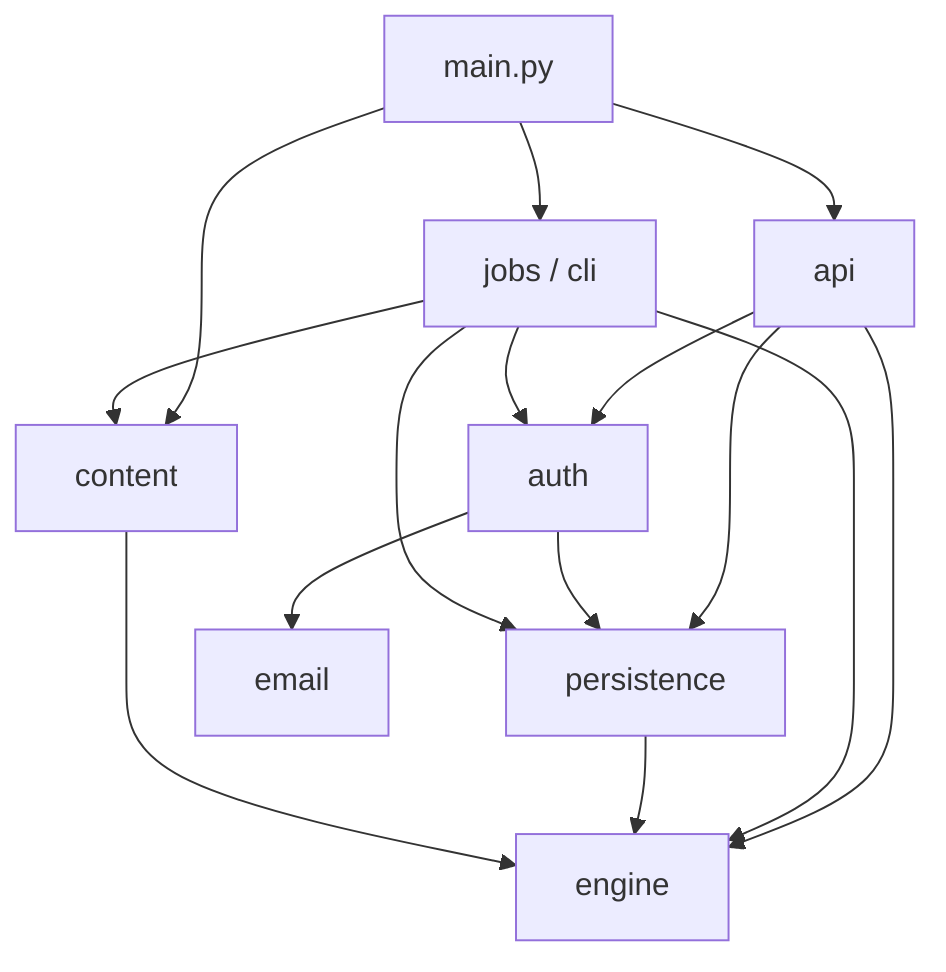
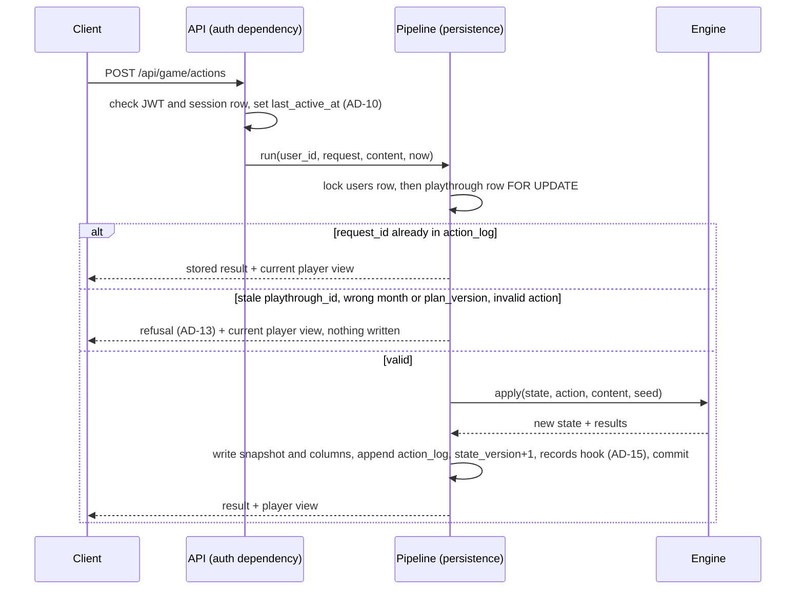
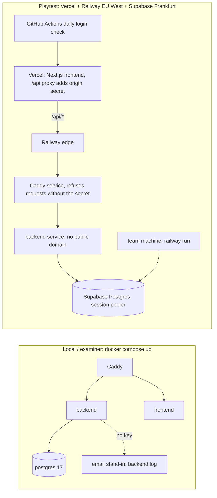
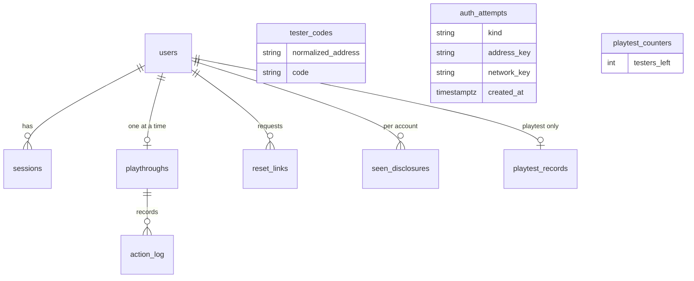

# Architecture Spine — LifeMode MVP backend

The PRD (final, as it stands on 2026-11-15) and Rule Set v1 (brief addendum) decide *what* the game does. This spine fixes only the calls that keep separately built backend parts from diverging. The team's reference setup (`architecture/technology.md`) is adapted, not copied: only what the MVP needs is taken. Rationale and rejected alternatives are in `.memlog.md`.

## Design Paradigm

**Functional core / imperative shell.** The engine is pure Python: `(state, action, content, seed) → (new state, results with cause links)`. It has no database, web, clock, network or global random access. Everything else is the shell: it authenticates, loads, calls the engine, saves in one transaction, and responds.

| Layer | Directory | Holds |
| --- | --- | --- |
| Core | `backend/app/engine/` | State model and content model (Pydantic), month loop (rule 1), ledger, selection step, draws, wellbeing, endings, cause links, text formatting, player view |
| Shell: content | `backend/app/content/` | YAML loader, YAML validation into the engine's content model, fingerprint, content check (FR-58) |
| Shell: persistence | `backend/app/persistence/` | All SQLAlchemy models on one `Base`, the mutation pipeline, state upgrades, playtest records, account deletion |
| Shell: API | `backend/app/api/` | FastAPI routers, request/response models, the auth dependency's wiring, error handlers |
| Shell: auth | `backend/app/auth/` | Passwords, sessions, attempt limits, reset links |
| Shell: email | `backend/app/email/` | Resend sender, local stand-in, null sender, Jinja2 templates |
| Shell: ops | `backend/app/jobs/`, `backend/app/cli.py` | Daily jobs, CLI commands |
| Leaf | `backend/app/settings.py` | All settings; imports nothing from `app` |
| Composition root | `backend/app/main.py` | Builds the FastAPI app, loads content, starts the daily jobs in the lifespan |



Arrows point from the importer to the imported. `main.py` and `cli.py` are the composition roots and may import every layer. Every shell layer may import `settings`, which imports nothing from `app`. `engine` imports nothing outside itself, not even `settings`.

## Invariants & Rules

### AD-1 — The engine is pure and is the only place game rules live

- **Binds:** all backend units; FR-12, NFR-4, NFR-9
- **Prevents:** financial rules leaking into routes, SQL or jobs; engine tests that need a database; two places computing the same figure; a content model defined outside the engine.
- **Rule:** Every financial result, wellbeing value, unlock, crisis check and ending is computed in `engine`. `engine` imports no I/O library (no SQLAlchemy, FastAPI, httpx, `random`, `datetime.now`, `os.environ`). Time, content and seed are passed in. The engine owns the content model (`engine/content_model.py`); `content/` only loads YAML into it. A CI import-boundary check fails on any import that breaks the dependency diagram above.

### AD-2 — The server decides; the client sends only inputs [ADOPTED]

- **Binds:** API, frontend boundary; NFR-4, NFR-7, FR-7
- **Prevents:** a client computing or submitting a result; trust in client figures; state changes reachable by a cross-site link.
- **Rule:** Requests carry the player's inputs listed in NFR-7, the protocol fields in AD-4, and the account and start inputs (auth form fields including the nickname, a nickname change, life goal, avatar, start a new life). Following NFR-7, unknown fields are ignored and a missing or wrongly typed field is refused; the refusal tests cover a JSON `null` and an omitted field separately. A "continue anyway" confirmation for a rule 8 trigger is client-side only; the server never requires it. The client talks only to `/api/*`, including for login. No request changes state on GET. No game result or figure is computed outside the backend.

### AD-3 — Postgres is storage only, and nothing else can reach it

- **Binds:** DB schema, migrations, infra; NFR-3
- **Prevents:** game rules split between Python and SQL; a second read or write path into the tables (such as Supabase's public Data API); tables split across model bases or migration branches.
- **Rule:** No game logic in the database: no functions, triggers or views carrying rules. The course's Supabase requirement is met by Supabase Postgres alone; Supabase Auth, Edge Functions, Realtime and Storage are not used. In the Supabase project the Data API is switched off, and every table has RLS enabled with no policies, set by one Alembic helper that every table migration uses. The backend and Alembic connect as the table owner, which bypasses RLS, and no table uses `FORCE ROW LEVEL SECURITY`. The backend holds no Supabase URL or API key and reaches the database only through `DATABASE_URL`. All tables are declared on one `Base` in `persistence/models/`, which Alembic uses. Alembic migrations in `backend/migrations/` are the only schema path, for local, CI and playtest alike, and CI fails if `alembic heads` shows more than one head.

### AD-4 — One mutation pipeline

- **Binds:** every state-changing endpoint, the seed script; FR-6, FR-8, FR-11, FR-43, FR-49, NFR-7
- **Prevents:** endpoints with their own locking or idempotency; double-applied retries; two devices both winning; two lives from a double tap; a stale device acting on a new life; deadlocks between requests; a read that writes.
- **Rule:**
  - **One endpoint:** every state-changing game request is `POST /api/game/actions` with `{request_id, playthrough_id, month, plan_version?, action}`. `action` is a discriminated union on `type` that mirrors the engine's action model; starting, ending early and playing again are members of it. `GET /api/game` returns the player view. Account, session and disclosure endpoints are separate.
  - **Protocol fields:** `request_id` is a client-made UUID. `month` is on every request (FR-49): the playthrough's current month, and for a start month 1, the month it opens. `playthrough_id` names the playthrough the request acts on or replaces, and is null only for an account's first start; if it isn't the user's current row, the request is refused with `409 game_changed`. `plan_version` is a counter in the state, raised only by month-plan changes (place, remove, same as last month) and reset at month open; continue sends it back, and a mismatch is `409 plan_changed`.
  - **One pipeline:** every such request runs through one pipeline function, and nothing else writes game state. It takes the authenticated `user_id` (the auth dependency runs before it), the loaded content, the transaction time `now`, and for a start an optional seed. Routes never pass a seed; only the CLI seed command does, and seed scripts submit each stored action through the pipeline in-process.
  - **Lock order:** every state-changing transaction (game request, life request, account deletion) locks the `users` row first (`FOR UPDATE`), then the playthrough row, then the playtest record. No code locks them in another order.
  - **Life requests:** ending early sets `status = ended` and keeps the row. Only a start deletes the previous row, in the same transaction. A life request's `request_id` and result are stored as an `action_log` row of the playthrough it ends or creates, and a repeat is looked up there.
  - **Months:** continue is one engine action that closes month M and opens M+1 in the same transaction. A start opens month 1, and setup steps before the first choice are game requests for month 1. No read path opens a month.



- **Database session discipline:** one `AsyncSession` per request (`expire_on_commit=False`), opened and closed by one dependency and shared by the auth check and the pipeline. Handlers and the pipeline never call `rollback()`. A refusal builds its response from the state already loaded and writes nothing. Expected conflicts (sign-up email, `request_id`) use `INSERT … ON CONFLICT DO NOTHING … RETURNING` and check the result.

### AD-5 — Snapshot plus append-only action log

- **Binds:** persistence, engine state model; FR-12, FR-40, FR-43, NFR-7, NFR-11
- **Prevents:** replaying a whole playthrough per request; engine fixes rewriting results the player already saw; 10-15 joined tables per request; per-account data lost on a new life; indexed columns drifting from the state; an upgrade written by a read overwriting a confirmed choice.
- **Rule:** One `playthroughs` row per user (unique on `user_id`). It holds indexed columns (`id`, `user_id`, `status`, `current_month`, `state_version`, `seed`, `config_version`, `library_version`, `state_schema`, `last_played_at`) and the whole engine state as one JSONB document. `status` is `active`, `completed` (the ending is calculated, FR-49) or `ended` (ended early, FR-43); only a `completed` life is shown again. The document's shape is the engine's Pydantic model, not the database's, and the document is the authority: one persistence function copies the indexed columns from the new state on every write, and no game logic reads them. `state_schema` versions the shape. Old documents are upgraded in memory on every load by one upgrade function per version step; read paths never write the playthrough row, and the upgraded document is saved only by the pipeline's own write. `action_log` rows (`playthrough_id`, `request_id` unique per playthrough, `month`, action payload incl. minigame answers, result part, `state_version`, `created_at`) are never updated or deleted while their playthrough exists; they store the result, not the whole state. Data that lives per account and survives a new life (disclosures seen, FR-40) is in its own table keyed by `user_id`, written by an idempotent upsert outside the game pipeline.

### AD-6 — Determinism and exact money

- **Binds:** engine, content loader, persistence, API; FR-12, NFR-4
- **Prevents:** results that change on reload, retry or replay; float rounding errors (NOK 8,151 vs 8,152); kroner converted twice; one random result with two creators.
- **Rule:**
  - **Seed and draws:** the shell makes one seed per playthrough with `secrets`. Every draw is derived from `(seed, month, draw key)` by one draw function, independent of request order. Draw keys are built only by `engine/draws.py`, one function per draw kind (`<kind>:<content id or slot>`). Each drawn result has one owner, the unit that applies its effect; any other unit (the selection step, a message) reads it from the state's draw store and never draws it. A result is stored the first time and read back after that. Tests force a draw by pre-filling the draw store, never by patching the draw function.
  - **Money:** amounts are `int` whole kroner everywhere: engine, state document, actions, player view. Rates, hourly wages and hours are `Decimal`, written as quoted strings in content YAML (the loader fails on any float). A `Decimal` result becomes `int` again through the one rule 2 rounding function, at the points Rule Set v1 names: a year's tax once on the sum (rule 3), each job's pay on its own (rule 10). The only other roundings are the ones Rule Set v1 and the PRD name: rounded down for the monthly hour cap (rule 10), the loan cap (FR-25) and activity slots (FR-52), and largest remainder for cause shares (AD-9). No `float` anywhere in game arithmetic.
  - **Replay:** replay checks run in CI on action logs made by the same build; live playthroughs are never replayed against a newer engine.

### AD-7 — Content as versioned, frozen YAML

- **Binds:** content authors, content loader, engine, CI; FR-17, FR-34, FR-48, FR-58, NFR-4, NFR-9
- **Prevents:** mechanics changing under running playthroughs; tuning breaking the answer key; a permanently red CI, or a freeze that never bites; config and library pinned in a pair nobody checked; content kinds placed differently by authors and engine builders.
- **Rule:**
  - **Layout:** content lives in the repo, never in database tables. `content/config/vN/` holds Rule Set figures, each with source and date. `content/library/vN/` holds `events/`, `activities/`, `messages/`, `room/`, `options/` (each open option defined once, referenced by id from its offer message and listed in the money and job views, FR-48), `expenses/`, `texts/` (endings, system causes, example purchases, disclosures, teasers) and `lists.yaml` (flags, mechanisms, activity kinds, senders, LK20 codes, avatar looks for FR-10), one YAML file per item, mechanics and Norwegian text together.
  - **Manifest:** each version folder has a manifest with a fingerprint over all non-text fields, including each item's `version`, which rises on mechanics changes only. A library manifest names the config version it is built for. A new playthrough pins the newest frozen library version and its named config version. In `local`/`ci`, and in the playtest while no version is frozen (the sprint-1 spike), it pins the newest library. The content check validates each library against its named config.
  - **Freeze:** each manifest has `frozen: true|false`. While `false`, the version may change freely, no fingerprint gate applies, and only the schema gate and the open-option gate fail CI (FR-58); the schema gate is every check in the addendum's schema tables, references included. The other FR-58 hard gates warn. The PR that opens the playtest sets `frozen: true`. From then on CI allows text-only edits, fails if the fingerprint changes, and fails on every FR-58 gate; a mechanics change means a new version folder. CI fails if a frozen version folder is removed, and no version folder is deleted in the MVP. When `v1` is frozen, the playtest database's game data is cleared once, before testers arrive.
  - **Loading:** all versions are loaded and checked against their fingerprints once at startup, and startup fails on any error. The backend image is built from the repo root and copies `content/`.
  - **Worked examples:** tests read only `content/config/test-vN/` and items defined in the test code. They never load a play library version.

### AD-8 — One selection step

- **Binds:** engine; FR-18, FR-46, FR-48, FR-55
- **Prevents:** event choice and message choice drifting apart; V2 needing a rewrite to plug in generated content.
- **Rule:** One engine unit decides what arrives when a month opens: the event, and the messages. Seed-drawn items and state-triggered items are produced separately and merged under FR-55's cap and fill order. It reads draws through the draw store (AD-6). The result is stored in the state.

### AD-9 — One ledger for every balance

- **Binds:** engine; FR-15, FR-21, FR-23, FR-26, FR-32, FR-36, FR-38, FR-39, FR-42, FR-45, FR-47, FR-53, FR-57, rule 16
- **Prevents:** the payment order coded differently for options, activities, costs and card bills; income, interest, transfers and loans each updating balances their own way; cause shares that don't add up; an ending ranking built from data the engine can't see; the hub, the month summary, the year view and the year end each counting in and out their own way; a loan month looking like income.
- **Rule:**
  - **One writer:** every change to any balance (current account, savings, BSU, card, each loan or payment plan) goes through `engine/ledger.py`, and no other code changes a balance. `pay()` implements the FR-45 payment-order table, and `transfer()` moves money between the player's own accounts. `receive()` puts money into the current account, where it first covers a negative balance (FR-45). Only money from a crisis choice or a money action in a crisis month then pays overdue card minimums before the rest stays in the account (rule 8, FR-32b). Wages and other income never pay the card outside the debt step.
  - **Causes:** every ledger call carries its cause, a choice id or a system cause, and updates that balance's per-cause parts using the addendum's rules (interest split in proportion, payments reducing every part in proportion, largest-remainder rounding).
  - **Choice ids:** each applied choice gets a sequence number from the state, in confirmation order. Cause links and FR-42's tie-break use it, never `request_id` or log order.
  - **Totals:** the state keeps a running total of money and wellbeing effects per choice, which FR-42's ranking reads.
  - **Flow classes (#116):** every ledger call also carries one flow class, and a part within it taken from the call's cause:
    - `in`: money from outside into the player's balances. Parts: `wage` (gross, including summer jobs and one-off shifts), `bsu_deduction` (rule 9) and `other` (gifts, the pengegave, family money, sales).
    - `out`: money leaving to the outside. Parts: `spending` (rule 16), `costs` (fixed and everyday), `unexpected`, `activities` (by activity kind) and `purchases` (options, licences, moped, experiences). A card purchase counts when it is made. Deductions taken back at a BSU withdrawal are `out` under `bsu_deduction`.
    - `tax`: only rule 3's monthly tax step. It is never negative, and the BSU deduction stays a separate payment (rule 9, FR-21).
    - `interest`: parts `earned` (savings, BSU) and `charged` (card, consumer loan, payment plan). Each month the interest on the card, a consumer loan or a payment plan is its own `interest` call that raises that balance, before any instalment or bill.
    - `internal`: transfers between the player's own accounts, cover from savings (part of the payment it covers), loan payouts, instalments, early payoff, card bill payments, and a card balance turned into a payment plan. Borrowed money is never `in` or `out`.
    - A thing given (a gift moped, a car licence) and the parents' insurance share move no money and make no ledger call. Every part is a non-negative `int`, and the formatting function adds the sign the UI shows.
  - **Month totals (#116):** a flow belongs to the month whose totals are open when its ledger call is made. Only `engine/ledger.py` writes the totals. The month loop calls `close_month(M)` as the last step of closing M (after the planned activities, wellbeing and, in December, the BSU deduction), which appends M's totals by class and part to a per-month list in the state that is never rewritten. It then calls `open_month(M+1)` before M+1's income step. A start calls `open_month(1)` before any setup step, and month 60 is closed like any other. A one-off shift's pay therefore belongs to the month it is paid (FR-47). Every surface that shows in, out, interest or tax reads these totals. They are for display only: rule 8, rule 16 and FR-25 read the wage figures their rules name, never `in`. A test asserts, for every month of every worked example, seed run and replay, that `in − tax − out + earned − charged` equals the change in current account + savings + BSU − card − consumer loan − payment plan − family loan. A state document upgraded to this schema starts the list empty.

### AD-10 — Own login with revocable sessions [ADOPTED in part]

- **Binds:** auth, every authenticated endpoint, DB schema, Caddy; FR-1 to FR-5, FR-44, NFR-3
- **Prevents:** tokens that can't be revoked (FR-4, FR-5 failing; shared school PCs staying logged in); a player logged out while playing; endpoints checking auth their own way; limits that reveal whether an address has a user, count every user as one network, or can be spoofed by a header.
- **Rule:**
  - **Passwords:** login is built in the backend (reference setup). Email is normalized per FR-1 by one function. A password (8-128 characters, settings) is stored as `bcrypt(base64(sha256(password)))`; bcrypt 5 refuses inputs over 72 bytes, and the pre-hash keeps every password at 44.
  - **Sessions:** a session is a row in `sessions` (`id`, `user_id`, `created_at`, `last_seen_at`, `stay_logged_in`, `expires_at`). Sign-up and login each create one, with the player's "stay logged in" choice (FR-1, FR-5). The client holds a JWT (HS256, `JWT_SECRET`) carrying only `sid` and `exp`, in an `httpOnly`, `SameSite=Lax` cookie, `Secure` everywhere except `APP_ENV=local` and `ci` (Safari doesn't reliably keep Secure cookies on `http://localhost`, and the test client runs on http). Without "stay logged in" the cookie has no `Max-Age`, and the row's idle limit is 30 minutes. With it, the cookie and the row last 30 days from the last authenticated request. One FastAPI dependency checks the JWT *and* the row on every authenticated request, and the row is the authority. It slides `last_seen_at` and `expires_at` at most once a minute, and whenever it does, it re-issues the cookie with a new JWT whose `exp` equals the new `expires_at`. It is the only writer of `users.last_active_at`. The client never polls in the background: it calls the API only when the player acts or under FR-8's fetch rules, or the idle limit would never end a session on a shared PC (FR-5).
  - **Revocation:** session rows are deleted as FR-3, FR-4, FR-5 and FR-44 say. A completed reset also logs this device in with a new row, with "stay logged in" off, and clears the address's failed-login count.
  - **Limits:** attempts are counted in an `auth_attempts` table (`kind`, `address_key` or null, `network_key`, `created_at`) with no link to `users`, so unknown addresses are counted the same way. `address_key` and `network_key` are HMAC-SHA256 under `HASH_SECRET`, computed by one auth function that every writer and reader uses. Failed logins are keyed by (address, network). Unknown addresses do the same work as known ones: login checks a dummy hash, and reset requests write the same rows and return the same response. The failed-login pause never applies to reset. A reset request held back by a limit gets the same response as one that was sent (FR-3); only sign-up and login answer `429`. With the Resend sender, the daily total reset cap (default 80, settings) counts `reset_sent` rows in the current UTC day, matching Resend's quota; auth writes one only when the sender reports the email accepted.
  - **Network:** the network key is built from the client IPv4 address or IPv6 /64. The backend reads the client address only from `X-Client-IP`, which Caddy always overwrites with `{client_ip}`. In the playtest, API requests reach Caddy only through Vercel's proxy and then Railway's edge (AD-12). Vercel overwrites `X-Forwarded-For` with the visitor's address and Railway's edge appends its own peer, so Caddy trusts every peer (`trusted_proxies static 0.0.0.0/0 ::/0`, from an environment variable) with `client_ip_headers X-Forwarded-For` and takes the leftmost address, the visitor's. That is safe only because Caddy refuses every request without Vercel's origin secret (AD-12), so a forged header can't get past Vercel. Locally no proxy is trusted. The backend service has no public domain. Sign-up, login and reset always go browser → Vercel's proxy → Caddy → backend, never through a Next.js function or other frontend server code.
  - **Reset links:** one auth function creates them for both the endpoint and the CLI. Only the token's SHA-256 is stored, and a new link cancels older ones.
  - The login-hardening items on the PRD's cut list follow these rules if they're built. A player only ever reaches rows with their own `user_id`.

### AD-11 — Email through one module, off in the playtest

- **Binds:** email, auth, ops; FR-3, NFR-3, NFR-6, NFR-11, OQ-4
- **Prevents:** reset paths that differ between environments; email text built in several places; email addresses and reset links in the playtest logs; a sync email call blocking the server.
- **Rule:** One email module picks its sender by key and `APP_ENV`. Resend: when `RESEND_API_KEY` is set, through `resend[async]` and `send_async`. Local stand-in: only in `local`/`ci` without a key; it writes the rendered email, marked `[email:mock]`, to the backend log, and the README says how to find it. Null sender: in `playtest` without a key; it sends nothing and logs only the template name and `user_id`. All senders render the same Jinja2 template, and each reports whether the email was accepted. In the playtest the team creates one-time reset links with a CLI command (AD-14) that prints the link and writes no address to the log. Go-live turns Resend on by key plus a verified domain.

### AD-12 — One origin for the browser: Vercel in front, Caddy before the backend [ADOPTED, amended 2026-11-22]

- **Binds:** infra, backend route prefix, session cookie, frontend boundary, frontend `vercel.json`
- **Prevents:** cross-origin cookie and CORS differences between local and playtest; backend coupling to the frontend build; the backend being reachable around Vercel and Caddy; a stripped or doubled `/api` prefix; API responses cached by a CDN; reset tokens in logs.
- **Rule:**
  - **Playtest:** the frontend is a Next.js app on Vercel Hobby (the frontend team's choice, 2026-11-22), with its functions in `fra1` (Frankfurt). The Vercel domain is `PUBLIC_BASE_URL` and the only address the browser uses. A `routes` entry in the frontend's `vercel.json` proxies `/api/(.*)` to Caddy's Railway domain with the path unchanged. It sets `x-origin-secret` from the `ORIGIN_SECRET` environment variable with a `request.headers` `set` transform, so a visitor can't supply their own, and turns rewrite caching off for `/api/*` (`x-vercel-enable-rewrite-caching: 0`). The backend also sends `Cache-Control: no-store` on every `/api` response. The browser sees one origin: the session cookie is first-party, `SameSite=Lax` holds, and no CORS is enabled.
  - **Caddy:** the only way into the backend in every environment, from one Caddyfile with upstreams, listen address, trusted proxies and the origin secret from environment variables. On Railway its site address is `:{$PORT}` with no hostname, behind the edge, and it answers `403` to every request whose `x-origin-secret` doesn't equal `ORIGIN_SECRET` (at least 32 bytes, set in both Vercel and Railway, never a placeholder). There it serves only `/api/*`. `/api/*` and `/openapi.json` go to the backend with the path unchanged, and the backend's routes carry the `/api` prefix. `/docs` goes to the backend only in `local`/`ci` (the Swagger page loads third-party assets, NFR-3).
  - **Local and the examiner run (NFR-6):** Caddy serves `http://localhost:<port>` and routes everything outside `/api/*` and `/openapi.json` to the frontend's Next.js server, its own compose service. The examiner gets the same single origin without Vercel, and no origin secret is required.
  - The backend never serves frontend files and enables no CORS.
  - **Reset link:** `{PUBLIC_BASE_URL}/nytt-passord#token=<token>`, agreed with the frontend team 2026-11-22. The token is in the fragment, so the browser never sends it to Vercel, Railway or any log. The page reads it, removes it from the address bar (`history.replaceState`), and posts the token and the new password to the API.
  - **Player information (NFR-3):** a static page in the frontend, owned by the frontend team and reachable before any account exists, since it must be read before sign-up and needs nothing from the backend. It names the processors and the log notes in AD-14.

### AD-13 — The API contract, the player view, and errors

- **Binds:** API, engine, CI, frontend boundary; FR-8, FR-12, FR-13, FR-15, rule 11, FR-16, FR-21, FR-33, FR-34, FR-37 to FR-40, FR-42, FR-51, FR-54, NFR-4, NFR-7, NFR-8
- **Prevents:** undocumented API changes breaking the separately built frontend; hidden draws, unpicked effects and minigame answers reaching the client; a frontend text catalog that can't follow pinned content versions; figures put into text outside the backend; the client comparing server time with the device clock; each endpoint inventing its own errors; the frontend hard-coding wellbeing bands, computing the calendar year or summing months; the timeline and the game text showing different years.
- **Rule:**
  - **Contract:** the OpenAPI schema FastAPI generates is the contract. It is committed to the repo, and CI fails if it is stale.
  - **One view function:** responses carry a **player view** built by one engine function, `view(state, content, last_action_at, seen_disclosure_ids, nickname) → PlayerView`; the raw state document is never sent. The view reads only the visible parts of the state, never the draw store, and resolves content only for items the player can currently see. It leaves out the seed, future schedule data, minigame solutions and the wellbeing effects of event options not yet picked (FR-13), and a test fails if it holds any of them. A planned or available activity shows its cost and effects (FR-53). No endpoint serves library or config files or their parsed form; the disclosure texts ("Om tallene", FR-40) are the only content served outside the view.
  - **Identity and time:** the view carries `playthrough_id`, `state_version` and `plan_version`; the pair `playthrough_id` + `state_version` identifies a state (FR-8). `last_action_at` is `playthroughs.last_played_at`, which the pipeline sets from `now`; the same `now` goes to `records.on_action` and `action_log.created_at`. Every response carries `server_time` and the recap threshold from settings, and the client measures the gap as `server_time − last_action_at` (FR-16), never against the device clock.
  - **Game text:** the backend renders all game text. The view carries finished Norwegian strings with the engine's figures filled in and formatted by one engine formatting function, plus raw integers where the UI needs a number (balances, wellbeing, slots). The player's nickname (FR-1) is a placeholder that the same formatting function fills in when the view is built. It is never written into the state document, the action log or a stored text, so a changed nickname shows in all text from then on and replay is unaffected. The view also carries the nickname as its own field so the settings can show it; the frontend never inserts it into game text. The frontend owns only UI chrome text (buttons, labels, offline and saving notices) and the player information page (NFR-3), which is shown before any account exists; that page names the processors and the log note in AD-14.
  - **Derived figures (#116):** the view carries every figure the UI shows as a status, a date or a sum, computed in the engine; the frontend never derives one.
    - **Bands:** these wellbeing figures are `{value, band}`, with `band` one of `good`, `warn` (FR-33's "ok") and `bad`: the open month's score and three parts (this month's rule 12 result with the planned activities applied, FR-33), the average so far (null until month 19 is calculated), the current calendar year's average (shown on the year end), and the ending average. `value` is the integer shown; averages are rounded under rule 2 before banding. One engine function sets the band on that integer: `bad` if v < threshold, `good` if v ≥ threshold + offset, else `warn`. For stress, v is 100 − stress, while `value` stays the raw stress. The usual stress and social life are plain integers with no band. The threshold and the offset are game figures in `content/config/vN/`.
    - **Calendar:** `start_year` is a game figure in `content/config/vN/` (2026, matching D6's 2026 rates). One engine function maps a game month to `year = start_year + (month - 1) // 12`, `calendar_month = (month - 1) % 12 + 1` and the age, and the view carries all three. After month 60 the ending view carries age 20 and year `start_year + 5`. Game text names a month only through one placeholder kind that takes a game month. The formatting function writes it as the month name in the current year, "<month> i fjor" for the year before, and "<month> <year>" otherwise and always on the ending. Content authors never write a year.
    - **Money per month:** the view carries twelve entries for the current calendar year: closed months from AD-9's list, the open month from the running totals marked `open: true`, and later months as null. It also carries the year so far, summed by the engine over the closed months and the open month. The year end also carries the expected BSU deduction (FR-21), which is not yet in the totals.
  - **Errors:** engine refusals are one enum of stable codes, each tagged turn (409) or input (422). Errors are raised only as one `AppError(code, status)`, and the handlers for it, for `RequestValidationError` and for Starlette's `HTTPException` all emit one shape: `{code, message, state}`. `code` is a stable string listed in the schema, `message` is plain Norwegian (NFR-8), and `state` is the current player view when a game request is refused.

| Status | Codes |
| --- | --- |
| 401 | `not_logged_in` (session missing, expired or revoked); `login_failed` (neutral) |
| 403 | `wrong_password` (password change, account deletion) |
| 404 | `not_found` (no such resource for this user) |
| 409 | Turn and month refusals (NFR-7): `wrong_month`, `plan_changed`, `game_changed`, `already_chosen`, `cannot_continue` (real choice, crisis or minigame unfinished), `game_ended`. Sign-up: `email_in_use` (FR-1) |
| 410 | `reset_link_invalid` (used, expired or replaced) |
| 422 | `invalid_input` and the other NFR-7 input refusals |
| 429 | `rate_limited`, with the neutral message (sign-up and login only) |

### AD-14 — Environments, configuration and operations [ADOPTED in part]

- **Binds:** infra, CI, README, backend config, ops; NFR-5, NFR-6, NFR-10, NFR-11
- **Prevents:** local and playtest drifting; the examiner needing team keys or a copied `.env`; seed users with published passwords on the playtest; a playtest host that sleeps, leaves the EU/EEA unannounced, or keeps billing; deploy config in a format Railway stops reading.
- **Rule:**
  - **One image, one settings file:** one backend image in every environment. All settings are pydantic-settings fields in `backend/app/settings.py`, read from environment variables and listed in `.env.example`. `APP_ENV` (`local | ci | playtest`) has no default, and the app refuses to start without it. `compose.yaml` sets `APP_ENV=local` and every local default inline, so `.env` is optional. `JWT_SECRET` and `HASH_SECRET` are never empty; the `.env.example` placeholders are at least 32 bytes. Outside `local`/`ci` the app also refuses a placeholder or a secret shorter than 32 bytes, and requires `PUBLIC_BASE_URL`.
  - **No secrets locally:** every external service falls back to a local stand-in when its key is missing, so `docker compose up` runs the full stack with no secrets.
  - **Migrations and seeding:** `python -m app.cli schema upgrade` runs Alembic before the app starts: on Railway as the pre-deploy command (`preDeploy` in `.railway/railway.ts`, or the service setting; no `railway.json`/`railway.toml`, which Railway stops reading on 2026-12-01), and in the compose entrypoint after the database is ready. The app never migrates inside its own startup. In `local`, the entrypoint then runs `cli seed --if-empty`. Seeding refuses outside `local`/`ci`. Seeded users are made by scripted play from month 1 through the pipeline (AD-4), each with a fixed seed and pinned content versions, and CI runs the seed script and asserts each target state (NFR-6).
  - **Database:** `DATABASE_URL` is one URL for the app and Alembic. Settings normalize `postgres://` and `postgresql://` to `postgresql+asyncpg://` and rewrite `sslmode=` to `ssl=` (asyncpg's name). In the playtest it is Supabase's session pooler (port 5432, host copied from the Connect dialog, `?ssl=require`). The Free pooler allows 15 clients: the app pool is 5 per instance with no overflow (two instances during a deploy overlap), and Alembic and CLI commands use `NullPool`. Local Postgres uses the same major version as Supabase.
  - **Playtest host:** Railway Hobby in EU West (Amsterdam), Serverless (sleeping) off for every service. The backend service's healthcheck is `/api/health`. Supabase Free Postgres in Frankfurt; this departs from the addendum's "same region" (Supabase has no Amsterdam region). Railway stores all logs, including its own HTTP logs with client IPs, in US West for 90 days under Railway's DPA; this is accepted. The frontend runs on Vercel Hobby, which is for non-commercial use, as a school project is. Its functions run in `fra1` (Frankfurt), while Vercel's edge network, which also proxies `/api/*` (AD-12), may handle a request in the region nearest the visitor; Hobby keeps runtime logs for 1 hour. The playtest deploys from a `playtest` branch; `main` is the working branch. Data processors named in the player information (NFR-3): Vercel (the frontend and the `/api` proxy; edge network, functions in Frankfurt), Railway (services in EU West, logs in US West) and Supabase (Frankfurt); no email relay.
  - **Speed and fallback:** the course's Supabase requirement wins over speed. If the spike is slow, cut database round trips first. Switch to Railway Postgres 17 in EU West (image tag checked when switching) only if Supabase pauses or fails, by changing `DATABASE_URL`, and record it as a deviation from the course requirement in the delivery report. On the fallback, ops commands run with `railway ssh -- python -m app.cli …` or use the database's public URL.
  - **Cost:** about USD 5-8 a month while the environment exists, from the sprint-1 spike to the analysis (about two billing months). The frontend on Vercel Hobby costs nothing. A usage alert is set at USD 6 and a hard limit at USD 10 (Railway's minimum; hitting it takes the playtest offline). After the analysis, both projects are deleted and the Hobby plan is cancelled.
  - **Ops commands** (reset link, tester codes, test-account marking, export) run from a team member's machine with `railway run`, so their output stays local.
  - **Deploys during the playtest:** migrations and `state_schema` steps only add. Rollback means redeploying the previous image, and only if the deploy had neither.
  - **Sprint-1 spike checks:** server time per month process+save between Amsterdam and Frankfurt, read from the logged server time; the Serverless toggle off for Caddy and backend, and no cold start after more than 15 minutes idle; usage near USD 5; peak pooler clients during a deploy; the Data API toggle off by hand in the dashboard, `/rest/v1/` no longer answering, and RLS on (AD-3); through Vercel's proxy: `Set-Cookie` and `Cookie` passed through unchanged, the visitor's address arriving as the leftmost `X-Forwarded-For` entry, a forged `X-Forwarded-For` not reaching the network key, no `/api` response cached, a request to Caddy's Railway domain without the origin secret refused, and the extra time the Vercel hop adds (AD-10, AD-12). If the visitor's address doesn't arrive, the frontend team proxies `/api/*` through a Next.js route handler that sets it in a header Caddy trusts only with the origin secret; Supabase counting the daily check's database traffic as activity; `SHOW server_version` recorded.

**Playtest limits (NFR-11):**

| Limit | Value |
| --- | --- |
| Sleeping when idle | None: Railway sleeping is off |
| Database pause | Supabase Free pauses after 1 week without database activity; the daily login check prevents it |
| Storage | 500 MB on Supabase Free; expected use is under 100 MB for 10-20 testers |
| Database clients | 15 on the Free session pooler (sizing in AD-14) |
| Users | No Supabase Auth, so no user limit applies; 10-20 testers expected |
| Logs | Railway keeps all logs in US West for 90 days; Vercel Hobby keeps runtime logs for 1 hour; both named in the player information |
| Email | None sent in the playtest; Resend Free at go-live allows 100 a day (UTC), reset cap 80 a day |

### AD-15 — Playtest data stays separate

- **Binds:** persistence, ops, CLI, daily jobs; FR-44, FR-50, NFR-3, SM metrics
- **Prevents:** records leaking into the examiner run; tester codes joined to email in exports or stored in several places; records lost when a playthrough is deleted; records rebuilt in different ways; two account-deletion paths; "playtest only" read as two different settings.
- **Rule:**
  - **One switch:** everything playtest-only (the records hook, the tester-code table and loader, the `testers_left` counter) is gated by `PLAYTEST_RECORDS` alone (default off; on only in the playtest), never by `APP_ENV`.
  - **Records:** the pipeline calls one `records.on_action(user, before, after, action, now)` in the same transaction after the engine step; starting a new life updates the record before the old playthrough is deleted. Records are never rebuilt from `action_log`. They live in their own table keyed by account and survive playthrough deletion (FR-43).
  - **Account deletion:** every deletion, by the player or by the inactivity job, goes through one `delete_account(user_id)`, which follows AD-4's lock order and deletes the account's records in the same transaction. It adds one to `testers_left` only when `PLAYTEST_RECORDS` is on and the account isn't `users.is_test`. The counter row is created by its migration.
  - **Tester codes:** a CLI command loads the email-to-tester-code list into its own table, normalizing each address with the FR-1 function. The code is resolved once, at export, by joining the user's normalized address to that table; records hold no code, and nothing else stores or matches codes. A re-created account with the same address therefore counts as the same tester.
  - **Test accounts:** team and check accounts carry `users.is_test`, set by a CLI command, and records and the export skip them.
  - **Export and cleanup:** the export writes tester codes, never email addresses or nicknames, and records never hold the nickname (NFR-3). Codes, records and playtest accounts are deleted after the analysis, no later than the December delivery.

### AD-16 — Typed facts have one owner; content sees them as derived flags

- **Binds:** engine, content authors, content check; FR-28 to FR-30, FR-34, FR-46, FR-48, FR-55
- **Prevents:** a moped (licence, job, card, loan) held both as a typed field and as a content flag, so that selling clears one and the room or the draws still follow the other.
- **Rule:** A fact the engine holds as a typed field (belongings, licences, job, BSU, card, loans, payment plan) is visible to content only as a derived flag, computed from that field by one engine function. Content may require or block a derived flag but never set or clear it; an option changes such a fact only through its typed effect. `lists.yaml` marks which flags are derived, and the content check rejects an option that sets or clears one.

## Consistency Conventions

| Concern | Convention |
| --- | --- |
| Naming | Python `snake_case`; DB tables plural `snake_case`; JSON fields `snake_case`; API paths `/api/<noun>`, game actions at `POST /api/game/actions` (AD-4); content ids as in the addendum schemas (`E-041`) |
| IDs | UUIDs for users, sessions, playthroughs and `request_id`; content ids are strings from the library; choices are ordered by the state's sequence number (AD-9) |
| Time | UTC `timestamptz` in the DB; the engine never reads a clock, game time is months 1-60, and the calendar year shown comes from the config's `start_year` (AD-13); the pipeline's one `now` per transaction (AD-13); day-based playtest metrics use Europe/Oslo |
| Money | `int` whole kroner everywhere; `Decimal` only for rates, hourly wages and intermediate products (AD-6) |
| Errors | One `AppError` and the shape and status classes in AD-13; refusals are logged with `user_id` and `code`, never email, password or nickname |
| Logging | Our logs carry no email address, password, nickname or reset token (NFR-3); the one exception is the `local`/`ci` email stand-in (AD-11). Our access logs leave out the client address and query strings; Railway's own HTTP logs are outside our control (AD-14). Server time per month process+save is logged |
| Config | Game figures (pinned per playthrough, including `start_year` and the wellbeing band offset, each with its Rule Set v1 parameter row and also in `config/test-vN/`, AD-13) and the content check's minimums and limits (FR-17, FR-58) in `content/config/vN/`. Operational limits (login limits, idle times, reset link lifetime and caps, inactivity deletion, the FR-50 gap, the recap threshold, pool size) in `backend/app/settings.py` with the PRD defaults, overridable by environment variable |
| Accounts | `users.nickname` is set at sign-up and changed in the settings, both through one validation function with the FR-1 rules (trimmed, 2-16 characters from settings, letters including æ, ø and å, digits, spaces and hyphens); it is deleted with the account. `users.last_active_at` is written only by the auth dependency (AD-10); the 12-month inactivity deletion uses it. "Play" in FR-5 and NFR-3 means any authenticated request |
| Deletion | Every table keyed by `user_id` has `ON DELETE CASCADE`; `tester_codes` is keyed by address and has no link to `users` |
| Jobs | Daily inside the backend process, started by `main.py`, as idempotent deletes: accounts after 12 months without activity (through `delete_account`, AD-15), expired sessions and reset links, attempt rows older than 24 hours |
| Health | `GET /api/health` (no auth) returns 200 once content is loaded and the database answers |
| Monitoring | Daily scheduled GitHub Actions login check against the playtest, with a test account, alerting the team on failure (also keeps Supabase from pausing) |
| Performance | p90 ≤ 300 ms server time per month process+save, taken from the logged server time in the playtest environment (spike and playtest). The backend test in CI is a regression bound with headroom. The session check and the pipeline share one transaction |
| Tests | pytest. Engine tests use no DB. Tests that touch the database run against Postgres 17 with the migrated schema (compose locally, a service container in GitHub Actions); SQLite is not used. One automated test per NFR-7 refusal case, with `null` and omitted fields tested separately. Worked examples, F1-F4 and F6-F10 (F5 is V2), refusals, replays, the seed script, the import-boundary check, the single Alembic head and the content check run on every PR |

## Stack

| Name | Version |
| --- | --- |
| Python | 3.12 (container image; security-only until 2028-10) |
| uv | version pinned in the Dockerfile; `uv.lock` committed; installs `--locked` |
| FastAPI + Uvicorn | FastAPI 0.162.x (0.162.7, 2026-11-13); exact pins in `uv.lock` at first build |
| Pydantic + pydantic-settings | 2.x |
| SQLAlchemy (async) + asyncpg | SQLAlchemy 2.1.x (2.1.8, 2026-11-04); asyncpg 0.32.x |
| Alembic | 1.20.x (1.20.1, 2026-10-22) |
| PyJWT, bcrypt | PyJWT 2.x (empty HMAC keys refused); bcrypt 5.x (refuses inputs over 72 bytes) |
| Jinja2, resend | latest at first build, pinned in `uv.lock`; resend with the `async` extra |
| PostgreSQL | 17 (Supabase platform default; local image and the Railway fallback match) |
| Caddy | 2.11.x (2.11.9, 2026-11-05; at least 2.11.8 for its security fixes) |
| Docker Compose | the `docker compose` plugin (5.x current) |
| Railway | Hobby plan, EU West (Amsterdam); deploy settings in `.railway/railway.ts` or the dashboard |
| Supabase | Free plan, Postgres only, eu-central-1 (Frankfurt) |
| Resend | Free plan, built in, switched off until go-live |

## Structural Seed





`tester_codes`, `auth_attempts` and `playtest_counters` have no link to `users` by design (AD-10, AD-15).

```text
backend/
  app/
    main.py        # composition root: app, content load, daily jobs (lifespan)
    settings.py    # all settings, leaf (AD-14)
    engine/        # core (AD-1): state and content models, month loop, ledger.py (AD-9),
                   #   draws.py (AD-6), selection (AD-8), derived flags (AD-16), view + text formatting (AD-13)
    content/       # YAML loader and validation, fingerprint, content check (AD-7)
    persistence/   # models/ (one Base), pipeline, state upgrades, records, delete_account (AD-3, AD-4, AD-5, AD-15)
    api/           # routers, request/response models, AppError handlers (AD-2, AD-13)
    auth/          # passwords, sessions, attempt limits, reset links (AD-10)
    email/         # Resend, stand-in, null sender, templates/ (AD-11)
    jobs/          # daily jobs
    cli.py         # schema upgrade, seed, reset link, tester codes, mark test account, export
  migrations/      # Alembic, incl. the RLS helper (AD-3)
  tests/
content/
  config/v1/       # play figures with source + date
  config/test-v1/  # frozen figures for worked examples
  library/v1/      # manifest, events/, activities/, messages/, room/, options/, expenses/, texts/, lists.yaml
infra/
  Caddyfile
.railway/
  railway.ts       # Railway services: pre-deploy, healthcheck (AD-14)
compose.yaml
.env.example
openapi.json       # committed contract (AD-13)
frontend/          # frontend team
```

## Capability → Architecture Map

| Capability / Area | Lives in | Governed by |
| --- | --- | --- |
| Account and login (FR-1 to FR-5, FR-44) | `auth`, `api`, `email`, `persistence` | AD-10, AD-11, AD-13, AD-15 |
| Saving and devices (FR-6 to FR-8, FR-16) | `persistence`, `api` | AD-4, AD-5, AD-13 |
| Start, avatar, months, events (FR-9 to FR-15, FR-49) | `engine`, `persistence` | AD-1, AD-4, AD-6 |
| Content, tips and scheduling (FR-17 to FR-19, FR-46, FR-48, FR-58) | `content`, `engine` | AD-7, AD-8, AD-16 |
| Month plan, phone, job view (FR-52 to FR-56) | `engine`, `api` | AD-4, AD-8, AD-9 |
| Money (FR-20 to FR-27, FR-45, FR-47, FR-57) | `engine` | AD-6, AD-9 |
| Moped and licences (FR-28 to FR-30) | `engine` | AD-6, AD-9, AD-16 |
| Warnings, wellbeing, room, causes, endings (FR-31 to FR-43) | `engine`, `content` | AD-1, AD-5, AD-6, AD-7, AD-9, AD-13 |
| Disclosures seen (FR-40) | `persistence`, `api` | AD-5, AD-13 |
| Minigames (FR-51) | `engine`, `api` | AD-4, AD-13 (one saved answer per request; solutions never in the view) |
| Playtest support (FR-50) | `persistence`, `cli` | AD-15 |
| Privacy (NFR-3) | all | AD-3, AD-10, AD-11, AD-14, AD-15, logging convention |
| Local run and playtest (NFR-5, NFR-6, NFR-11) | infra, `cli` | AD-12, AD-14 |
| Responsiveness (NFR-10) | backend, infra | AD-5, AD-14, performance convention |

## Deferred

| Item | Owner | Why it can wait |
| --- | --- | --- |
| Everything in the frontend: framework, screens, client structure, TS type generation, fetching on visibility/online and the idle check with their timings (FR-6, FR-8), the player information page (NFR-3), self-hosted fonts, accessibility check in CI (NFR-1, NFR-2) | Frontend team | Bounded by AD-2, AD-12 and AD-13; nothing in the backend depends on it |
| Device matrix and throttled-network tests (NFR-1, NFR-10) | Frontend team | Measured against the playtest; the backend's part is the 300 ms budget |
| Members of the action union; account, session and disclosure endpoints; request/response models | Epics and stories | AD-4 fixes the game endpoint and protocol and AD-13 the responses; the list follows the FRs |
| Other fields of the engine state document and the player view | Engine stories | AD-5 makes the Pydantic model the owner; AD-9 fixes the ledger and cause shape, AD-16 the derived flags, AD-13 what the view must carry and leave out; the addendum lists what the state must hold |
| Content schemas in detail | Content stories | The addendum's schemas apply; AD-7 fixes the layout and versioning, AD-16 the flag ownership |
| Event authoring | Content epic, after OQ-3 and OQ-8 | Drafted against the schemas and approved by PR |
| Go-live email: relay, domain and quota (OQ-4) | Team, before go-live | The playtest needs no email (AD-11) |
| Privacy review for go-live (#24), including log residency beyond the playtest | Team, before go-live | Out of the school project's scope (PRD §4.3); the playtest's log residency is accepted and disclosed (AD-14) |
| Backups | Team, before go-live | Playtest data is short-lived and deleted after analysis, so no backup service is set up for the MVP |
| Zero-downtime deploys | Team, before go-live | The playtest accepts a short restart; the team doesn't deploy during playtest hours |
| V2: storing generated content with the playthrough | V2 | AD-5's JSONB state and AD-8's single selection step leave room; nothing is built now |
| Real-time minigames | V2 | The MVP's minigames are one saved answer per request (FR-51) |
