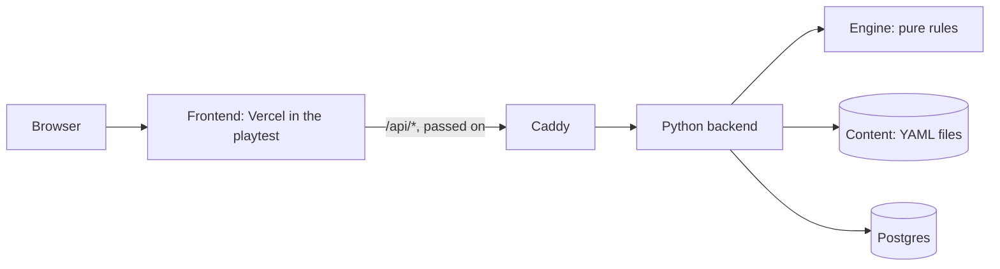
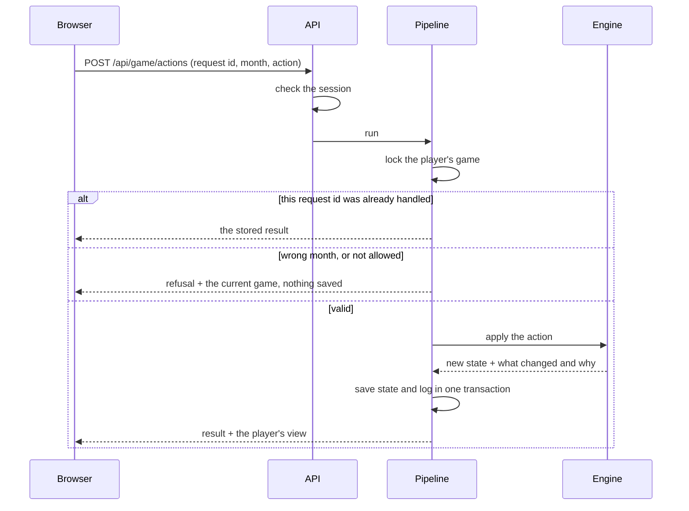
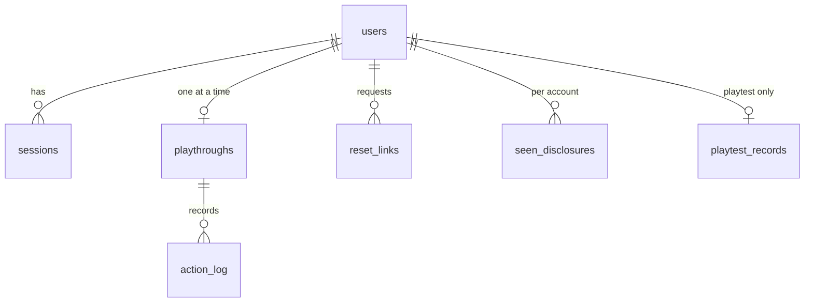

# LifeMode MVP backend: solution design

This document explains the backend architecture of LifeMode's first version: what is decided, why, and what it means for the people who build against it. It covers the Python backend, the database, the content files, and hosting. The frontend belongs to the frontend team, so it appears here only where the two meet (section 9).

**Where to start:** the frontend team can go straight to section 9. For the examiner, sections 1, 2, 8 and 10 give the decisions and the reasons, and section 12 says how they were checked.

The binding version is [`ARCHITECTURE-SPINE.md`](ARCHITECTURE-SPINE.md), which states each decision as a short rule with an ID (AD-1 to AD-16). This document explains those rules and adds none. If the two differ, the spine applies. The requirements come from the PRD (`prds/prd-IBE160-G13-2026-10-22/prd.md`), and FR and NFR numbers below refer to it.

## 1. The short version

- **The server decides everything.** The browser sends what the player picked, never a result. One part of the backend, the engine, works out every amount, every wellbeing value and every ending (AD-1, AD-2).
- **The engine is pure calculation.** It has no database, no clock and no network. The same state, choice and seed always give the same result, so the worked examples in Rule Set v1 run as plain unit tests (AD-1, AD-6).
- **Every action goes through one path.** One endpoint and one function save a choice. That path handles retries, two devices and double taps in one place (AD-4).
- **A game is one row.** The whole state of a life is one JSON document, plus a log of every action taken (AD-5).
- **Content is files, not database rows.** Events, activities, messages and figures are YAML files in the repo, in versioned folders that are frozen before the playtest (AD-7).
- **Login is our own.** Email and password, with sessions the server can end at once (AD-10).
- **One address for the browser.** In the playtest, the frontend runs on Vercel and passes every `/api` call on to Caddy, a small web server in front of the backend, so the browser sees one address and the login cookie needs no cross-site rules. Locally, Caddy serves both (AD-12).
- **The playtest costs about USD 5-8 a month** on Railway and Supabase, and nothing afterwards (AD-14).

## 2. The system at a glance



Locally there is no Vercel: Caddy serves the frontend and the API on one address. Otherwise the picture is the same, and only what sits behind each box changes:

| | Examiner and developers | Playtest |
| --- | --- | --- |
| Started with | `docker compose up` | A deploy from the `playtest` branch |
| Frontend | A container behind Caddy | Vercel Hobby (free), functions in Frankfurt |
| Caddy, backend | Containers on the machine | Railway, EU West (Amsterdam) |
| Postgres | A container, version 17 | Supabase Free, Frankfurt |
| Email | Written to the backend log | Switched off; the team hands out reset links |
| Secrets needed | None | The team's own |

The backend is one Docker image in both. The examiner needs only Docker and the README (NFR-6).

## 3. What happens when the player makes a choice



The pipeline is the one backend function that saves game actions. Because every action takes this path, the PRD's saving rules hold without extra code per feature:

- **A choice counts once the server has saved it (FR-6).** The browser shows the result only after the response.
- **A retry never applies twice (NFR-7).** The browser makes an ID for each action and sends the same ID again if the connection drops. The server recognises it and returns the first result.
- **Two devices can't both win (FR-8).** The game row is locked while a request runs, and every request names the month it belongs to. The second device gets a refusal together with the latest game.
- **A refusal changes nothing (NFR-7)** and always returns the current game, so the browser can show where the player really is.

Continuing to the next month is one action. It closes the month and opens the next one in the same save, so a month is never left half processed (FR-49).

## 4. The engine

The engine is ordinary Python functions: state and an action in, a new state and a list of results out. Everything around it (web, database, email) is the "shell". This split is called *functional core, imperative shell*.

**Why it matters for this game:**

- **Repeatable.** A playthrough has one random seed. Every draw (the pengegave, which event comes, whether family can help) is worked out from the seed, the month and what is being drawn. It's stored the first time and read back after that, so a reload never changes it (FR-12).
- **Exact money.** Amounts are whole kroner as integers. Rates are exact decimals. Floating-point numbers are never used, because they round NOK 8,151.5 the wrong way (NFR-4).
- **One ledger.** Every change to any balance goes through one module. It follows the payment order in FR-45, and it records the cause of each change. That is what makes "Hvorfor?", echo badges and the ending's "three choices that mattered most" possible (FR-36, FR-38, FR-42).
- **One selection step.** A single function decides which event and which messages arrive when a month opens (FR-46, FR-55). In V2, an AI can propose content at this one point without the rest changing.
- **Testable without a database.** The worked examples and F1-F10 run in milliseconds.

The engine also builds the **player view**: the part of the state the player is allowed to see, with finished Norwegian text. The raw state never leaves the server. The view leaves out the seed, future events, minigame answers, and the wellbeing effect of event options not yet picked (FR-13).

## 5. What is stored



| Table | Holds | Notes |
| --- | --- | --- |
| `users` | Email address, password hash, nickname | The only real personal data the player types in (NFR-3). The nickname never goes into logs, playtest records or the export |
| `sessions` | One row per logged-in device | Deleting a row logs that device out |
| `playthroughs` | The current life: a few indexed columns and the whole state as JSON | One per account (FR-43) |
| `action_log` | Every action and its result | Never changed. Used for retries and replay tests |
| `seen_disclosures` | Which "Forenklet" texts the account has seen | Survives a new life (FR-40) |
| `reset_links` | A hash of each reset token | One use, 60 minutes |
| `auth_attempts` | Hashed counters for the login limits | Not linked to users; deleted after 24 hours |
| `playtest_records`, `tester_codes` | The playtest metrics and the email-to-code list | Only in the playtest; deleted after the analysis (FR-50) |

Deleting an account removes every row tied to it in one step (FR-44). Postgres only stores data: there are no game rules in SQL, and nothing but the backend can reach the tables.

## 6. Content

All game content lives in the repo as YAML, one file per event, activity or message, with the mechanics and the Norwegian text together:

```text
content/
  config/v1/       figures from Rule Set v1, each with source and date
  config/test-v1/  frozen figures for the worked examples
  library/v1/      events/ activities/ messages/ options/ room/ expenses/ texts/
```

- **A playthrough keeps the version it started with (NFR-4).** A changed figure or event only reaches games started afterwards.
- **Frozen before the playtest.** Once a version is frozen, only text corrections are allowed in it. A change to a figure, option or flag needs a new version folder. The automatic checks on every pull request (CI) enforce this with a fingerprint of everything that isn't text.
- **The content check (FR-58) runs on every pull request.** While content is being written, only broken schemas and mismatched open options fail the build; the balance checks warn. From the freeze, all of them fail.
- **Tests have their own figures,** so tuning the game doesn't break the answer key.

Content authors write and review events as ordinary pull requests. There is no admin tool.

## 7. Login and sessions

Login is built in the backend, as the team's reference setup prescribes. Supabase is used as a Postgres database only.

- **Passwords** are stored as a bcrypt hash.
- **A session is a row in the database.** The browser holds a cookie that points to it, which JavaScript can't read. Because the row is checked on every request, logging out, changing the password, or "Log out on all devices" takes effect at once (FR-4, FR-5). This matters on shared school PCs.
- **Idle limits:** 30 minutes without "stay logged in", 30 days with it.
- **Limits against guessing** are counted per address and network, so a classmate can't lock a player out (FR-2). Nothing in a response reveals whether an address has a user, except at sign-up (FR-1).
- **Password reset** uses a one-time link. Locally the email is written to the log. In the playtest no email is sent: a team member creates the link with a command and sends it to the tester (NFR-11).

## 8. Hosting, cost and limits

| | Choice | Why |
| --- | --- | --- |
| Frontend | Vercel Hobby, functions in Frankfurt, `/api` passed on to Caddy | The frontend team's choice; free, and the browser still sees one address |
| Backend and Caddy | Railway Hobby, EU West (Amsterdam), sleeping off | No cold start, so the 10-second rule in NFR-10 is met |
| Database | Supabase Free Postgres, Frankfurt | The course requires Supabase; it has no Amsterdam region |
| Email | Resend (an email service), built in but switched off | The playtest needs no email; go-live needs a verified domain (OQ-4) |
| Daily check | A scheduled GitHub Actions job logs in with a test account | Required by NFR-11; it also keeps the free database from pausing |

**Cost:** about USD 5-8 a month for the two months the environment exists. Both projects are deleted after the analysis, so nothing keeps costing money (NFR-5).

**Limits that matter for 10-20 testers:** 500 MB of storage (expected use under 100 MB), 15 database connections, and a database that pauses after a week without activity, which the daily check prevents.

**Where data is:** player data is in the EU. Railway keeps its own platform logs, including client IP addresses, in the US for 90 days. The team has accepted this for the playtest, and the player information says so. Our own logs hold no email address or IP address (NFR-3, NFR-11).

**Fallback:** if Supabase pauses or fails, the database moves to Railway Postgres by changing one setting. That would be recorded as a departure from the course requirement.

## 9. For the frontend team

These are the facts the frontend builds against. The exact request and response shapes are in `openapi.json`, which is generated from the backend, committed to the repo, and checked in CI. TypeScript types can be generated from it.

| Topic | What the frontend can rely on |
| --- | --- |
| Address | Everything is on one origin. The frontend calls only `/api/*` on its own domain, and `vercel.json` passes those calls on to Caddy with the origin secret and with caching off (AD-12). No CORS, no tokens to store: the session is a cookie the browser sends by itself |
| Reading the game | `GET /api/game` returns the player view |
| Changing the game | `POST /api/game/actions` for every game action, including starting, ending early and playing again |
| Each action carries | A new `request_id` (UUID), the `playthrough_id`, the `month`, and the action. Send the same `request_id` again when retrying |
| Knowing if the view is stale | `playthrough_id` + `state_version` identify a state. Fetch again on open, reload, tab return, reconnect, and after 5 minutes idle (FR-8) |
| Month plan | The view carries `plan_version`. Send it back when continuing; a mismatch means another device changed the plan |
| Text | The backend sends finished Norwegian game text with the figures and the player's nickname filled in. The view also carries the nickname on its own, for the settings. The frontend never calculates or formats an amount. The frontend owns button and label text, offline and saving notices, and the player information page |
| Errors | One shape: `{code, message, state}`. `code` is stable, `message` is Norwegian and can be shown, `state` is the current view when a game action is refused |
| Recap (FR-16) | Each response has `server_time` and the recap threshold. Compare with the view's last action time, never with the device clock |
| "Continue anyway" (FR-49) | The confirmation is shown by the frontend; the server doesn't ask for it |
| Hidden on purpose | Wellbeing effects of event options before the pick, minigame answers, future events |
| No background polling | Call the API only when the player acts or under the fetch rules above. Otherwise the 30-minute idle logout never happens on a shared PC |
| Agreed 2026-11-22 | The frontend is Next.js on Vercel. The reset link is `/nytt-passord#token=…`: the page reads the token from the fragment, removes it from the address bar, and posts it with the new password. The player information page is a static frontend page that names Vercel, Railway and Supabase |

Still the frontend team's own decisions: framework, screens, accessibility checks in CI, self-hosted fonts, and the device test matrix (NFR-1, NFR-2).

## 10. Why these choices

| Decision | Alternatives weighed | Why this one |
| --- | --- | --- |
| Pure engine with a shell around it | Rules spread over routes and SQL; storing only events and replaying them | Rules in one place can be tested against the answer key. Replaying a whole life on every request would break the budget of 300 ms of server time per month (section 11), and an engine fix would silently change results the player had already seen |
| One JSON document per life | 10-15 tables joined on every request | One read and one write per action. The cost: questions across players are hard in SQL, so the playtest metrics are counted in their own table |
| Snapshot plus action log | Snapshot only | The log gives safe retries and lets tests replay a whole life |
| Content as YAML in the repo | Database tables; separate text files | Reviewed in pull requests, the same in every environment, and one event reads as one file |
| Own login with session rows | Supabase Auth; long-lived tokens with no server record | The team's reference setup uses its own login. Tokens alone can't be withdrawn, which FR-4 and FR-5 require |
| Caddy in front of everything | The backend serving the frontend's files | One origin keeps cookies simple, and the frontend team stays free to choose how the frontend is served |
| The backend writes game text | A text catalogue in the frontend | Text has to follow the content version a playthrough is pinned to, and figures may only come from the engine (NFR-4) |
| FastAPI | Django, Flask | Request checking and the API contract come built in; Django's admin and ORM extras wouldn't be used |
| No email in the playtest | Buying a domain; another relay | 10-20 known testers can be handed a link. It costs nothing and puts no addresses in logs |
| Supabase before speed | Railway Postgres in the same region | The course requires Supabase. If it's slow, database round trips are cut first |

The team's reference setup (`architecture/technology.md`) is adapted, not copied. Left out because the MVP doesn't need them: Redis, file storage, payments, AI, backups and feature flags.

## 11. Not decided here, and what sprint 1 must verify

**Left to the stories:** the full list of actions and endpoints, the exact fields of the state and the view, and the detailed content schemas (the PRD addendum's schemas apply).

**Left to go-live:** email relay and domain, the full privacy review, backups, and deploys with no downtime.

**The sprint-1 hosting spike checks** what was decided from documentation and not yet measured:

1. Server time for one month, between Amsterdam and Frankfurt, is within 300 ms for 9 of 10 requests.
2. Sleeping is off, and there's no cold start after 15 idle minutes.
3. Usage stays near USD 5 a month.
4. Database connections stay under 15 during a deploy.
5. Supabase's public Data API is off and row-level security is on.
6. A forged client-IP header doesn't affect the login limits.
7. The daily check counts as database activity for Supabase.

If one fails, round trips are cut first. The database moves only if Supabase pauses or fails.

## 12. How this was checked

- Two reconciliations against the PRD and its addendum (2026-11-13 and 2026-11-15). The second read every requirement against the finished spine; its 20 findings are closed (`reviews/reconcile-prd-2026-11-15.md`).
- Three independent reviews on 2026-11-13: a checklist review, an adversarial review looking for ways two builders could follow every rule and still build incompatible parts, and a check of every named technology and version against current sources (`reviews/`).
- Every decision and the reasoning behind it is in `.memlog.md`, oldest first.
