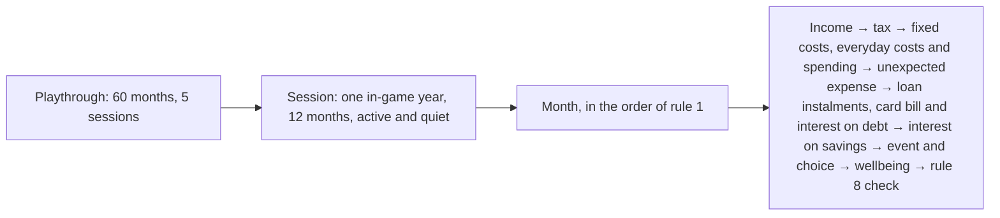

# PRD: LifeMode

## 0. Document Purpose

This PRD sets out what the first version of LifeMode (version one, also called the MVP) must do and why. The team, the downstream BMAD work (UX, architecture, epics and stories), and the examiner (sensor) all work from it. It builds on the product brief, `briefs/brief-Ibe160-prosjektmappe-2026-09-17/brief.md`. The brief's addendum holds the financial rule set (Rule Set v1), its parameters, and the worked examples. This PRD refers to those rules by number ("rule 5") and restates one only where a requirement needs the detail. Terms are defined in §3 Glossary.

**Status:** final, updated 2026-11-09. No AI in this version. Open questions that block work are marked in §8.

This PRD's own `addendum.md` holds detail that belongs downstream, along with the reasons behind several decisions. Every decision and change is logged in `.docs/planning-artifacts/prds/prd-IBE160-G13-2026-10-22/.memlog.md`, where a later entry replaces an earlier one. `#N` means a GitHub issue in the project's repo.

**Which source applies:**
- A decision that changes behaviour applies downstream only once it's written into this PRD, or into Rule Set v1 for financial rules.
- Where the brief, the architecture, or the research disagrees with this PRD, this PRD applies. The exception is how a financial result is calculated, where Rule Set v1 applies.
- If this PRD and the log disagree, the PRD is corrected before downstream work relies on that part.

## 1. Vision

LifeMode lets young people in Norway make expensive money mistakes before those mistakes cost real money. It is a life and money game for 15-20-year-olds. The player lives five years of a life, a few minutes at a time, and every choice carries forward. Spending the pengegave at 15 shapes what is possible at 18. Using a credit card like a debit card turns into months of extra shifts. The game always shows why.

**Built for Norway first and foremost.** The game uses Norwegian rules and life stages, such as frikort, BSU, credit only from 18, and the moped licence at 16, with real 2026 figures.

**Wellbeing counts too, without becoming complicated.** Good money management isn't just having the most money. The player's wellbeing (stress, free time, and social life) counts in how the game ends, so getting rich at any cost gives a hollow win.

**It feels like a game, not schoolwork.** A 15-year-old should prefer it to scrolling on the bus. It should be more rewarding and smoother to play than Koll på cashen, a free Swedish personal-finance game for the same age group.

- **Now (this PRD):** a complete game from 15 to 20, built on a pre-written event library and a deterministic financial engine, with no AI.
- **Next (V2):** AI as the game's play driver, generating events (brief Scope In, items 3-4), and pocket money the player can earn, for example through minigames. After that, moving out and rent, education, negotiation, a parent view, and modes for schools.
- **Later:** a wider simulation of adult life.

## 2. Target User

LifeMode is for young people aged 15-20 in Norway who want or need to learn about money and become more independent. It is aimed especially at those who are about to make their first real money decisions: a first pengegave, a first job, a first credit card. Some come by their own choice, and some because a parent or teacher told them to. They want to feel grown-up and make their own choices, and they don't want it to feel like homework. They play in short bursts, often on a phone and on the go.

What the survey "Unge og penger" found (133 responses):
- **They want to learn:** 63% would like to learn more about money.
- **Thinking ahead is the weak spot:** 88% know how much money they have, but only 38% think about how a purchase affects their money months ahead, and 39% often run out of money.
- **What they regret:** most often small purchases that add up, such as snacks and takeaway, and also clothes, trend buys, and collectibles.
- **What they understand least:** BSU and credit.
- **Where they learn:** family is the main source of money, knowledge, and help, and 88% learned most about money from family.

The survey is a convenience sample, probably spread through the team's own networks and schools, so it isn't representative. It has only 8 respondents aged 19-20, and it didn't test the LifeMode concept.

### 2.1 Jobs To Be Done

- When I'm about to make my first real money decisions, I want to see what they lead to before they cost me real money.
- When I have a few spare minutes, I want something more useful than scrolling that still feels like a game.
- When something changes in my money, I want to understand why, so I can do it differently next time.
- When I have a goal such as a flat or a big trip, I want to try different ways of getting there and see what each one costs me, in money and in the rest of my life.

### 2.2 Non-Users (version one)

- **Parents and teachers.** They may suggest the game, and they could pay for it later. But version one is designed for the player alone, with no parent view, class mode, or teacher tools. In UJ-1, Markus's mother has no account and can't see his game.
- **People under 15 or over 20.** The game covers the years from 15 to 20, and its rules and figures are tuned for that range.
- **Players outside Norway.** The rules, figures, and texts are Norwegian.

### 2.3 Key User Journeys

- **UJ-1. Markus is told to try LifeMode before he spends his pengegave.**
  - **Persona + context:** Markus, 15, has just been told by his mother that he can't spend his whole pengegave on Monster and Fortnite. She suggests LifeMode, so he can see that saving a little now can pay off later, and that being careless with money can have serious consequences. He opens it slightly irritated, just to test it.
  - **Entry state:** No account, on his phone, possibly on the bus. His mother has no account and no view of his game.
  - **Path:** Markus reaches his first real choice within about 2 minutes.
    1. The first screen offers two choices: **Log in** or **Create user**. Markus creates a user with an email address and password.
    2. He chooses his life goal: saving for something big, which for him is a flat of his own. The target is an amount the game sets, one that can be reached by 20, such as a start on the deposit, since a whole flat is out of reach by then.
    3. He chooses his avatar. In the game he is 15 and has just received a pengegave, a random amount between NOK 10,000 and NOK 30,000.
    4. His first real choice is what to do with the pengegave. Right afterwards, his money, wellbeing, and future opportunities change, and his room or belongings change with them.
    5. A new event follows, for example a part-time job offer or saving for a moped licence.
  - **Climax:** Markus understands that his own choices affect what happens next.
  - **Resolution:** The session ends after one in-game year. Before he leaves, the game shows a short teaser, such as "Next year the summer job unlocks" or "A choice you made earlier may have consequences later…". Progress is saved automatically. He wants to come back to see what happens next, what unlocks at the next age, and what his earlier choices lead to.
  - **Edge case:** Play can stop abruptly, for example when the bus arrives. Nothing he has already chosen and the server has confirmed is lost.

- **UJ-2. Markus picks up his game on a school PC to find out what the moped licence costs.**
  - **Persona + context:** Four days later, Markus is bored in class. He has realized that in real life he is only a year away from being old enough for a moped licence, and he comes back to find out what it would actually cost.
  - **Entry state:** He has an account but has never used LifeMode on this PC, so he is not logged in here.
  - **Path:**
    1. He logs in with his email address and password, leaving "Stay logged in on this device" unticked.
    2. He gets a quick recap of where he is, with a teaser for what opens later. The teaser names the moped licence and what it costs, based on real prices.
    3. He sees his balance and the next choice he has to make.
  - **Climax:** He sees what the moped licence would cost compared with what he has.
  - **Resolution:** He carries on with the same life from where he left it, and the game keeps saving his progress automatically. If he later chooses to take the licence, he pays for driving lessons, mandatory lessons, and the licence itself, and has to pass a short driving game (FR-51).
  - **Edge cases:**
    - **Long break:** he gets the same quick recap however long he has been away, so returning works after any gap. The game is exactly as he left it.
    - **Back on his phone:** the game checks for updates when he opens it, so he sees the progress he made on the PC (FR-8).
    - **Forgotten password:** he resets it by email (FR-3).

- **UJ-3. Markus sees that the little he saved has grown, and starts to think the moped might be possible.**
  - **Persona + context:** Markus spent most of his pengegave on things that felt exciting at the time, but after a short tip from the game he put a little into savings. He has heard that a moped is expensive.
  - **Entry state:** Logged in, mid-game. Some in-game months after the first choice.
  - **Path:**
    1. He sees that his savings have grown, because they have earned interest.
    2. He is glad and curious, so he presses "Hvorfor?".
    3. The game links the increase to his earlier choice and explains saving and interest. It shows the real figure: NOK 3,000 earns NOK 84 in a year in a savings account.
    4. The game points him to other ways of earning, such as a part-time job now or a summer job next year.
  - **Climax:** He understands that money he put aside earned more money without him doing anything, because of a choice he made himself.
  - **Resolution:** He starts thinking about other ways to earn more. With savings and a job, the moped he thought was too expensive might be possible after all.

- **UJ-4. Markus uses his first credit card like a debit card, and pays it off before it becomes a crisis.**
  - **Persona + context:** Markus, 18, has a part-time job, which is how he got his first credit card. He uses it as if it were a debit card, without thinking that it has to be paid back, with interest if he doesn't pay in time. He spends money on it for school lunches, a city trip with his friends where he pays for everyone, and fuel for his moped and for his parents' car when he borrows it. His parents paid for his car licence as a gift (FR-30).
  - **Entry state:** Logged in, aged 18, a couple of in-game months after getting the card. He has had a moped since he turned 16: he saved up for the licence from his part-time job and took a gift offer for a used moped, and it costs him fuel, repairs, and insurance (FR-29). He spends a lot from month to month, on the high spending level (FR-23). He pays his card bill as if it were a debit card: the bank takes what's on his account each month. Last month he paid for a city trip for everyone on the card, which took it to its limit, and he has about NOK 1,000 left on his account.
  - **Path:**
    1. The game warns him that his card debt has reached its NOK 10,000 limit, more than a month's wage, and that he couldn't pay it all by the deadline, so interest has started. This isn't a crisis month yet, and he decides for himself whether to act.
    2. The game shows the card's interest rate and, in kroner for his own balance, what the interest costs him this month and what the whole debt will cost if he pays only the minimum. At 22.6% a year on NOK 10,000, NOK 188 of his first NOK 350 minimum payment goes to interest. Paying only the minimum takes 51 months and costs NOK 5,508 in interest in total. He panics a little, because the longer he waits, the harder it gets.
    3. He talks to his mother. She wants to help but can't afford to, so she suggests he stops using the card until he has the repayment under control, and takes extra shifts to pay the debt down faster.
    4. He stops using the card, moves his spending down to normal, and takes extra shifts, within the working-hour limits in rule 10.
    5. He checks what his moped would sell for. After two years its price has dropped, so selling it wouldn't cover the debt, and he'd have to pay for the bus instead. He keeps it.
  - **Climax:** He realizes he has to work extra shifts and spend less for the next five months. He has less free time and does fewer social things, and the debt keeps weighing on him.
  - **Resolution:** After five months he is back on track, tired and relieved. Back on track means the card balance is paid in full, so it no longer accrues interest. In the game, his stress goes up from the debt, and his free time and social life go down while he works it off. He has learned to use a credit card carefully, and to spend only what he can afford.
  - **Edge cases:**
    - **He ignores the warning:** the debt barely shrinks, and interest keeps costing him about NOK 180 a month. If he misses the minimum two months in a row, a crisis month starts. A crisis that's still unsolved at 20 is a loss (FR-32, FR-41).
    - **Family help:** not always on offer and often partial. Family loans are interest-free (FR-27).

- **UJ-5. Markus turns 20, sees how his life turned out, and plays again to get rich.**
  - **Persona + context:** Markus is about to turn 20 in the game. He sorted out his credit card at 18, and since then he has been careful with money. He worked 20 h a week through his last eight months at school, and after upper secondary school he has taken a full-time job. He keeps his spending low and saves the rest towards a flat (worked example 23).
  - **Entry state:** Logged in, in the last in-game month before his 20th birthday. His stress has settled down, though he has cut back on social things to save.
  - **Path:**
    1. He turns 20, and the game ends.
    2. He sees a summary of how his life went. He has saved towards his flat, has no debt, and is doing fairly well. This is the real win: he reached his goal of saving for something big, and his wellbeing is at or above the threshold.
    3. The summary shows the three choices that mattered most, by their effect in kroner. He opens one to see how things could have gone if he had chosen differently.
    4. With each choice he gets a short, general, pre-written tip: how a costly choice could have been avoided, or why a good one paid off (FR-42).
  - **Climax:** He feels a bit stupid for ending up in so much debt at 18, but proud that he found a way out.
  - **Resolution:** He has seen how things like the moped licence and the credit card affect his money, and now he wants to find out how to get rich. He starts again from 15. He chooses a life goal again and gets a new pengegave.
  - **Second playthrough:** He chooses to save for something big or to be debt-free with a buffer, and puts money ahead of everything else. He finds that getting rich is possible, but chasing as much money as possible often costs him his social life and raises his stress. This is the hollow win: goal reached, wellbeing below the threshold. The summary includes the choice that hurt his wellbeing most, so he can see why (FR-42).

## 3. Glossary

| Term | Meaning |
|---|---|
| Active month | A month with an event, where the player makes a choice |
| Boomerang pair | Two linked events. An option in the first, the opener, sets a flag. The second, the follow-up, needs that flag and comes a few months later with an echo badge (FR-46, FR-37) |
| BSU | Boligsparing for ungdom: a savings account for a first home, with higher interest and a tax deduction (rule 9) |
| Card warning | The warning shown when interest starts on a card bill that wasn't paid in full (FR-31) |
| Cause link | The record of which choices or rules caused an effect, with each one's share |
| Choice | Anything the player decides: an option in an event or crisis month, a money action, or an open option taken from the money view (FR-48). Any choice can be a cause (FR-36). A real choice is an option picked in an active or crisis month, and those are what FR-46 counts |
| Content check | The automated check of the event library: the schema, the counts per in-game year, and seeded test playthroughs (FR-17, FR-43, FR-46) |
| Crisis month | A month the engine starts when a rule 8 trigger is met. It has up to three linked choices |
| D1-D25 | The disclosed simplification texts in the brief's addendum (FR-40) |
| Debt step | The rule 1 step with loan instalments, the card bill, and interest on debt |
| Echo badge | A marker showing that an effect comes from an earlier choice |
| Available money | Current account plus savings account, minus all debt (rule 13) |
| Ending wellbeing | The average wellbeing in months 19-60, from the summer after 10th grade to the 20th birthday. The endings use it |
| Endings | Real win, hollow win, goal not reached, or loss (FR-41) |
| Engine | The backend that applies Rule Set v1 and decides every financial result |
| Event | A pre-written situation with a few options, taken from the event library. Crisis events are used only in crisis months, and the rest are regular events |
| F1-F10 | The functional test criteria in the brief |
| Flag | A named yes/no marker in a playthrough, such as `owns_moped` or `has_card`. Options set or clear flags, and the engine sets flags for age unlocks and belongings. Flags decide which events can appear (FR-46), what a choice opened or closed (FR-35), and what the room shows (FR-34). Flag names come from a fixed list |
| Frikort | A tax card that lets someone earn up to NOK 100,000 a year (2026) with no tax deducted |
| "Hvorfor?" | The button that explains why something changed |
| "If you had chosen differently" line | An engine-calculated line comparing a choice with another option in the same event (FR-39) |
| Life goal | One of three goals chosen at the start: save for something big, be debt-free with a buffer, or afford a big experience |
| LK20 code | The code of the curriculum whose competence aim an event supports, such as MAT01-06 (maths after 10th grade) or SAF01-05 (social studies after 10th grade) |
| Mechanism | The money mechanism an event or effect belongs to, from a fixed list: wages and hours, tax, saving and BSU, fixed costs, consumer loans, credit card, unexpected expenses, family help, and moped and licences. Disclosed simplifications are tied to mechanisms (FR-40) |
| Milestone event | An event tied to an age unlock (FR-18), such as the credit card offer at 18 |
| Minigame | A short, turn-based game that takes skill, such as driving a route for a licence (FR-51) |
| Money action | Something the player can do in any month without using up the month's real choice (FR-45) |
| Money view | The place where the player sees their accounts, takes money actions (FR-45), and takes open options (FR-48). How it looks is UX |
| Net savings | Current account, savings account, and BSU, minus all debt, family loans included. The savings goal uses it (rule 13) |
| Payment plan | A card balance turned into a 12-month annuity loan in a crisis month (rule 15) |
| Pengegave | Money the player gets at the start of the game, at 15. It is drawn at random between NOK 10,000 and NOK 30,000 |
| Playthrough | One life, from 15 to the 20th birthday: 60 in-game months |
| Quiet month | A month with no event. It is processed by the same rules and shown as a short summary |
| Recap | The short summary a returning player sees before the next choice |
| Room | The player's room. It's built from a handful of layers, one per belonging, that change with choices (FR-34) |
| Rule N | Rule N in Rule Set v1, in the brief's addendum |
| Session | One in-game year, from January to December, about 10-15 minutes on a phone. A playthrough is five sessions |
| Sitting | One real-world stretch of play. A sitting can be shorter or longer than a session |
| Spending level | Low, normal, or high: the share of the player's wage after tax that's spent each month (rule 16). Costs come on top |
| Steady wage | Wage income in each of the last three months. A card and a consumer loan need it |
| Teaching point | One sentence saying what an event teaches |
| Teaser | A short line about what comes next, at the end of a session or in a recap |
| Tip | A short, general, pre-written hint in an event, which the player can ignore. It isn't personal advice |
| Trygdeavgift | The national insurance contribution on wages (rule 3) |
| V2 | The next version after the MVP |
| Virke/HK | The retail collective agreement whose minimum hourly rates the game uses (D2) |
| Wage income | Hourly wages before tax. It doesn't include sales, gifts, the pengegave, family money, interest, or loan payouts |
| Wellbeing | A score from 0 to 100 made from stress, free time, and social life, weighted by the life goal (rule 12) |

## 4. MVP Scope

### 4.1 In Scope

- Account, login, password recovery by email, and account deletion (5.1)
- Saving on the server and picking up on any device (5.2)
- A start with a life goal, an avatar, and a pengegave (5.3)
- Months, sessions of one in-game year, moving to the next month, teasers, recaps, the event library, event scheduling, age unlocks, options that stay open, and tips (5.4)
- Accounts, wages and hours, tax, saving and BSU, fixed and everyday costs, unexpected expenses, consumer loans, credit cards, and help from family (5.5)
- The moped licence, owning a moped, and the car licence as a gift or paid for (5.6)
- The card warning and crisis months (5.7)
- Wellbeing, room layers, and visible future opportunities (5.8)
- Cause links, echo badges, "Hvorfor?", "if you had chosen differently" lines, and disclosed simplifications (5.9)
- Four endings, the ending summary, and playing again from 15 (5.10)
- Minigames for the licences, such as the driving game (5.11)
- Playtest records (5.12)

**Cut list.** If time runs short, content is cut before the core, in this order:
1. "If you had chosen differently" lines during play, including the BSU comparison
2. The parents' share of the moped insurance
3. Events, down to the minimum of 50
4. The driving game. The licences are then a payment only, and D10 drops its sentence about the game (FR-28, FR-51)
5. The car licence, both the gift and the paid licence, with car fuel (FR-30)
6. Gift mopeds. Buying a moped stays (FR-29)
7. Room layers, down to 3 (FR-34)
8. Login hardening: per-network limits, the daily email cap, the "stay logged in" choice, **Log out on all devices**, and the 12-month deletion job. These then go on a "before go-live" list. Creating a user, login, reset, logout, account deletion, and the pause after repeated failed logins stay

These always stay: the engine, wellbeing, the spending level, the endings, cause links, "Hvorfor?", the card warning, the moped, and login.

### 4.2 Never in version one

Version one of LifeMode won't:
- use real money, real bank connections, or real financial data
- give personal financial advice (tips are general and about the game)
- use AI anywhere
- let the player type free text beyond the email address
- lock the player out in real time, or add interest or events during a break
- be a classroom or teacher-led tool

### 4.3 Later or left out

| Item | Status |
|---|---|
| AI-generated events and AI checks | V2 for now, after the base works |
| Pocket money, and earning it, for example through minigames | V2. The MVP has none, so a player with no job has no income |
| Avatar and home that develop over time | Later |
| Unlocks based on progress towards the goal, and new areas | Later |
| Funds and investing | Candidate for later |
| Moving out and rent | Later, the first new life area |
| Education and student loans | Later. Must show that a student loan while studying isn't the same as card debt |
| Moped value based on actual use | Later |
| Comparing one playthrough with another | Later |
| Negotiation, a parent view, school and private modes | Later |
| Replay from a crossroads | Out. It needs earlier game states to be stored |
| Tobacco and alcohol choices | Left out for now. The basis, if the team returns to it, is `research/domain-norwegian-tobacco-alcohol-advertising-la-2026-11-04/research.md` |

## 5. Features

### 5.1 Account and login

**Description:** The first screen offers **Log in** and **Create user**, with a link for a forgotten password. An account is an email address and a password, with no username. NFR-3 sets how the address is used. Realizes UJ-1 and UJ-2.

**Functional Requirements:**

#### FR-1: Create user

A new player can create a user with an email address and a password they choose. Realizes UJ-1.

**Consequences (testable):**
- Creating a user asks only for an email address and a password. No real age is collected.
- The password must have at least 8 characters (configuration). There are no other rules for what it contains, and paste and password managers work.
- The player types the email address twice, and a mismatch is caught before the user is created.
- The player information (NFR-3) is shown on the create-user screen, before the user is created.
- An email address that already has a user can't be used to create another one. The game then says the address is in use and points to **Log in** and the forgotten-password link. This is the only place the game shows that an address has a user (see addendum).
- Email addresses are matched without regard to letter case or spaces before and after. " Markus@Eksempel.no" and "markus@eksempel.no" are the same user, when creating a user, logging in, and resetting a password. Dots and "+tags" stay as typed.
- Sign-up attempts from one network are limited (default 60 an hour, configuration), so addresses can't be checked in bulk. A school class can still sign up at the same time.
- If someone else created a user with a player's address, the player can take it over. They reset the password by email (FR-3), which logs the other person out, then delete the account (FR-44) or keep playing.
- No email is sent when a user is created.
- No email confirmation step blocks play, which protects the 2-minute target in FR-11. After creating a user, the player goes straight to choosing a life goal.

#### FR-2: Log in

A registered player can log in with their email address and password on any device and continue the same game. Realizes UJ-2.

**Consequences (testable):**
- A failed login doesn't reveal whether the email address or the password was wrong.
- After repeated failed logins for one address (default 10 in 15 minutes), logins for that address pause for a while (default 15 minutes). The message still doesn't reveal whether the address has a user. A school class logging in on one network isn't blocked.
- A player can reach only their own game.

#### FR-3: Forgotten password

A player who has forgotten their password can reset it by email from the login screen. Realizes UJ-2.

**Consequences (testable):**
- The reset link can be used once and expires after 60 minutes (configuration). Asking for a new link makes earlier links stop working. A used or expired link says so and offers a new one.
- Reset emails are limited per address (default 1 a minute and 5 a day) and in total per day, below the email service's free quota. The screen shows the same message whether an email was sent, held back by a limit, or the address has no user.
- After a reset, every device that was logged in is logged out.
- The player's game is unchanged after a reset.
- Reset works in the local run (NFR-6) and in the playtest environment (NFR-11).

#### FR-4: Change password

A logged-in player can change their password from inside the game.

**Consequences (testable):**
- Changing the password requires the current password.
- The new password has the same minimum length as in FR-1.
- The old password stops working immediately.
- Every other device is logged out. The device where the password was changed stays logged in.
- The player's game is unchanged.

#### FR-5: Log out and staying logged in

A logged-in player can log out from inside the game, because a player needs this on any device they share. The player also chooses whether to stay logged in on this device.

**Consequences (testable):**
- After logging out, the game can't be reached on that device without logging in again.
- The player can also choose **Log out on all devices**, for example after forgetting to log out on a school PC.
- A device that was logged out from somewhere else can't make a choice. Its next action shows the login screen, and the game is unchanged.
- **Staying logged in:** at login and when creating a user, the player chooses whether to stay logged in on this device. The box is unticked by default. Unticked, the login ends when the browser is closed or after 30 minutes with no activity. Ticked, it lasts until the player logs out or hasn't played for 30 days. Both times are configuration.

#### FR-44: Delete account

A logged-in player can delete their account and game data from inside the game, after confirming.

**Consequences (testable):**
- Deleting requires the current password and can't be undone.
- After deletion, the email address and the game data are gone, and the old login no longer works.
- Every device is logged out. A device that is still open can't save anything to the deleted account.
- The same email address can create a new user afterwards.

**Notes:** the privacy check before go-live is open (OQ-6).

### 5.2 Saving and picking up on any device

**Description:** A player's game is stored on the server, so they can stop at any moment and continue on another device. Realizes UJ-1 and UJ-2.

**Functional Requirements:**

#### FR-6: Save every choice

Each choice is saved on the server as soon as the player makes it, so an abrupt stop doesn't lose a confirmed choice. Realizes UJ-1.

**Consequences (testable):**
- If the game closes right after a confirmed choice, that choice is still there on the next login.
- A choice counts only when the server has confirmed it. Until then the game shows that it is saving, locks the other options, and shows no result.
- If there's no confirmation within 5 seconds (configuration), the game says it is still trying and tries again when the connection is back. Trying again never applies a choice twice (NFR-7).
- If the connection drops after the server saved a choice, the game shows that choice's result when it reconnects. If the server never got the choice, the player sees the same event again.

#### FR-7: Nothing waits on the device

Everything that changes the game is decided and saved by the server when it happens, so the device never holds progress the server doesn't have. Realizes UJ-1 and UJ-2.

**Consequences (testable):**
- Closing the game at any moment, then logging in on another device, shows the same progress straight away. A choice the server never confirmed isn't there.

#### FR-8: Check for updates on opening or returning

Before it accepts the next choice, the game fetches the latest progress whenever the player opens or reloads it, logs in, comes back to the tab, gets the connection back, or has left it idle (default 5 minutes, configuration). Realizes UJ-2.

**Consequences (testable):**
- Progress made on the PC appears on the phone when the game is opened there.
- A device showing old progress can't overwrite a newer choice. If two devices answer the same event, the first choice the server confirms counts. The other device's choice is refused, and it loads the latest progress with a short message saying the game was updated on another device.
- With no connection, for example on the bus, the game says it is offline. What's on screen stays readable, but the options are locked until the connection is back. Choices aren't queued for later, and saved choices aren't affected.

### 5.3 Starting a life

**Description:** After creating a user, the player chooses a life goal, then an avatar, and then gets a pengegave. The first real choice is what to do with it. Realizes UJ-1 and UJ-5.

**Functional Requirements:**

#### FR-9: Choose a life goal

The player chooses one of three life goals: (1) save for something big, (2) be debt-free with a buffer, or (3) afford a big experience. Realizes UJ-1 and UJ-5.

**Consequences (testable):**
- The goal is chosen before the avatar.
- The engine checks the goal once, at age 20, using rule 13. Reaching the target exactly counts.
- **Save for something big:** net savings of at least NOK 100,000.
- **Be debt-free with a buffer:** available money of at least NOK 30,000 at the end of each of months 49-60, and no debt at all at 20, family loans and payment plans included. BSU doesn't count as a buffer. So this goal rewards keeping a buffer over time, not reaching a total at the end.
- **Afford a big experience:** the player bought the experience by the end of month 56 and has no net debt at 20. Having the money without buying it doesn't count.
- **The experience offer:** an event offers it in month 44, and it stays open in the money view until the end of month 56 (FR-48). It can't be paid for on credit. Its price is about NOK 50,000-75,000 (OQ-3), so this is a different, nearer goal.
- Borrowing never helps. A consumer loan can't be taken in months 59-60, and a loan taken earlier can't turn "goal not reached" into a reached goal (worked example 18).
- **Earlier play has to matter:** every careless run in worked example 21 misses all three goals. The main one spends the pengegave in month 1, stays on the high spending level until month 54, and moves to low from month 55. The others vary the full-time hours, when low starts, and how much of the pengegave is kept.
- **Reachable:** the targets and the experience price are configuration. An automated reference run that starts with NOK 10,000, works 10 h a week, and stays on normal spending reaches goals 1 and 2, and goal 3 is checked once its price has a source (worked example 20).
- **Checked with real costs:** seeded runs repeat these checks with real event costs (OQ-8). A careless run ignores every crisis, and a careful run takes the first option in it that clears the trigger. Unexpected expenses come from the run's seed.
- **The moped has a price:** a player with the moped reaches goal 1 by working more hours or spending less (worked example 22).
- The game shows progress towards the goal during play, worked out the same way, including the lowest available money so far for the buffer goal.
- The goal can't be changed during a playthrough, only when starting again.

#### FR-10: Create an avatar

The player creates an avatar for their life in the game. Realizes UJ-1.

**Consequences (testable):**
- The player picks from a small set of preset looks. Nothing is typed in, so the avatar has no free-text name.

#### FR-11: Get a pengegave and make the first choice

The game starts at age 15 with a pengegave drawn at random between NOK 10,000 and NOK 30,000. The first real choice is what to do with it. Realizes UJ-1.

**Consequences (testable):**
- The amount is drawn once per playthrough and stored, so it stays the same when the player resumes. Starting again draws a new amount.
- **Resuming the start:** the playthrough starts when the player confirms a life goal, and the pengegave is drawn then. If play stops before the first real choice, the next login continues at the first step not done yet, and steps already done aren't asked again.
- Engine tests can set a fixed amount.
- A new player reaches the first real choice within about 2 minutes of opening the game. This is checked in playtests.

### 5.4 Months, sessions, and events

**Description:** A playthrough is 60 in-game months, from 15 to the 20th birthday. Each session covers one in-game year, and the player never has to wait in real time. A library of pre-written events, event scheduling, and age unlocks decide what each month offers. Realizes UJ-1 to UJ-5.

**Functional Requirements:**

#### FR-12: Process each month in a fixed, repeatable way

The engine processes every month in the order set by rule 1: income, then tax, fixed costs, everyday costs and spending, any unexpected expense, loan instalments, the card bill and interest on debt, interest on savings, then the month's event and the player's choice, and last wellbeing. The rule 8 check runs at the end of the month. All amounts are in whole kroner (rule 2). Realizes UJ-3.

**Consequences (testable):**
- The same starting state, random draws, choices, and minigame answers always give the same result.
- The worked examples pass as unit tests, and they cover F1-F3, F7, and F8.
- **Calendar (rule 11):** month 1 is January, at the 15th birthday. Each session runs from January to December and is one tax year. Upper secondary school ends after month 54.
- **Random results:** every random result, such as the pengegave, which event comes next, an unexpected expense, a gift offer, or whether family can help, is drawn by the engine once and stored before the player sees it. Reloading, logging in again, or switching device shows the same result.
- **Reproducible:** a playthrough's random results can be reproduced from values stored when it starts, so engine tests can replay a whole playthrough from those values, the player's choices, and their minigame answers.
- Everything the engine processes in a month, quiet or active, is saved as soon as it's processed (FR-6, FR-7).

#### FR-49: Moving to the next month

A month has two parts. When it opens, the engine runs rule 1 up to interest on savings, and the player sees the event or the quiet-month summary. When the player continues, the engine works out wellbeing, checks rule 8, and opens the next month. Realizes UJ-1 and UJ-2.

**Consequences (testable):**
- A quiet month waits for the player to continue. In an active month, the player can continue once they've made the real choice. In a crisis month, the player can continue once the crisis has ended (FR-32). Nobody can continue while a minigame they've started is unfinished (FR-51).
- Money actions and open options can be taken until the player continues, so a player can clear a trigger before the rule 8 check.
- **Result screens:** an option's result shows that option's own effect. The month's wellbeing and the BSU deduction are worked out when the player continues, and the December summary marks the deduction as expected.
- Every request that changes the game names the month it belongs to. A request for an earlier month, such as one from another device, is refused (NFR-7).
- After month 60, the player goes to the ending (FR-41). Month 60's summary says that continuing ends this life. A playthrough counts as completed once its ending is calculated.

#### FR-13: Play an active month

In a month with an event, the player sees the situation together with their balance, savings, debt, and fixed costs, and picks one of a few options. Afterwards the game shows what changed in kroner and wellbeing, and why. Realizes UJ-1 and UJ-3.

**Consequences (testable):**
- Every option states its wellbeing effect (FR-33).
- An option the player can't pay for follows FR-45.
- Tapping an option twice applies it only once.

#### FR-14: Summarize a quiet month

A month with no event is shown only as a short summary. Realizes UJ-1.

**Consequences (testable):**
- Income, costs, and interest in a quiet month follow the same rules as in an active month.
- In a quiet month, the player can still take money actions (FR-45).

#### FR-15: End a session after one in-game year

A session ends after one in-game year with a teaser about what comes next, such as "Next year the summer job unlocks". Realizes UJ-1.

**Consequences (testable):**
- Nothing locks the player out in real time. The player can carry straight on into the next year.
- A teaser names the next age unlock (FR-18) or, if there's none, hints at an open boomerang pair (FR-46). From month 55, when nothing is left to unlock, it points to the ending at 20.

#### FR-16: Recap on return

A player who comes back sees a short recap of where they are, with a teaser for what opens later, and then their balance and the next choice. Realizes UJ-2.

**Consequences (testable):**
- The recap is shown after a login, or when the game is opened after at least an hour away (configuration). It's the same however long the break was. Its teaser follows the same rule as in FR-15.
- The game is exactly as the player left it. No interest or events run during the break.
- After the ending, FR-43 applies instead.

#### FR-17: Event library

The game is driven by a library of pre-written events. Realizes UJ-1 to UJ-5.

**Consequences (testable):**
- **Size:** at least 50 regular events, twice the 25 regular active months in a playthrough (FR-46), with a target of 60-80, plus about 10 crisis events. Every in-game year has at least 10 events whose age range covers it. Roughly 55% come before age 18 and 45% after. Unexpected expenses (FR-24) are a separate list and don't count.
- **Schema:** every event follows a fixed schema: mechanism, age, flags, boomerang pair, teaching point, LK20 code, source, and a wellbeing effect for each choice. An automated check rejects an event that breaks the schema. LK20 codes are the ones valid from 1 August 2026. The fields and what the check enforces are listed in the addendum.
- **Choices that come back:** the library has at least 8 boomerang pairs (configuration), and a seeded playthrough meets at least 3 follow-ups on average. Every mechanism has events both before and after 18 where its rules allow it. The content check enforces both.
- **Options that always work:** every regular event has at least one option with no cost (FR-45). Every crisis event includes asking family and ignoring it (FR-32).
- **Players with no money:** at least half of the regular events before 18 have two options with no cost, so a player with NOK 0 still has a real choice (configuration). The content check runs a seeded playthrough at NOK 0 and reports the share.
- **Everyday costs:** options can change them (FR-23).
- **No AI needed:** the whole game can be played from start to finish with zero AI calls (F6).

**Notes:**
- Candidate event topics from the survey are small purchases that add up, such as snacks and takeaway; clothes; trend buys; collectibles and in-game purchases; subscriptions with a binding period; and budgeting and paying bills. From the market research, the costs of russ at 18-19, with no alcohol content. Family appears as an actor in events.

#### FR-46: Event scheduling

The engine decides which months are active and which event each active month gets. Realizes UJ-1 to UJ-5.

**Consequences (testable):**
- **Active months:** every in-game year has the same active months, 5 by default, and the rest are quiet. Which months are active is configuration. A playthrough with no crisis months has 25 real choices, and crisis months add their linked choices. Rule 7 gives about 20-30 real choices in a playthrough.
- **Pace:** with the default, a session has 5 choices and 7 quiet-month summaries, which fits 10-15 minutes on a phone (checked in playtests).
- **First choice:** month 1 is always the pengegave choice (FR-11).
- **Milestones:** an event tied to an age unlock (FR-18), such as the credit card offer, takes the first active month at or after its unlock month, or the offer month FR-18 gives. Every playthrough gets it once the player qualifies.
- **Set placements:** offers land in the months in the FR-18 table. The car licence draw runs from month 37 (FR-30). The content check fails if an FR-18 offer month isn't active, and it reports how many drawn events each in-game year has left.
- **Who can get an event:** an event can be drawn only when the player's age is in its age range, all its required flags are set, none of its blocking flags are set, and it hasn't appeared in this playthrough.
- **Drawn at random:** each other active month gets an event drawn from the eligible ones, each with the same chance. The draw is stored (FR-12).
- **Boomerang pairs:** when the player picks an option that opens a pair, the follow-up is due after a delay drawn from the pair's range, and takes the first active month at or after that. An opener can be drawn only if its longest delay still lands by the last active month, so no follow-up is lost after month 60.
- **When events collide:** a crisis month comes first (FR-32), then a card warning (FR-31). Milestones and follow-ups come next, in the order they're due, with a milestone winning a tie, and a drawn event comes last.
- **Pushed out:** a milestone or follow-up that is pushed out takes the next active month, or makes month 59 or 60 active if none is left. A milestone's option stays open in the meantime (FR-48), and the crisis or warning that pushed it out names the open offer, with its last date if it has one. A milestone is dropped if its option has been taken or its date has passed.
- **Card warning in a quiet month:** it makes that month active.
- **No repeats:** no regular event appears twice in one playthrough. Crisis events, the card warning, and the yearly summer job offer can repeat (FR-32, FR-31).
- **No eligible event:** the active month becomes a quiet month. The content check runs seeded test playthroughs and reports every month this happens.

#### FR-18: Unlock options by age

New options open in set in-game months (rule 11). Realizes UJ-1 and UJ-4.

| Option | Opens | In-game month | Source |
|---|---|---|---|
| Savings account and BSU | 15 | 1 | FR-22. BSU has no lower age |
| Part-time job, up to 12 h a week (NOK 136.41 until month 12) | 15, in grunnskole | Offered in month 3 | Rule 10. From 15, a minor can sign their own work contract (vergemålsloven § 10) |
| Moped licence | 16th birthday | 13 | FR-28. Class AM 146 from 16 |
| Owning a moped (buying, gift offer) | With a moped licence | 13 at the earliest | FR-29 |
| Part-time job, up to 40 h a week | After grunnskole | 19 | Rule 10 |
| Summer job | 16 | Offered in months 18, 30, 42 (June), paid in months 19, 31, 43 (July) | FR-20, worked example 1 |
| Car licence: the gift draw, then the paid licence | 18th birthday | 37 | FR-30. The class B minimum age still needs a source (OQ-3) |
| Credit card | 18th birthday | 37 | Rule 6 |
| Consumer loan | 18th birthday | Open from month 37, and its event comes in month 49 | Rule 6, FR-48 |
| Big experience, for goal-3 players | 18 | Offered in month 44, open until the end of month 56 | FR-9 |
| Full-time job | After upper secondary school | 55, offered in month 54 | FR-20 |

**Consequences (testable):**
- No option is offered before the offer month in this table, and the engine rejects a choice for one that hasn't opened (NFR-7).
- Teasers and recaps use the same table.
- In the MVP, only age unlocks options, not progress towards the goal.

#### FR-48: Options that stay open

An option that has unlocked stays open until the player takes it, and opens again when its one-at-a-time rule allows another. A milestone event offers it first, and after that the player can take it from the money view, so a player who couldn't afford something can save up and come back. The consumer loan is open from month 37, before its event in month 49, so a player in trouble can reach it. Realizes UJ-2, UJ-3, and UJ-4.

**Consequences (testable):**
- **What stays open:** the moped licence, buying a moped, the paid car licence, the credit card, a consumer loan, a part-time or full-time job, and, for goal-3 players, the experience. The conditions and prices are the same as in the event.
- **Same option:** an open option is the same option as in the event, with all its effects, flags, and texts, and the content check enforces this.
- **Can't pay yet:** the option shows the missing amount and stays open. Test: a player on normal spending with NOK 8,000 saved can't afford the moped licence in month 13, and buys it after the summer job in month 19, when NOK 4,182 of the wage is left after spending, so they have NOK 12,182 before interest.
- **Blocked for another reason:** the option shows what's missing, such as a steady wage, stays open, and is refused until the condition is met (NFR-7).
- **Saying no or quitting:** a player who declines a job or quits can take a job again later.
- **Dated offers:** a summer job stays open only until that July's income step (months 19, 31, and 43). If a crisis month pushes out the June offer, it can still be taken from the money view until then. The experience stays open until the end of month 56.
- Taking an open option counts as a choice, so cause links and echo badges can point to it (FR-36). It doesn't use up the month's real choice.
- Gift offers and family help aren't open options. They're drawn once (FR-12).

#### FR-19: Tips in events

Some events carry a short, general, pre-written tip, which the player is free to ignore. Realizes UJ-3.

**Consequences (testable):**
- A tip is about the situation in the game and is never personal advice.
- Ignoring a tip has no effect in the game.

### 5.5 Money

**Description:** The money side of the game covers accounts and money actions, wages and working hours, tax, saving, fixed and everyday costs, loans and credit cards, unexpected expenses, and help from family. Figures follow NFR-4. Realizes UJ-1, UJ-3, UJ-4, and UJ-5.

**Functional Requirements:**

#### FR-45: Accounts and paying for choices

The player has a current account, a savings account, and, if they open one, a BSU. Income lands in the current account, and costs are paid from it. Realizes UJ-1, UJ-3, and UJ-4.

**Consequences (testable):**
- When a payment would take the current account below NOK 0, savings pay the rest, as far as they reach. BSU never does. The month summary shows each transfer.
- An option can be picked only if the player can pay for it from the current account and savings, plus the card if card use is on and the cost fits under the limit. An option they can't pay for is shown with the missing amount and can't be picked. Every event has at least one option with no cost (FR-17).
- Tax, fixed costs, everyday costs, consumer-loan and payment-plan instalments, and unexpected expenses are always charged, even if the current account goes below NOK 0. Card payments, family-loan instalments, and spending never take it below NOK 0, and spending never draws on savings (rule 16).
- A negative current account has no interest or fee. It can't pay for choices, and the next income pays it off first.
- **Money actions:** in any month, from the money view, the player can:
  - move money between the current account and savings, from NOK 1 up to what the source holds
  - deposit in BSU from the current account, or withdraw the whole BSU (FR-22)
  - turn card use on or off, set the card payment, and pay extra on the card
  - pay off a consumer loan, a family loan, or a payment plan early, with no fee
  - set the spending level, and stop an everyday cost that has no binding period (FR-23)
  - set working hours or quit a job (FR-47)
  - sell the moped (FR-29)

  Taking an open option (FR-48) works the same way. These actions don't use up the month's real choice.

#### FR-20: Wages

The player can earn hourly wages from part-time and summer jobs, at the Virke/HK collective-agreement rate for their age, and later from a full-time job. Realizes UJ-1, UJ-4, and UJ-5.

**Consequences (testable):**
- A summer job at 16, 120 hours at NOK 139.40, pays NOK 16,728 with no tax (worked example 1, F7).
- A full-time job is available from month 55, the July after upper secondary school, at age 19 (rule 11).

#### FR-47: Working hours

A player with a job sets how many hours a week they work. The setting stays until they change it. Realizes UJ-4 and UJ-5.

**Consequences (testable):**
- The player has at most one part-time or full-time job, plus a summer job in July. They set weekly hours when taking the job, and can change them or quit in any month. A change applies from the next month.
- Monthly pay is weekly hours × 52 / 12 × the hourly rate for the player's age, in whole kroner, for at most 173 h a month (rule 10). A full-time week of 37.5 h at 18+ pays NOK 31,694 a month, and a 40 h week pays NOK 33,742.
- **Weekly limit:** hours never go above rule 10: 12 h a week in grunnskole (months 1-18), and 40 h a week from month 19.
- **Monthly cap:** a summer job and part-time hours share one monthly cap of 173 h. The engine cuts the summer job to fit at July's income step, using that month's hours, extra shifts included. With 30 h a week of part-time work (130 h), a 120 h summer job is cut to 43 h. If the player's hours leave 0 h when the offer is made, no summer job is offered, and the game says why.
- A full-time job is 37.5 h a week and can be raised to 40.
- Extra shifts raise the weekly hours by the event's amount (default +4 h) for the event's number of months (default 3), then go back, never above rule 10. They're offered only to a player with a job who is below the weekly limit, and only while a later income step remains, so not in month 60. The option shows the kroner it would leave after spending at the player's level, not only the extra wage.
- More hours mean less free time (FR-33). The hours control shows the limit where free time goes below 50, which is 25 h a week beside school.

#### FR-21: Tax

Tax is calculated from the year's total wage income at 2026 rates (rule 3).

**Consequences (testable):**
- An 18-year-old earning NOK 110,000 in a calendar year pays NOK 2,588, all of it trygdeavgift (worked example 5, F8).
- Each in-game year is one tax year. Trygdeavgift is 5.1% in in-game years 1-2 and 7.6% from in-game year 3 (rule 11). Every year uses 2026 rates (D6).
- The December summary shows the year's tax and the expected BSU deduction, which is paid when the player continues (rule 9).

#### FR-22: Saving and BSU

The player can save in a savings account at 2.87% a year or in BSU at 5.61% a year, and interest is added under rule 2. The BSU deduction follows rule 9. Realizes UJ-3.

**Consequences (testable):**
- NOK 10,000 in savings for 12 months gives NOK 10,289 (worked example 2, F2).
- When the player pays no tax, the game says plainly that the BSU deduction is NOK 0, and shows that BSU still pays off through the higher interest (worked example 6).
- The game shows the real interest even when it's small. For example, NOK 3,000 earns NOK 84 in a year.
- BSU deposits are capped at NOK 27,500 per calendar year. The game accepts at most what's left of the year's cap and shows how much that is.
- BSU money can't pay for choices or cover a negative balance. The player can withdraw the whole BSU. It then closes for the rest of the playthrough, and any BSU deductions received are taken from the payout at once.

#### FR-23: Fixed and everyday costs

From the 18th birthday, the player pays for mobile and transport every month. Before that, the parents pay for them. On top of this, the player's spending level decides how much of their wage is spent each month (rule 16). Realizes UJ-4.

**Consequences (testable):**
- Fixed and everyday costs and spending are deducted at their place in the rule 1 order.
- **Spending level:** low is 60%, normal is 75%, and high is 95% of the wage income after tax. Costs come on top, so a new cost lowers what the player keeps by the whole amount. Spending is never more than the current account holds, and it never draws on savings or takes the account below NOK 0. The default is normal. With no wage, nothing is spent. A change in the money view applies from the next month. The shares are configuration.
- **It costs something either way:** in a month with spending, low lowers social life by 2, and high raises it by 2. High gives nothing in a month when interest is charged on debt (rule 12).
- **Shown as purchases:** the month summary shows what was spent in total, with a few example purchases that fit the player's age and spending level, such as canteen, clothes, and cinema. The examples are pre-written and have no amounts of their own, so the only figure shown is the one the engine calculated (NFR-4).
- **Transport:** it's the public transport ticket, or moped insurance and fuel in months when the player owns a moped (rule 14). The ticket and the moped costs are never charged in the same month. With a car licence, the player can start or stop borrowing the parents' car, an everyday cost with no binding period that pays for car fuel (FR-30).
- **Moped costs:** they're the player's own at any age, apart from any share of the insurance the parents pay (FR-29).
- **Before 18:** a player with no job who keeps a NOK 10,000 pengegave in savings never goes below NOK 0 (worked example 15). The MVP has no pocket money (§4.3). The month summary says when the player takes over the bills at 18.
- **Everyday costs:** some event options start, change, or stop a monthly everyday cost, such as canteen lunches or a subscription. It's charged with the fixed costs until a later choice stops it, and it links to the choice that started it. From the money view, the player can stop one that has no binding period. A cost with a binding period can't be stopped before the period ends.
- **Card:** with card use on, card-payable costs go on the card first, then spending as far as it fits under the limit, and the rest comes from the current account. That isn't shown as a declined purchase (FR-26). While a payment plan blocks the card, card use is off.

#### FR-24: Unexpected expenses

Unexpected expenses come up at random, such as a broken phone screen or a moped repair. Realizes UJ-4.

**Consequences (testable):**
- An unexpected expense is stored with a system cause, so "Hvorfor?" explains it from the rules.
- **How often:** one unexpected expense per in-game year by default, in a drawn month, of a kind that fits the player then. The number, amounts, and conditions are configuration.
- An expense tied to something the player owns, such as a moped repair, is drawn only while they own it.
- An unexpected expense is a deduction, not an event, so it doesn't use an active month. If it pushes the account below zero, rule 8 starts a crisis month where the player can respond.

#### FR-25: Consumer loans

From age 18, the player can take a consumer loan, repaid in equal monthly instalments (an annuity loan) at a fixed 15% a year (rule 4).

**Consequences (testable):**
- NOK 20,000 over 12 months gives monthly payments of NOK 1,805, a final payment of NOK 1,808, and NOK 21,663 in total (worked example 3, F1).
- A loan needs a steady wage, and it can't be taken in months 59-60 (rule 6).
- The amount can be from NOK 5,000 up to 3× the average monthly wage over the last three months, minus the player's other debt, not counting family loans, rounded down to the nearest NOK 1,000. Below NOK 5,000 no loan is offered. The multiplier is configuration.
- The term is 12, 24, 36, 48, or 60 months. A loan may run past age 20, and what's left counts as debt in the ending.
- The player can have one consumer loan at a time, and can pay off what's left at any time with no fee.

#### FR-26: Credit card

From age 18, a player with a steady wage can get a credit card, under rule 5. Realizes UJ-4.

**Consequences (testable):**
- If the wage stops later, the card stays open.
- The limit is fixed for the playthrough. It's configuration, NOK 5,000-10,000, with NOK 10,000 as the default.
- When taking the card, the player chooses how the bill is paid: the whole balance, the minimum, or a fixed amount of at least the minimum, in steps of NOK 100. They can change it at any time, and the change applies from the next bill. If nothing is set, which only happens in engine tests, the whole balance is paid.
- The bill is paid at the debt step and never takes the current account below NOK 0. Paying less than the minimum counts as a missed minimum (rule 8).
- A missed minimum leaves an overdue amount, and later payments cover that first (rule 5).
- An extra payment lowers the balance at once. It doesn't undo interest already charged that month.
- A NOK 3,200 balance, with only the minimum paid each month, is paid off after 13 months, NOK 3,606 in total (worked example 4, F3).
- While card use is on, purchases and card-payable monthly costs, such as fuel, go on the card as long as they fit under the limit. An event purchase that doesn't fit is paid from the current account as a whole, and the game says the card was declined. Spending follows FR-23.
- The player can turn card use off at any time.
- Interest can take the balance above the limit. The card then takes no purchases until the balance is below the limit again.
- The game shows, in kroner, this month's interest and the total cost of paying only the minimum, for the player's own balance.

#### FR-27: Help from family

In some events and crisis months, family can give or lend money. Talking to family can also bring advice instead of money. Realizes UJ-4.

**Consequences (testable):**
- Help isn't always on offer, and it often covers only part of the amount. Whether family can help, and how much, is drawn once per event or crisis month and stored. Asking again in the same event or crisis month shows the same answer, moves no money, and uses no step.
- A family loan carries 0% interest and is repaid in monthly instalments set by the event.
- Each instalment is the loan divided by the number of months, rounded to whole kroner, and the final instalment makes the total exact. NOK 5,000 over 6 months is NOK 833 five times and NOK 835 (worked example 8).
- If the player can't pay an instalment, it moves to the end of the loan, and stress rises, but no higher than 50 (rule 12). A family loan never takes the account below NOK 0. What's left at 20 counts as debt.
- A player has at most one family loan at a time, from age 15. While it's being paid back, family can still give advice or a gift, but doesn't lend more.
- A family loan doesn't count towards the debt trigger (FR-32). Otherwise a teenager with no income would go into crisis from any loan.

### 5.6 Moped and licences

**Description:** At 16 the player can get the moped licence and a moped. By 18 some players get a car licence from their parents, and others can pay for one. These add costs, choices, and something to sell. The licences and buying a moped stay open once unlocked (FR-48). Realizes UJ-2, UJ-3, and UJ-4.

**Functional Requirements:**

#### FR-28: Moped licence

From age 16, the player can choose to take the moped licence. They pay for driving lessons, the mandatory lessons, and the licence itself, at real prices, and have to pass a short driving game (FR-51). Realizes UJ-2.

**Consequences (testable):**
- Apart from the driving game, taking the licence is only a payment. A player who doesn't pass keeps the licence option open and can try again (FR-51).
- The recap's teaser names what the licence costs.
- Every price has a source and a date (#29).

#### FR-29: Own a moped

From age 16, the player can own a moped. They choose whether to buy one, and now and then a random event offers one as a gift. Buying one is how saving up pays off, as in UJ-3. Realizes UJ-3 and UJ-4.

**Consequences (testable):**
- **One moped, with a licence:** the player can own one moped at a time, and only with the moped licence.
- **Gift offers:** a gift offer comes only to a player who has the moped licence and owns no moped, at most once per playthrough. A gift moped is a used moped.
- **Resale value:** it starts at the price paid, or at the used price for a gift. It drops by 15% of that each year, a little each month, but never below 20% (rule 14). A used moped sold after two years fetches NOK 9,625 (worked example 19). Tracking actual use comes later.
- **Costs only while owned:** insurance and fuel are charged only in months the player owns the moped (FR-23). Moped repairs follow FR-24, and moped events are drawn only while they own one. Whether the parents pay part of the insurance is drawn once, when the player gets the moped, and stored (cut list, item 2).
- **Selling:** the player can sell the moped in any month at its current resale value. Public transport comes back from the next month, and the moped disappears from the room.

#### FR-30: Car licence

By age 18, some players get a car licence as a gift from their parents. In month 37, the engine draws once whether the gift comes, and stores the result. It's shown in the first active month from month 37. A player without the gift can pay for the licence at a real price. With a licence, the player can borrow the parents' car, and that opens car events. Borrowing costs fuel for as long as the player keeps it going (FR-23). Realizes UJ-4.

**Consequences (testable):**
- The gift is drawn before the paid licence is offered. A player with the gift is never offered the paid licence.
- The gift costs the player nothing. Car fuel is a transport cost (FR-23).
- The paid licence works as in FR-28, with the driving game. The gift needs no driving game, because the parents' gift is the finished licence.
- How often the gift comes is configuration (OQ-8).
- Every price has a source and a date (#29).

### 5.7 Warnings and crises

**Description:** The game warns the player before money trouble turns into a crisis, and the player decides whether to act. Only the engine starts a crisis month. Realizes UJ-4.

**Functional Requirements:**

#### FR-31: Card warning

Each time a card bill isn't paid in full, and the month before had a bill paid in full or no card balance, the game warns the player in that month. The warning shows this month's interest, the balance, and how long the bill would take to pay and what it would cost if only the minimum were paid from now on. It says whether the player couldn't pay the whole bill or chose to pay less. The player then chooses whether to act, for example by talking to family, turning card use off, taking extra shifts, or selling something. Realizes UJ-4.

**Consequences (testable):**
- The warning is the event of the month in which interest starts. It's shown before the next interest charge.
- In a crisis month, the crisis shows the warning's figures first, and the warning counts as shown.
- The warning doesn't start a crisis month on its own.
- When the reason is "chose to pay less", one option switches the payment to the whole balance. Other options are shown only when they're possible, as in FR-32.
- Test: the setting is the whole balance, the bill is NOK 6,000, and the account and savings hold NOK 4,000. The engine pays NOK 4,000, charges NOK 113 interest, and shows the warning in that month (worked example 7).

#### FR-32: Crisis month

The engine checks rule 8 at the end of every month. When a trigger is true and no cooldown is running, the next month is a crisis month. The triggers are:
- the current account is below NOK 0
- the card minimum has been missed two months in a row
- debt, not counting family loans and after subtracting savings, is above 3× the average monthly wage over the last three months, or above NOK 5,000 if that's higher

A crisis month has up to three linked choices with realistic actions, such as selling something, taking extra shifts, taking a job, lowering the spending level, withdrawing BSU, asking for a payment plan, asking family, or ignoring it. The engine calculates the effect of each one. Realizes UJ-4.

**Consequences (testable):**
- **Always started:** F4 has one test per trigger.
- **Check when it opens:** when the crisis month opens, after that month's income and costs, the triggers are checked again. If none is true, the crisis is skipped with a short note, with no crisis stress and no cooldown (worked example 10).
- **One at a time:** however many triggers are true, one crisis month starts. Its event follows the most urgent trigger: below zero, then missed minimum, then debt. It names every true trigger.
- **Crisis events:** each is written for one trigger and an age range, and the library of about 10 covers every trigger that can occur at each age. Before 18, only the below-zero trigger can occur.
- **Which crisis event:** crisis events can repeat. The engine draws among those that fit, preferring the one seen longest ago, and stores the draw (FR-12).
- **Linked choices:** a crisis event has up to three steps, and each step offers the options that are possible then. Starting something with a later effect, such as extra shifts or a payment plan, counts as a step.
- **Cooldown:** no new crisis month starts in the two months after one, except month 60 (FR-41). The game shows any trigger that's true during a cooldown. The cooldown is configuration.
- **Ends when solved or after three steps:** after each linked choice, the engine checks the triggers again. The crisis month ends as soon as none is true, when the player ignores it, or after the third step, even if a trigger is still true.
- **Money actions in a crisis month:** money actions and open options stay available, use no step, and the triggers are checked again after them.
- **Money arriving in a crisis month:** money from a crisis choice or a money action goes first to a negative current account, then to overdue card minimums, and the rest stays in the current account.
- **Nothing is lost:** a milestone or follow-up that's pushed out is handled under FR-46.
- **Options that work:** a crisis option is shown only when it's possible. Selling needs something to sell, extra shifts need a job and hours left under rule 10, taking a job needs no job, lowering the spending level needs a level above low, withdrawing BSU needs a BSU, a payment plan needs a card balance and no plan already running, and turning card use off needs it to be on. Asking family and ignoring it are always offered. An option whose effect would land after month 60 isn't shown, and each option says when its effect lands.
- **Payment plan:** the card balance becomes a 12-month annuity loan at the card's rate, and the card is blocked until the plan is paid off (rule 15, worked example 12). The option shows the monthly instalment against what the player has left each month, because instalments are always charged (FR-45).
- **Never fatal before 20:** a crisis doesn't end the game, and going below zero only starts a crisis month. It isn't a loss. Ignored debt keeps growing under rules 4-5 and starts new crisis months after each cooldown.

### 5.8 Wellbeing and visible consequences

**Description:** The player sees what their choices do to their life, not only their money. Realizes UJ-1, UJ-4, and UJ-5.

**Functional Requirements:**

#### FR-33: Wellbeing

Wellbeing is one score from 0 to 100, made from three parts (rule 12):
- **Stress** rises with interest on debt, crisis months, working too much, a very low social life, and postponed family-loan instalments, and falls again when they stop.
- **Free time** follows the hours of school and work.
- **Social life** follows the choices made in events and the spending level, and falls when the player works too much.

The life goal sets how much each part counts. Realizes UJ-4 and UJ-5.

**Consequences (testable):**
- Each part and the score stay between 0 and 100.
- Every event choice states its effect on stress and social life, which may be 0. Free time changes only with hours.
- In UJ-4, extra shifts lower free time, cutting back lowers social life, interest raises stress, and paying the debt off lets it fall again (worked example 17).
- The ending uses ending wellbeing: the average score in months 19-60, rounded to a whole number. Easing off can't make up for the years before it: a money chaser who works 40 h a week until month 48 ends at 34, and one who stops at month 24 ends at 43, both below the threshold (worked example 17b).
- Permanent debt on the high spending level scores below a debt-free player on normal, because high gives no social bonus while interest is charged (rule 12).
- The game shows the score, its three parts, and the threshold. Once month 19 has been calculated, it also shows the average so far.
- The weights, start values, monthly changes, and threshold are configuration (OQ-8).

#### FR-34: Room layers

The player has one room that changes with choices and belongings. Realizes UJ-1 and UJ-4.

**Consequences (testable):**
- The room changes right after a choice that affects it. For example, the moped appears when the player gets it and disappears when it's sold.
- **Layers:** the room is built from one layer per belonging, at most 6 in the MVP, each with a few states. It always shows the current state of every belonging, so several changes in one month all show.
- **From flags:** each layer follows the playthrough's flags, so the room looks the same after a reload and on every device.
- Each room state has a short text that says what's in the room and what just changed (NFR-2).

#### FR-35: Visible future opportunities

After a choice, the game shows what the choice opened or closed. Realizes UJ-1.

**Consequences (testable):**
- What is shown comes from the event's flags, with a short text for each in the event (see the event schema in the addendum).

### 5.9 Explaining consequences

**Description:** Every change can be traced to a cause, so the player can always find out why something happened. The game also shows what another choice would have led to, and says where it simplifies reality. Realizes UJ-3 and UJ-5.

**Functional Requirements:**

#### FR-36: Cause links

Every effect in the engine stores what caused it. An effect with no choice behind it is stored with a system cause. Realizes UJ-3.

**Consequences (testable):**
- Every cause link points to a choice that exists in the playthrough, or to a rule (F10).
- **Shared causes:** an effect with several causes stores each one with its share in whole kroner, and the shares add up to the effect. Interest on a card or loan is shared between the choices that make up the balance, and savings interest between the deposits, in proportion to each one's part of the balance.
- **Effects that continue:** an effect that keeps following from an earlier choice links to that choice, such as the moped's fuel and insurance, a subscription's monthly fee, or interest on a purchase made on the card.
- **System causes:** wages, tax, the mobile cost, unexpected expenses, and spending have a system cause. Interest on spending put on the card links to the spending's system cause. Setting a level or hours has no kroner of its own, so it isn't ranked in FR-42, and "Hvorfor?" explains it from the rules.
- **Wellbeing:** a wellbeing change links to the choice whose option set it, or to a rule, such as stress from a crisis month.

#### FR-37: Echo badges

When an effect comes from an earlier choice, an echo badge marks the effect and links to that choice. Realizes UJ-3.

**Consequences (testable):**
- An echo badge is shown only for effects that carry a cause link to an earlier choice.
- An echo badge has a text that names the earlier choice, so a screen reader reads it out.

#### FR-38: "Hvorfor?"

The player can press "Hvorfor?" on a change to see why it happened. The explanation links the change to the choice behind it. Realizes UJ-3.

**Consequences (testable):**
- An effect with a system cause is explained from the rules.
- The explanation of an effect with shared causes lists up to the three largest shares and sums the rest.
- The BSU comparison ("in BSU this would have been NOK …") is optional (cut list, item 1).

#### FR-39: "If you had chosen differently"

The engine calculates what another choice would have led to. It does so only where it can calculate the result reliably, from the choice's own effect and the rules for interest and instalments, and never with AI. Realizes UJ-5.

**Consequences (testable):**
- **The comparison:** the line compares the chosen option with the option in the same event whose direct kroner effect differs most from it. Ties go to the option listed first.
- **Debt cost:** if the choice put money on a card or a loan, the line shows the interest linked to it (FR-36). For example: «Byturen på kortet sto for 406 kr av rentene dine.»
- **Money kept:** otherwise, if the two options' direct effects differ, the line shows the difference grown with savings interest (rule 2) from the month after the choice to the 20th birthday. Spending NOK 15,000 of the pengegave in month 1 instead of saving it gives «Hadde du valgt å spare alt, ville du hatt 17 270 kr mer da du fylte 20.»
- **No figure to show:** if neither applies, the line is a pre-written text, plus the difference in the two options' stated wellbeing effect where there is one. The game never shows a figure the engine didn't calculate.
- **No re-runs:** a line never re-runs later months or events, so no earlier game states need to be stored.
- **Where:** the lines for the choices on the ending screen stay in the MVP. The lines during play are optional (cut list, item 1).

#### FR-40: Disclosed simplifications

Where the game simplifies reality, it says so (D1-D25 in the brief's addendum). Every mechanism or feature with a simplification has a disclosure. Each disclosure is shown the first time its mechanism or feature appears, behind an info icon or under "Hvorfor?". All the texts are also collected on one page, "Om tallene".

**Consequences (testable):**
- **Once per account:** a disclosure the player has seen isn't shown again on another device or in a later playthrough. It stays behind its info icon and on "Om tallene".

### 5.10 Ending and replay

**Description:** At 20, the game ends with one of four endings and a summary of the life. The player can start again from 15. Realizes UJ-5.

**Functional Requirements:**

#### FR-41: Four endings

At the 20th birthday, after month 60, the engine checks the endings in this order:
1. **Loss:** a rule 8 trigger that was true at the end of month 59 is still true at the end of month 60. The consequences are shown clearly, and the text also reflects wellbeing, for example "you had a good life, but the economy did not hold".
2. **Real win:** the goal is reached (rule 13), and ending wellbeing is at or above the threshold (rule 12).
3. **Hollow win:** the goal is reached, and ending wellbeing is below the threshold.
4. **Goal not reached:** none of the above. This is neither a win nor a loss: saving little or spending a lot is allowed. The player gets general advice on modest savings goals, what they bring, and what not saving costs.

Realizes UJ-5.

**Consequences (testable):**
- Every end state gives exactly one valid ending screen (F9, one test per end state).
- Every ending is calculated from measurable state and works with no AI.
- Ending wellbeing exactly at the threshold gives the real win, and a goal measure exactly at its target counts as reached (worked example 18).
- If a trigger is true at the end of month 59, month 60 is a crisis month, even during a cooldown.
- A trigger that first becomes true at the end of month 60 doesn't give a loss. The summary names it.
- Test: minimum missed in months 58 and 59 and paid in month 60 is not a loss (worked example 11).

#### FR-42: Ending summary

The ending shows how the life went and the three choices that mattered most, ranked by their effect in kroner. The player can open each of them to see the "if you had chosen differently" line (FR-39) and a short pre-written text about it. Realizes UJ-5.

**Consequences (testable):**
- **Kroner effect:** a choice's effect is the sum of the money effects linked to it over the playthrough (FR-36), with money in as plus and money out as minus. Moving money between the player's own accounts, taking a loan, and paying down debt count as zero, but the interest that follows counts. Belongings aren't valued, and a sale counts when it happens.
- **Ranking:** choices are ranked by the size of their effect, plus or minus. Ties go to the choice made first, by month and then by order within a crisis month. Choices with no kroner effect aren't ranked.
- **Fewer than three:** if fewer than three choices have a kroner effect, the summary shows the ones there are.
- **Texts:** a choice that cost money gets a tip on how the cost could have been avoided or made smaller. A choice that brought money gets a short line on why it paid off. The texts are general and pre-written (FR-19).
- **Hollow win:** one of the three is the choice that hurt wellbeing most, by its linked wellbeing changes (FR-36), even if it wouldn't make the top three by kroner. If it isn't already there, it takes third place. If no choice lowered wellbeing, that place shows the largest system cause instead, such as crisis months, explained from the rules.
- Only the choices shown can be opened.

#### FR-43: Play again

The player can start a new life from age 15. Realizes UJ-5.

**Consequences (testable):**
- **A fresh start:** the player chooses a life goal again and gets a newly drawn pengegave. Nothing in the game carries over from the last playthrough. Only the record of which disclosures the account has seen stays (FR-40).
- **No crossroads:** a replay always starts at 15, never from a point partway through.
- **Different choices, different story:** two playthroughs with different choices give different stories.
- **How it's checked:** in the content check, pairs of playthroughs with random choices share, on average, no more than two-thirds of their regular events. A second check uses pairs with the same seed and different choices, so the difference comes from the choices alone, and each pair must differ in at least one follow-up.
- **One life at a time:** an account has at most one playthrough in progress.
- **Starting over before 20:** the player can end the current life from the menu and start a new one, after confirming. The ended life can't be resumed and is deleted.
- **After the ending:** a finished playthrough is kept, read-only, until the player starts a new life or deletes the account. Then it's deleted.
- **Coming back after the ending:** a player whose life has ended sees the ending summary again, with **Play again**, instead of a recap.

### 5.11 Minigames

**Description:** Minigames come up along the way, so the player sometimes uses skill rather than only choosing. In the MVP, minigames are for the licences, such as a driving game. More can come in V2, such as earning pocket money (§4.3). Realizes UJ-2.

**Functional Requirements:**

#### FR-51: Minigames

Some events and options start a short, turn-based minigame. To take a licence, for example, the player drives a route step by step and has to follow the rules at each step (FR-28). The MVP's driving game is turn-based on purpose: the server can judge every answer, and it works the same for every player. Realizes UJ-2.

**Consequences (testable):**
- **The server runs it:** the server draws the route from the playthrough's seed (FR-12), sends one traffic situation at a time, judges each answer, and decides the result. The device sends only the player's answer (NFR-7).
- **The engine still decides the money:** what the result leads to is set in the event, and the engine calculates every effect (NFR-4). A minigame never sets an amount.
- **States:** a minigame is not started, started, passed, or not passed. Each answer is saved like a choice, so closing the game, losing the connection, or changing device continues the same attempt (FR-6, FR-7, FR-8). There's one attempt a month.
- **Payment and retries:** the licence is paid for when the player starts the first attempt. A player who doesn't pass keeps the option open and can try again from the next month. A retry follows "Can't pay yet" in FR-48 if it has a fee (OQ-16).
- **Real choice:** a minigame started from an event option uses that month's real choice, and one started from the money view doesn't. The player can't continue to the next month with an attempt unfinished (FR-49).
- **Works for every player:** with no timing, motion, or gestures, it can be played on a phone, with a keyboard, and with a screen reader, so nobody needs a way past it (NFR-1, NFR-2).
- **Fits the pace:** a session with a minigame still fits 10-15 minutes on a phone (checked in playtests).
- **Tests and test users:** engine tests feed in the answers, and seeded test users already hold a licence (NFR-6, NFR-9). No request can skip a minigame.
- **Reaching it in tests:** the playtest script and the seeded runs each include a licence, because a player who never takes one never meets a minigame.

### 5.12 Playtest support

**Description:** The playtest environment keeps the records that the metrics in 7.1 need.

**Functional Requirements:**

#### FR-50: Playtest records

In the playtest environment only, the game keeps a small record for each account, so the metrics in 7.1 can be measured even though FR-43 deletes earlier lives.

**Consequences (testable):**
- **What's counted:** time to the first choice, session lengths, the days the tester played, the highest month reached in each playthrough, completed playthroughs with their ending, goal, and net savings at 20, playing again after an ending, and starting over before 20. No choices or other game content are kept.
- **How time is measured:** on the server. Time to the first choice runs from creating the user to the first confirmed real choice, so the time before that isn't included. Session length adds up the time between confirmed actions in one in-game year, and a gap above 10 minutes (configuration) doesn't count.
- The records survive when a playthrough is deleted (FR-43).
- **Deleting an account:** when a tester deletes their account (FR-44), the record goes with it, and only a count of testers who left is kept, with no link to anyone. A tester who creates a user again with the same email address keeps the same tester code.
- **Switched off elsewhere:** the setting is off by default and on only in the playtest environment. It's off in the examiner's local run, and a test covers both states.
- **Test users:** accounts used for checks (NFR-11) are marked and left out of the records and the export.
- **Tester code:** the team gives each tester a random code with the invitation, for the quiz, the survey, and the records. The key from email address to code is kept apart from the results. Records are exported with the code instead of the email address, and deleted with the playtest accounts (NFR-3).

## 6. Non-Functional Requirements

### NFR-1: Platform and every screen size

LifeMode is a web app that runs in the browser, with nothing to install. It isn't a PWA in the MVP and has no offline mode, because the server decides every result (FR-8). It is designed mobile-first, and its layout adapts to phone, tablet, laptop, and desktop, down to 320 CSS pixels wide. It has:
- no horizontal scrolling
- touch-friendly controls
- no core function that works only on hover
- text that is readable on a small screen

**Browsers:** the two newest major versions of Safari (iPhone, iPad, Mac), Chrome (Android, Windows, Mac, Chromebook), Edge, and Firefox.

**Tested:** the main flow, from creating a user to the ending, is tested on Safari on an iPhone, Chrome on an Android phone, a tablet, and Chrome or Edge on a Windows laptop.

### NFR-2: Accessibility

The game meets WCAG 2.2 level AA. This includes contrast, keyboard navigation, text alternatives, form labels, clear error messages, and touch targets of at least 24 × 24 CSS pixels, with option buttons at 44 × 44 where possible.
- Everything the game shows as a picture also exists as text: each room state, the moped, each echo badge, and the wellbeing parts.
- Nothing is shown by colour alone. A money change has a sign and a word, not only red or green.
- Messages such as "saved", "offline", and the card warning are read out by screen readers.
- Login works with password managers and paste.
- The main flow, including minigames, can be played with a keyboard alone. A minigame has no time limits, motion, or gestures.

It's tested with an automated accessibility check on the main screens, with no serious or critical findings, and by hand before each playtest, with a keyboard alone and with a screen reader on a phone.

### NFR-3: Privacy and data minimization

The email address and the password are the only real personal data the player types in. The game collects no real age, takes no free text beyond the email address, and simulates the whole economy. Game data is tied to the email address, and the attempt limits briefly process network addresses, so these count as personal data too.

**How the data is handled:**
- The email address is used only for login and password recovery, and is never shown in the game or used for marketing.
- Passwords are stored only as a hash, never in game data. Neither the email address nor the password is written to the game's own logs.
- A player can reach only their own data.
- A player can delete their account and game data (FR-44).
- Before creating a user, the player sees short information in plain Norwegian: what is stored, what for, how long, how to delete it, and which services handle the data (the login service and any email relay). The full text can also be opened from inside the game.
- An account and its game data are deleted after 12 months without play (configuration). The player information says so, and no email is sent about it.
- The game uses no analytics, advertising, or tracking cookies or scripts, and loads nothing from third parties apart from the login service.
- Only the current playthrough, or the last finished one, is kept (FR-43). In the playtest environment, the records in FR-50 are the one exception, and the playtesters' information describes them.

**Playtests:** only 18-20-year-olds take part, and they see the player information before they start. Game data is exported with a random tester code instead of the email address. If the team links game data to survey answers, the code key is kept apart from the results. The key and the playtest accounts are deleted when the analysis is done, no later than the December delivery.

Who is responsible for the data, and on which legal basis, must be settled before the first playtest, which is when real email addresses first arrive (OQ-6, #24). The brief addendum recommends a legal basis other than consent.

### NFR-4: Correct, explainable figures

The backend engine decides every financial result and all critical game state, and the frontend never calculates them.

**Figures:**
- They follow Rule Set v1, use real Norwegian 2026 values, and are held fixed for the whole playthrough (D6).
- Every figure is stored as configuration with its source and date, never hard-coded.
- The worked examples are the test answer key. New rules get worked examples and unit tests in the same way (brief addendum, examples 7-23). These cover the card warning, family loans, the debt trigger, crisis cadence, month 60, the payment plan, consumer loan limits, the BSU cap, fixed costs before 18, the calendar, wellbeing, the endings, the moped's resale value, goal reachability, the careless runs, the moped against the goal, and Markus in UJ-5.

**Versions:** each playthrough keeps the configuration and event-library version it started with until it ends. A changed figure or event applies only to playthroughs started afterwards, and cause links keep pointing to the event version the player saw. A correction to player-facing text that changes no figure, option, or flag can apply to running playthroughs.

### NFR-5: Zero ongoing cost

Everything the game uses runs at no ongoing cost, including the email for password reset (#30) and the playtest environment (NFR-11).

### NFR-6: Runs from the README

An examiner can run the full application on a clean machine with Docker, following only the README, in about 15-20 minutes. This must work without the team's cloud account or keys, so the required database and login service (Supabase) runs self-hosted in the local run. Password reset works locally. Reset emails land in a local inbox that comes with the local setup, and the README says where to open it (#30). The repo has a `.env.example`.

The README also provides test users seeded at useful states: just before 18 with a steady wage, in debt with a crisis due, and in month 59 close to each ending. A full game takes about an hour, so this is how the examiner reaches the card, crisis, and ending flows. The README covers what criterion 6 in the examiner's guide asks for.

### NFR-7: Robust against wrong input

The server decides every result. The device sends only which option or money action the player picked, plus an amount where one is asked for, or an answer in a minigame, and the server ignores anything else. The server refuses:
- a choice or money action for an event or month that isn't the current one (FR-49)
- moving to the next month before the real choice is made, with a crisis unfinished, or with a minigame unfinished (FR-49)
- a second real choice in the same month (FR-49)
- an option that wasn't offered, was shown as unavailable, or hasn't unlocked yet (FR-18)
- more working hours than rule 10 allows, including extra shifts
- a loan or credit card before the 18th birthday (rule 6), a card or loan with no steady wage (FR-25, FR-26), or a loan in months 59-60 (rule 6)
- turning card use on while a payment plan blocks the card (rule 15)
- a BSU deposit when the year's cap is used up, or after the BSU has closed (FR-22)
- selling or using something the player doesn't have, such as a moped they don't own (FR-29)
- a second moped, or a moped without a licence (FR-29)
- the paid car licence before the draw or after a gift (FR-30)
- the experience paid for on credit (FR-9)
- an amount that isn't in whole kroner, is zero or below, or is outside the option's allowed range
- a minigame answer with no started attempt, for a situation that isn't the current one, or a second answer to the same situation (FR-51)
- a second minigame attempt in the same month (FR-51)
- a choice after the game has ended, or in a playthrough that no longer exists
- a request for another player's game (FR-2)
- a malformed request, such as a missing field or a value of the wrong type

Three cases aren't refusals, and each has its own test. A BSU deposit above what's left of the year's cap is cut to fit (FR-22), a summer job offer above the monthly cap is cut to fit (FR-47), and a card purchase that doesn't fit under the limit is paid from the current account (FR-26).

**Consequences (testable):**
- A refusal leaves the game unchanged, returns the current progress, and, where the player could see it, shows a short message in plain Norwegian.
- A repeated request applies the action once and returns the same result as the first time.
- Each case in the list has its own automated test (NFR-9).
- Refusals are logged without the email address or the password.

### NFR-8: Tone and content

Player-facing text is in Norwegian, in plain language a 15-year-old understands.
- **Tips:** they sound like tips, not lectures.
- **Warnings, crises, and endings:** they state the consequence plainly and don't scold. "Goal not reached" is never framed as failure.
- **Visual style:** grown-up, not childish.
- **Credit and BSU:** these get more explanation than the rest, because most players have never used credit and BSU is what they understand least.
- **Age-appropriate content:** all content suits a 15-year-old. Chance-based purchases are shown as a cost, never as a reward.
- **Tobacco and alcohol:** the MVP has no tobacco or alcohol choices, and no content markets them.

### NFR-9: Automated tests

The engine tests, meaning the worked examples and the F-criteria, can be run by following the README, and they run in GitHub Actions on every pull request. So do the input-refusal tests (NFR-7), the content check (FR-17, FR-43, FR-46), and the automated accessibility check (NFR-2). The results of manual tests (NFR-1, NFR-2) and the aggregated playtest results are kept in the repo.

### NFR-10: Responsiveness

Every choice is a round trip to the server, so the game has to answer fast enough to feel like a game. Measured on a mid-range phone on a throttled 4G connection, against the playtest environment (NFR-11):
- After the player picks an option, the result shows within 1 second for 9 out of 10 choices, and within 3 seconds for all of them.
- A quiet-month summary shows within the same times.
- On a first visit, the first screen is usable within 3 seconds.
- If the server has been asleep, the game shows a loading message within 1 second, and the first screen is usable within 10 seconds.

These are starting values, like the targets in 7.1. When the connection is lost, FR-6 and FR-8 apply instead.

### NFR-11: Playtest environment

The playtests run on one hosted environment that testers open on their own phones.
- It runs the same version as the README's local setup, at no ongoing cost (NFR-5).
- It stays available for the whole test period, which lasts at least 7 days.
- Player data is stored in the EU/EEA.
- An automated check logs in with a test user every day of the test period and alerts the team if it fails.
- Password reset works there (FR-3, OQ-4).
- The architecture names the provider and tier, and the limits that matter for the test: pausing or sleeping when idle, storage, number of users, and email quota.

## 7. Success Metrics

### 7.1 Playtest

There are 10-20 playtesters before the December delivery, all 18-20-year-olds. The targets below are starting values, which can change once real data exists.

| Signal | Metric | Target |
|---|---|---|
| Understanding | Can explain how an earlier decision affected a later outcome | 70% or more |
| Understanding | 5-question money quiz, before and after | Higher after |
| Understanding | Can say what the wellbeing score shows, and why their ending came out as it did | Most players |
| Behaviour | Completes the full playthrough from 15 to 20 | 70% or more |
| Behaviour | Comes back voluntarily for another sitting or a replay within a week | 50% or more |
| Experience | "It felt more like a game than schoolwork" (1-5) | Median 4 or higher |
| Experience | Describes two playthroughs with different choices as different stories | Most players |
| Experience | "The money parts were easy to follow" (1-5) | Median 4 or higher |
| Pace | Reaches the first real choice, from creating the user | Within about 2 minutes |
| Pace | One session, one in-game year | 10-15 minutes on a phone |
| Mission | A parent or teacher who sees the game wants to try it | At least one |

- **Counted from records:** completion, coming back within a week, time to the first choice, and session length are counted from the playtest records (FR-50) in the playtest environment (NFR-11), across several sittings. Coming back is measured over each tester's own first 7 days, and the team sends no reminders during them.
- **Quiz and survey:** the quiz is taken before the first sitting and after the last one. Its questions still need a teacher's review (#18). The quiz and the playtest survey use a random tester code instead of a name or email address.
- **Restarts:** starting over before 20 (FR-43) can lower the completion figure, so the team also counts how often testers do it, apart from playing again after an ending. Testers who deleted their account are reported as a separate count.

**Dates:** the team works back from the delivery date to set the feature freeze and the playtest start (OQ-13). The playtest needs at least 7 days, plus time for analysis, before delivery.

**Validity limit:** all testers are 18-20, so the results show whether the game works for older players, not for 15-17-year-olds. A test with younger players is a later step.

### 7.2 Counter-metrics

- **Completion rises but explaining falls:** players are tapping through without reading.
- **The return rate rises but quiz scores don't:** the teaser hooks them, but they don't learn.
- **Quiz scores rise but "more like a game" falls below a median of 4:** the game has turned into a lesson.

### 7.3 Functional criteria

F1-F10 from the brief apply, with these changes:
- F4 is read as: a trigger that's true outside a cooldown always starts a crisis month. During a cooldown the trigger is shown, not skipped silently.
- F5, the fallback when the AI fails, moves to V2, because the MVP has no AI.
- F9 has one test for each combination of crisis active or not, goal reached or missed, and ending wellbeing at or above the threshold or below it, plus both boundaries.
- F10 is read as "an earlier choice or a system cause" (FR-36).

## 8. Open Questions

UX and architecture can start. The Blocks column names the work each question holds up. Gaps in the numbering are questions already resolved, recorded in the log.

| # | Question | Owner | Blocks |
|---|---|---|---|
| OQ-3 | Figures that still need a source: moped insurance from a primary source, moped repairs, and a better used-moped price (#29); the big-experience price, within the range in FR-9, youth everyday spending to check the spending levels against, moped and car fuel use, the class B minimum age, and the free email quota (#43) | Team | Writing those events and final tuning |
| OQ-4 | How password reset email works at zero cost in the examiner's local run, in the playtest environment, and at go-live (#30) | Architecture, first build sprint | FR-3 acceptance and the first playtest |
| OQ-6 | Who is responsible for the data in the playtest, on which legal basis, and whether the institution requires a notification for student projects. Also what applies to the email addresses of players as young as 15 before any go-live (#24). Ask the lecturer | Team | First playtest |
| OQ-8 | Tuning values: goal targets, spending levels and their social effect, wellbeing weights, start values, monthly changes and threshold (a player on low spending at exactly 25 h a week lands on it, worked example 17b), the idle check interval, the first card limit, how often family helps (the survey suggests about half of those in need), the parents' insurance share, how fast the moped loses value, how often the car licence gift comes, what car fuel costs, active months and their positions, unexpected expenses per year, boomerang delays, and which belongings get room layers | Team, when tuning | Event balancing |
| OQ-9 | What the avatar contains, which control the player uses to set weekly hours (the mechanism is in FR-47), and whether an option's wellbeing effect is shown before the pick | UX | Nothing |
| OQ-11 | Whether a delivery with no AI in the app meets the course requirements, including moving F5 to V2. So far it's checked only against part 1 of the examiner's guide, and the lecturer's difficulty rating leaned partly on in-app AI (#39). The team has decided to keep the AI driver in V2 and to update this PRD if that changes | Team | Nothing |
| OQ-12 | Whether typing the email address twice (FR-1) falls under an exception in WCAG 2.2 criterion 3.3.7, Redundant Entry | UX | Nothing |
| OQ-13 | The dates for feature freeze and playtest start, worked back from the exact delivery date | Team | Sprint planning |
| OQ-14 | Whether a free host meets NFR-5, NFR-10, and NFR-11 together: zero cost, EU/EEA storage, 7 days of availability, and a usable screen within 10 seconds after sleep. Which of these gives way first, and what the fallback is | Architecture | First playtest |
| OQ-15 | The approved proposal isn't in the repo. The examiner's guide requires anything left out or changed from it to be described and justified, so the proposal needs adding to the repo, and the "Changes from the proposal" table in the addendum needs finishing | Team | Delivery |
| OQ-16 | The driving game: whether a retry has a fee and how large, how many situations a route has, and how many the player must get right. Its look is UX | Team, UX | Building it |

## 9. Assumptions

Confirmed assumptions A-1 to A-28 are kept in `addendum.md`.
