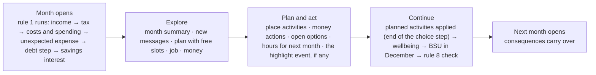

# Revision proposal: more game, less quiz

This is a **proposal** for the team. Nothing in it is applied to `prd.md`, the PRD addendum, or Rule Set v1, and nothing is logged as a decision. Once the team has decided the proposals P1-P8 in §3, the accepted parts are applied through `bmad-prd` update. Each one is logged in `.memlog.md`, and the PRD goes through review and finalize again.

Proposed PRD text is in English, like the PRD. The summary just below is in Norwegian.

## Sammendrag (norsk)

**Hovedgrepet:** Månedsløpet beholdes, inkludert den faste rekkefølgen i regel 1, todelt måned (FR-49) og at timeendringer gjelder fra neste måned. I tillegg får spilleren noe å gjøre hver måned: planlegge fritid, lese meldinger, styre jobb og penger. Hendelsene blir høydepunkter, ikke hele spillet.

1. **Kalender = «månedsplan» med aktivitetsplasser.** Antall plasser regnes ut fra fritiden som regel 12 allerede beregner ut fra skole og arbeidstimer. Mer jobb gir færre plasser. Timetallet er fortsatt den eneste kilden til lønn og fritid, så ingenting regnes dobbelt. Aktiviteter påvirker penger, stress og sosialt liv.
2. **Aktiviteter trekkes når spilleren går videre.** De legges til sist i valgsteget i regel 1, før trivselen. Rekkefølgen i regel 1 endres ikke.
3. **Ekstravakter kan ikke legges inn samme måned.** Konseptet viser ekstravakt som en aktivitet i kalenderen. Det kolliderer med regel 1 og 10: lønn og skatt er allerede regnet når måneden åpner. Ekstravakter gjelder derfor fra neste måned som i dag, og vises som jobbblokker der.
4. **Mobil = innboks med forhåndsskrevne meldinger.** Meldingene er av fire typer: info, invitasjon (åpner en aktivitet), tilbud (jobb, ekstravakter, åpne valg) og hendelse. Ingen melding har quiz-alternativer.
5. **Faste tilbud flyttes fra hendelser til meldinger.** Det gjelder jobb, mopedlappen, kort, lån og lignende, som da kommer som meldinger og åpne valg (FR-48). Hendelsesmånedene går til historiene, med 4 per år i stedet for 5. Dette forenkler FR-46 og gjør at biblioteket kan krympe fra 50 til 40 hendelser.
6. **Jobb og økonomi bygger videre på det som finnes:** FR-20, FR-47, FR-48 og FR-45. Det nye er en jobbvisning, valgfritt eget sparemål, kjente utgifter neste måned og hva aktiviteter har kostet i år. Ingen nye økonomiregler.
7. **Sluttoppsummeringen** slår sammen aktiviteter av samme type, for eksempel «Konserter: −3 400 kr». Det viser «små kjøp som summerer seg», som var det spørreundersøkelsen fant at unge angrer mest på.
8. **V2 med KI som spillmotor:** Alt innhold (hendelser, meldinger, aktiviteter) går gjennom ett skjema og ett utvalgssteg, «hva skjer denne måneden». I V2 kan KI ta over utvalg og tekst innenfor de samme skjemaene. Motoren bestemmer fortsatt alle beløp.

**Konflikter som må løses:**
- Regel 1, 7 og 12 og FR-13, FR-14, FR-18, FR-46 og FR-49 må omformuleres.
- Trivselsbalansen må regnes ut på nytt, særlig eksempel 17a, 17b og 23 og den hule seieren i UJ-5.
- Månedsoppsummeringens eksempelkjøp må ikke overlappe med aktiviteter.

**Største risiko:** tid før leveransen i desember. Mest nytt arbeid er innhold (aktiviteter og meldinger) og grensesnitt, ikke motoren. Forslaget har derfor en minimumskjerne og en kuttliste (§7).

**Åpne spørsmål til teamet:** P1-P8 i §3 og OQ-17 til OQ-22 i §6.9.

---

## 1. The new month loop

From **Event → pick A/B/C → consequence → next month** to **Explore → Plan → Act → See consequences → Next month**, inside the existing two-part month (FR-49):

- **A quiet month** has no highlight event. The player sees the summary and any new messages, and can continue at once. Planning is never required.
- **An active month** has a highlight event (a story event, card warning, or crisis). As today, the player continues after the real choice.
- **What carries over:** money, savings, debt, wellbeing, hours, flags, and open options. Plans don't carry over: each month starts with empty slots (P2).
- **Not a day-by-day simulator:** there are no days, times, or dates inside a month (rule 10 already has no daily limits).

## 2. What we reuse

| Area | Reuses as is | Reuses with a change | New |
|---|---|---|---|
| **Calendar (month plan)** | Rule 10 hours, rule 12 free time, FR-45 affordability, FR-36 cause links, FR-12 seed and stored draws | FR-49 continue (applies the plan), rule 12 (activity effects) | Activity slots (FR-52), activities (FR-53) |
| **Job** | FR-20 wages, FR-47 hours and extra shifts, rule 10 caps, D12 | FR-18 job offers via messages, FR-48 open options | Job view (FR-56) |
| **Phone** | FR-46 seeded scheduling, event schema and content check (FR-17), FR-35 opened/closed texts, FR-31 and FR-32 as events | FR-18 offer months now deliver messages | Messages (FR-54), message scheduling (FR-55) |
| **Money** | FR-45 money view and actions, FR-9 goal progress, month summary, FR-22, FR-26 card figures, FR-38 "Hvorfor?" | FR-23 example purchases, FR-42 grouping | Savings target, upcoming costs, activity spend (FR-57) |
| **Across all four** | Engine order (rule 1), endings (FR-41), cause links and echo badges, recap and teaser, minigames (FR-51), login, saving | Rule 7, FR-13, FR-14, FR-46 | — |

Nothing in the economy is replaced. There's still one wage path (hours → rule 10 → income step → tax), one spending path (rule 16), and one wellbeing calculation (rule 12).

## 3. Proposals for the team to decide

Each proposal has a recommendation and the alternative weighed. Nothing is decided.

**P1. Time model: slots come from free time; hours stay the source of truth.** *Recommended.*
Activity slots per month = the month's free time (rule 12) ÷ 20, rounded down, at most 4. Work isn't placed in slots. It comes from the hours setting (FR-47) and shows as blocks in the plan.
- **Why:** time stays one number, so pay, tax, free time, and the rule 10 checks are unchanged. More work automatically means fewer slots, which is the trade-off the concept is about.
- **Alternative:** slots replace hours, with work placed in slots. Rejected: it rewrites rules 3, 10, and 12, FR-47, and worked examples 1, 5, 17, and 20-23, and would need a second wage path.

**P2. Plan this month, applied when the player continues.** *Recommended.*
Activities are planned for the current month. They move no money until the player continues. Then the engine applies them at the end of the choice step, before wellbeing. Removing one before continuing is free.
- **Why:** the rule 1 order is unchanged, there's no undo logic, and affordability is checked once more at the end.
- **Alternative:** plan next month, with hours and activities together. That gives the concept's "drop a shift to fit the concert" in one screen. But a plan would then sit across two months, with money, affordability, and cause links split between them. Possible in V2.

**P3. Extra shifts are never placed in a slot.** *Recommended (follows from P1 and rule 1).*
Extra shifts work as in FR-47: they raise weekly hours from the next month for N months. The plan shows them as work blocks from then on.
- **Why:** this month's income and tax are already calculated when the month opens. Paying a shift at the choice step would need wages after tax, which breaks rule 1.
- **Also replaced:** the concept's "+500 kr per extra activity slot" becomes the engine's own figure, the kroner the shift leaves after spending (FR-47).

**P4. Fixed offers arrive as messages, and active months go to story events.** *Recommended.*
The offers in the FR-18 table arrive as messages pointing to the open option (FR-48), instead of taking an active month. That covers the part-time job, moped licence, moped, summer jobs, car licence gift, credit card, consumer loan, experience, and full-time job. The pengegave (month 1) stays an event. Active months drop from 5 to 4 a year (months 1, 4, 7, 10; configuration), all for drawn events and follow-ups.
- **Why:** offers stop looking like A/B/C questions. FR-46 loses milestones and their push-out rules. And the library can shrink.
- **Overlap (FR-43), M + D² / (N − M):**
  - Today: 11 milestones + 14 drawn, N = 50 → 64%.
  - P4 with 4 a year: 1 fixed + 19 drawn. N = 40 → 51%; N = 50 → 42%.
  - P4 with 5 a year: 1 + 24, N = 50 → 51%.
  - So the event minimum can go from 50 to 40 (twice the 20 active months), which frees authoring time for activities and messages.
- **What's lost:** a few offers had teaching built into their event options, such as the loan event in month 49. The teaching moves into the message's tip text. Or the team keeps that one as a drawn event.
- **Alternative:** keep milestones as events and 5 active months, and add messages only for invitations. Fewer changes, but less of the "less quiz" goal.

**P5. Activities change stress and social life only, within a monthly cap.** *Recommended.*
- **Per activity:** an effect within ±10 on stress and on social life.
- **Per month:** all applied activities together move each part at most ±15 (configuration).
- **Like event effects:** they don't count as one of rule 12's rows.
- **Free time:** never changed by an activity. Slots *are* the free time.
- **Why:** no double counting with hours. The cap stops cheap or free activities from removing the hollow win (UJ-5, example 17b). A money chaser on 40 h in school has 1 slot, so the time trade-off still bites.

**P6. Call it the "month plan" in the PRD.** *Recommended.*
"Calendar" is already the name of rule 11 and FR-12's calendar bullet. The UI label ("Kalender") is UX's choice.

**P7. The ending summary groups activities by kind.** *Recommended, cut list item.*
FR-42 ranks applied activities of the same kind as one entry, with their summed kroner effect, for example «Konserter og utesteder: −3 400 kr». Single activities are too small to rank, but together they show «små kjøp som summerer seg», which the survey names as the most common regret. FR-39's "money kept" line compares the group with not doing it.

**P8. V2 readiness: one schema and one selection step for all content.** *Recommended; costs nothing now.* See §8.

## 4. Conflicts with the current PRD and Rule Set v1

| Where | Today | Conflict | Proposed resolution |
|---|---|---|---|
| Rule 1 | "the month's event and the player's choice" | Several choices a month (activities) | "the month's event and the player's choices, ending with the planned activities (PRD FR-53)". Order unchanged |
| Rule 7 | A quiet month shows only a short summary; 20-30 real choices | Quiet months now have messages and optional planning | A quiet month has no highlight event. The 20-30 count refers to real choices in events and crises |
| Rule 10 / FR-47 | Hours change from the next month; extra shifts +4 h for 3 months | The concept places an extra shift in this month's calendar | P3: never in a slot; shown as work blocks from the next month |
| Rule 12 | Only event choices carry their own stress and social effects (±20) | Activities carry effects too | P5: activity effects with a monthly cap; free time unchanged |
| Rule 12 balance, examples 17a, 17b, 23 | Tuned without activities | Free "rest" each month could lift ending wellbeing and remove the hollow win | P5 cap, slots from free time, and a recalculation of 17a, 17b, and 23 with a stated planning policy (OQ-21) |
| Rule 16 / FR-23 | Spending (60/75/95% of wage) shown with example purchases such as cinema | Activities also cost money, and "cinema" overlaps with them | Activities come on top, like event options. Example purchases avoid activity kinds (canteen, clothes, snacks, not cinema) |
| FR-13 | An active month is an event with options | Unchanged for highlights; offers leave (P4) | An active month has a highlight event, which may arrive as a message |
| FR-14 | A quiet month "is shown only as a short summary" | It now has messages and a plan | Reworded; continuing at once is always allowed |
| FR-17 | ≥ 50 events, twice 25 active months | With P4, 20 active months | Minimum 40, target 50-60. Activities and messages get their own schema and content check |
| FR-18 / FR-46 | Milestone events take active months, with push-out rules | P4 | Offers arrive as messages in their offer month and can't be pushed out. FR-46 drops the milestone rules |
| FR-48 | "A milestone event offers it first" | P4 | "A message offers it first" |
| FR-49 | Continue after the real choice | Plan applied at continue | Continue applies the plan (P2). Empty slots and unread messages never block |
| FR-42 | Choices ranked one by one | Many small activities never rank | P7 grouping |
| FR-9 | Reference runs reach goals 1 and 2 | Activity costs lower savings | Reference runs need a planning policy (OQ-21) |
| NFR-2 | Keyboard and screen reader | A drag-based calendar would fail WCAG 2.2 criterion 2.5.7 | Plan by tapping or selecting, no dragging needed; slot state in text |
| NFR-7 | List of refusals | New requests | New refusals for activities (§6.6) |
| NFR-8 | No alcohol or tobacco | Invitations (concert, party) | Invitations never mention alcohol or tobacco; senders are fictional |
| UX concept | "+500 kr per extra activity slot", "Anslått netto +300 kr" incl. a shift, "Overføring til sparing −400 kr" listed as a cost | NFR-4 (only engine figures) and FR-42 (transfers count as zero) | Shift kroner come from FR-47. The estimate covers activity costs only. Transfers are shown as transfers, not costs |

The only earlier decisions this touches are the 2026-11-05 scheduling decisions: active months 1, 3, 6, 8, 10, milestones in active months, and the library minimum of 50. P4 replaces them if accepted. The 2026-11-03 decision of 4-6 choices a year still holds for events.

## 5. MVP or V2

| Item | MVP | V2 or later |
|---|---|---|
| Month plan with slots from free time (FR-52) | ✅ core | Planning next month (P2 alternative), recurring weekly habits |
| Activities: a basic set, always available, plus invitation-only ones (FR-53) | ✅ core: about 5 basic + 12-20 invitation activities | Activities that earn money (pocket money is V2 already) |
| Phone: info, invitation, offer, and event messages (FR-54, FR-55) | ✅ core | Replying in a chat, choosing between reply options, negotiation (brief addendum) |
| Fixed offers as messages + open options (P4) | ✅ if P4 is accepted | — |
| Job view on top of FR-20 and FR-47 (FR-56) | ✅ core (mostly UI) | Job development: reliability leading to more offers, raises beyond the age steps, being let go, several jobs, applying among several jobs |
| Savings target, upcoming costs, activity spend (FR-57) | ✅ cut list | Budget tools, several targets |
| Grouped activities in the ending summary (P7) | ✅ cut list | — |
| Persistent friends (Emma remembers you said no) | Names recur as flavour only | Relationships as game state |
| School work with an effect on grades | Only as stress relief, or left out (OQ-19) | Education (already "Later") |
| AI as game master | ❌ (§4.2) | Selection and text of messages, invitations, and events inside the same schemas (§8) |
| Push notifications | ❌ (no PWA, NFR-1) | — |
| Day-by-day planning | ❌ never | ❌ |

## 6. Proposed PRD changes

### 6.1 Vision, scope, and cut list

**§1 Vision.** Add after "It feels like a game, not schoolwork.":
> **Time is as limited as money.** Each month the player plans their free time, reads what friends, family, the employer, and the bank send them, and manages their job and money. Story events are the highlights, not the whole game. The player learns from what their own actions lead to, not from questions and answers.

**§1 Next (V2):** replace "AI as the game's play driver, generating events" with:
> AI as the game master where possible: choosing and writing messages, invitations, and events within the same schemas the MVP uses, while the engine still decides every amount (§8 of the revision proposal, NFR-4).

**§4.1 In scope:** add:
> - The month plan with activity slots, and activities (5.13)
> - The phone, with messages and invitations (5.14)
> - The job view (5.15)

**§4.1 Cut list:** add these as items 1-3, ahead of the existing items:
> 1. Savings target and upcoming costs in the money view (FR-57)
> 2. Grouped activities on the ending screen (P7). Activities then aren't ranked
> 3. Invitation activities and info messages, down to their minimum (FR-17)

Add to "These always stay": *the month plan with the basic activities, the phone with offers and invitations, and the job view.*

**§4.3 Later or left out:** add rows for job development (V2), relationships with recurring friends (V2), replying to messages (V2), planning the next month (V2), and push notifications (out).

### 6.2 Glossary

| Term | Proposed meaning |
|---|---|
| Activity | A pre-written thing to do in a free slot, such as meeting friends, resting, or a concert. It can cost money and changes stress and social life (FR-53) |
| Activity slot | One unit of the month's free time that the player can fill with an activity. The month's free time (rule 12) sets how many there are (FR-52) |
| Highlight event | The month's event: a story event, card warning, or crisis. A month with one is active |
| Invitation | A message that makes an activity available this month (FR-54) |
| Message | A pre-written text in the phone from a friend, family, the employer, or the bank (FR-54) |
| Month plan | The month's free slots and the activities in them, with work shown as blocks from the hours setting. Not the calendar of rule 11 |
| Offer | A message that points to an open option (FR-48) or to extra shifts (FR-47) |
| Savings target | One open option the player pins to see their progress towards its price (FR-57) |
| *Changed:* Active month | A month with a highlight event |
| *Changed:* Choice | Add "an applied activity" |
| *Changed:* Milestone event | Removed if P4 is accepted. Offers replace it |
| *Changed:* Quiet month | A month with no highlight event. The player sees the summary and any messages, and can plan or continue at once |

### 6.3 User journeys

**New: UJ-6.** Drafted from the team's month example, with Markus and Emma. To be confirmed by the team; amounts are illustrative.

- **UJ-6. Markus fits a concert into an October with extra shifts.**
  - **Persona + context:** Markus, 17, is in Vg2 and works 10 h a week in a shop. In September his employer sent a message asking for extra help, and he said yes: 4 more hours a week for three months. He's saving for the moped licence, which he has pinned as his savings target.
  - **Entry state:** month 34 (October). The extra shifts run from October to December, so he works 14 h a week. His free time is 72, which gives him 3 free slots this month instead of 4.
  - **Path:**
    1. October opens. The month summary shows his wage with the extra shifts. His phone has two new messages. Emma invites him to a concert on Friday, and the bank says he has reached 50% of his savings target.
    2. He opens his month plan: 3 free slots, with the shifts shown as work blocks. He wants the concert, an evening with friends, a rest night, and gaming, which is four things.
    3. He places the concert and the evening with friends, which shows him what they cost together, and keeps the last slot for rest because his stress is rising.
    4. In the job view he sees that going back to 10 h would give him 4 slots from November, and how much less he'd earn after spending. He keeps the shifts: they end after December anyway.
    5. He continues. The engine charges the two activities, then works out wellbeing. Social life goes up from the concert and friends, and the rest night eases his stress.
  - **Climax:** he sees that time is as limited as money. The extra shifts bring the moped closer, but cost him a slot every month.
  - **Resolution:** savings and wellbeing carry over into November. In January his hours drop back to 10 and he gets the fourth slot back. At 20, the ending summary shows «Konserter og utesteder» as one line, with what they cost over five years.
  - **Edge cases:**
    - **He can't afford the concert:** it shows the missing amount and can't be placed.
    - **He switches to the PC:** the plan is saved and looks the same there.
    - **No slot left:** he has to remove an activity first.
    - **He does nothing:** the invitation runs out at the end of the month, with no other effect.

**Small changes to existing journeys:**
- **UJ-1 step 5:** "A new event follows, for example a part-time job offer…" → "His phone gets a message from a shop that needs a part-timer (month 3). He takes the job in the job view and sets his hours. In the quiet months between events, friends' invitations show up, and he decides what to spend his free time on." Session resolution unchanged.
- **UJ-3 step 1:** "He sees that his savings have grown" → "The bank sends a message: his savings have earned interest." Then "Hvorfor?" as today.
- **UJ-4 steps 3-4 and climax:** the extra shifts cost him free slots in the month plan, and he turns down invitations from friends. This is how his social life falls, shown in play rather than only in the score.
- **UJ-5 step 3:** the three choices that mattered most can include a group of activities (P7).

### 6.4 New functional requirements

New sections 5.13-5.15. FR numbers continue from FR-51.

#### FR-52: Month plan and activity slots

Each month the player has a few activity slots for their free time, and fills them with activities or leaves them empty. Work isn't placed in slots. It comes from the hours setting (FR-47), so more work means fewer slots. Realizes UJ-4 and UJ-6.

**Consequences (testable):**
- **How many:** slots this month = the month's free time (rule 12) ÷ 20, rounded down, at most 4. Both values are configuration. In a school month:
  - 0 or 10 h a week → 4 slots
  - 12 h → 3 (free time 76)
  - 25 h → 2 (free time 50)
  - 40 h → 1 (free time 20)
  - Full-time at 37.5 h after school → 4 (free time 85)
  - July (summer month) → 4
- **Never zero:** rule 10 keeps free time at 20 or above in school months, so there's always at least one slot.
- **Fixed when the month opens:** the count comes from that month's hours, extra shifts included. An hours change applies from the next month (FR-47), and the plan shows the next month's slot count before the player confirms it.
- **Never required:** an empty slot has no effect, and the player can always continue with empty slots (FR-49).
- **Work as blocks:** the plan shows school and work as fixed blocks, and work can't be moved there. The look is UX.
- **No days or times:** the plan has no days, times, or dates within the month.
- **Engine figures only:** the plan's estimate of what the planned activities cost is calculated by the engine (NFR-4).

#### FR-53: Activities

An activity is a pre-written thing to do in a free slot. Some are always available, and some come only with an invitation (FR-54). Realizes UJ-6.

**Consequences (testable):**
- **Fields:** each activity uses one slot and has a cost of NOK 0 or more, a card-payable flag, effects on stress and social life (each within ±10), an age range, required and blocking flags, a mechanism, and a source for its price.
- **Always available:** a basic set of at least 5 activities. At least two of them cost nothing, so a player with NOK 0 can still plan.
- **Invitation activities:** available only in the month their invitation arrives.
- **Once a month:** the same activity can be planned at most once a month (configuration).
- **Planning moves no money:** a planned activity shows its cost and its effects. One the player can't pay for now is shown with the missing amount and can't be placed (FR-45). Removing a planned activity before continuing is free and leaves no trace.
- **Applied at continue:** when the player continues, the engine applies the planned activities in slot order at the end of the choice step (rule 1), before wellbeing. Payment follows FR-45, and the card follows FR-26. An activity that can't be paid at that point is dropped with a short note and has no effect.
- **On top of spending:** activity costs come on top of the spending level (rule 16), like event options. The month summary lists each activity and its cost.
- **Wellbeing:** effects apply at the wellbeing step. Together they move each part at most ±15 a month (configuration). They don't count as one of rule 12's rows, and they never change free time.
- **A choice, not the real choice:** an applied activity is a choice with a cause link (FR-36), so echo badges and "Hvorfor?" work. It doesn't use up the month's real choice.
- **In a crisis month:** activities can be planned, under the same payment rules.

#### FR-54: Phone and messages

The phone is an inbox of pre-written messages from friends, family, the employer, and the bank. Messages show the player what's happening around them, and most need no answer. Realizes UJ-1, UJ-3, and UJ-6.

**Consequences (testable):**
- **Four kinds:**
  - **Info:** no action.
  - **Invitation:** makes an activity available this month (FR-53).
  - **Offer:** points to an open option (FR-48) or extra shifts (FR-47).
  - **Event:** brings the month's highlight event (FR-13), and the player answers it there.
- **No quiz answers:** an invitation is accepted by placing its activity, and an offer by taking it in the job or money view. Ignoring a message only means missing what it offered.
- **Pre-written:** all messages are pre-written in Norwegian (NFR-8), from fictional senders. The player can't write messages (§4.2).
- **Engine figures:** any amount or share in a message, such as «50 % av sparemålet», is the engine's figure.
- **New and old:** a message that arrived this month is marked new. Earlier messages stay readable for the rest of the playthrough.
- **Reading changes nothing:** reading a message changes nothing in the game, and nothing about reading is stored.

#### FR-55: Which messages arrive

The engine decides which messages arrive each month, in the same way it schedules events (FR-46). Realizes UJ-1 and UJ-6.

**Consequences (testable):**
- **Drawn and stored:** messages are drawn when the month opens, from the playthrough's seed, and stored (FR-12). Reloading or switching device shows the same messages.
- **Who can get one:** a message needs the player's age to be in its range, its flags to fit, and, for one-off messages, not to have appeared before. Bank messages are triggered by state, such as goal progress passing 25, 50, 75, or 100%.
- **How many:** at most 3 new messages a month (configuration). Offers come first, then the event message, then invitations, then info.
- **Offers always arrive:** each offer in the FR-18 table arrives as a message in its offer month, in every playthrough where the player qualifies. A crisis can't push it out.
- **Invitations:** 0-2 a month are drawn (configuration). The content check reports invitations per in-game year and months with none.

#### FR-56: Job view

The player sees their job in one place: the workplace and role, the hourly rate for their age, weekly hours and the rule 10 limit, the expected monthly pay, and any current offers. Realizes UJ-4 and UJ-6.

**Consequences (testable):**
- **No new wage rules:** FR-20, FR-47, and rule 10 apply unchanged. The pay shown is the engine's, and an extra-shift offer shows the kroner it would leave after spending (FR-47).
- **What the player can do here:** set hours from the next month, quit, take a job offer (FR-48), and accept offered extra shifts.
- **Slots before confirming:** before an hours change is confirmed, the view shows how many slots it gives from the next month (FR-52).
- **Extra-shift offers:** can come from the employer as a message as well as from events, and always follow FR-47.
- **Flavour only:** the workplace and role are flavour text. Every part-time job pays the Virke/HK rate for the player's age (D2).
- **With no job:** the view shows the open job offers, or when the next one unlocks (FR-18).

#### FR-57: Savings target, upcoming costs, and activity spend (cut list, item 1)

The money view shows progress towards one savings target the player picks, the costs already known for next month, and what activities have cost this year. Realizes UJ-6 and UJ-3.

**Consequences (testable):**
- **Savings target:** the player can pin one open option with a price, such as the moped licence. Progress is the savings account against that price, calculated by the engine. Pinning moves no money and isn't a choice.
- **Upcoming costs:** next month's known fixed and everyday costs, plus loan, payment-plan, and family-loan instalments. The card is shown as its current balance, not a forecast.
- **Activity spend:** the total cost of applied activities this in-game year, by kind.

### 6.5 Changed functional requirements (deltas)

- **FR-9:** "an event offers it in month 44" → "a message offers it in month 44" (P4). The reference runs state their planning policy (OQ-21).
- **FR-12:** "then the month's event and the player's choice" → "then the month's event and the player's choices, ending with the planned activities". The reproducibility bullet adds message draws and plans.
- **FR-13:** "In a month with an event" → "In a month with a highlight event". Add a content rule: options read as actions the player takes, never as quiz answers with one right option.
- **FR-14:** replace the description with: "A month with no highlight event shows a short summary and any new messages. The player can plan, act, or continue at once."
- **FR-15 / FR-16:** the recap and the teaser can name new messages. The rule for what the teaser names is unchanged.
- **FR-17:**
  - **Size:** "at least 50 regular events, twice the 25 regular active months" → "at least twice the regular active months (40 with P4), target 50-60".
  - **New content:** add activities (≥ 5 basic, 12-20 invitation-only) and messages, each with a schema and a content check.
  - **Per year:** "at least 10 events" per in-game year → 8 (configuration).
- **FR-18:** the table stays. "Offered in month N" now means a message arrives (FR-55). Add: "No offer takes an active month."
- **FR-23:** example purchases avoid activity kinds: canteen, clothes, and snacks instead of cinema.
- **FR-33:** "Social life follows the choices made in events" → "in events and activities".
- **FR-36:** applied activities are choices with cause links.
- **FR-39:** for an activity group (P7), the line uses "money kept", the group's cost grown with savings interest.
- **FR-42:** ranking treats applied activities of the same kind as one choice, with the summed effect (P7). The hollow-win slot can name an activity group.
- **FR-46:**
  - **Active months:** 4 a year by default (P4), and the "Pace" bullet updated.
  - **Removed:** "Milestones", "Set placements" (except the pengegave and the car licence draw month), the milestone half of "When events collide", and "Pushed out" for milestones. Follow-ups keep their rules.
- **FR-47:** the hours control lives in the job view (FR-56) and shows its effect on slots.
- **FR-48:** "A milestone event offers it first" → "A message offers it first (FR-55)". Open options can also be taken from the job view.
- **FR-49:** continuing applies the planned activities (FR-53) before wellbeing. Empty slots and unread messages never block continuing.
- **FR-50:** add counts with no content: months with at least one planned activity, and invitations accepted against those received.
- **FR-28 / FR-30 / FR-51:** a licence started from an offer message or the money view doesn't use the real choice. The car licence gift arrives as a family message in month 37.

### 6.6 Non-functional requirements

- **NFR-2:** the month plan works by tapping or selecting, with no dragging needed (WCAG 2.2, 2.5.7). Each slot's state is available as text. New messages are announced politely to screen readers.
- **NFR-7:** add refusals for:
  - an activity with no free slot left
  - an activity that isn't available: an expired invitation, not unlocked, or failing its flags
  - the same activity twice in a month
  - a plan change for a month that isn't the current one
  - an activity the player can't pay for at planning time
  - a plan change after continuing

  Add a non-refusal with its own test: an activity that can't be paid when the player continues is dropped with a note.
- **NFR-8:** invitations never mention alcohol or tobacco, and senders are fictional. A message from family can carry advice, but never personal financial advice.
- **NFR-9:** the content check covers activities and messages.
- **NFR-10:** placing or removing an activity meets the same response targets as a choice.

### 6.7 Success metrics

- **7.1 Understanding:** add "Can explain why more work hours gave them fewer activity slots" (target: most players).
- **7.2 Counter-metrics:** add "Planning is ignored: fewer than a third of months have a planned activity (FR-50). The plan adds screens without adding play." And add "Sessions run past 15 minutes: planning slows the pace."

### 6.8 Rule Set v1 (brief addendum)

- **Rule 1:** "→ the month's event and the player's choice → wellbeing" → "→ the month's event and the player's choices, ending with the planned activities → wellbeing".
- **Rule 7:** "A month without an event is still processed by rules 1-5, but the player only sees a short summary" → "A month without a highlight event is still processed by rules 1-5. The player sees a short summary and can plan or continue at once." The 20-30 real choices count events and crisis choices.
- **Rule 12:** after "Each event choice changes stress and social life by its own effect, at most 20 points either way", add: "Each applied activity changes stress and social life by its own effect. All activities in a month together move each part at most 15 points either way. Activity effects don't count as one of the rows below, and never change free time."
- **New disclosure, D26 (activities):** «Forenklet: En måned har noen få ledige plasser for fritid. Jo mer du jobber, jo færre blir de. Spillet følger ikke dager eller klokkeslett.»
- **New worked examples** (added when the proposal is applied, and independently recalculated as before):
  - **24:** slots from hours, the table in FR-52.
  - **25:** a concert month. The activity is charged at continue, after spending. A second activity that can't be paid is dropped.
  - **26:** wellbeing with activities, the monthly cap, and the stress fall in rule 12 unaffected.
  - **Rework:** 17a, 17b, 21, and 23, once OQ-21 sets the planning policy for reference runs.

### 6.9 New open questions

| # | Question | Owner | Blocks |
|---|---|---|---|
| OQ-17 | P1-P8: which proposals the team accepts | Team | Applying this revision |
| OQ-18 | Activity catalog: which basic activities; prices with a source and date; whether "school work" has any effect without a school system (stress relief, or left out) | Team | Writing activities |
| OQ-19 | Tuning, added to OQ-8: slot divisor (20) and maximum (4), activity effect range (±10) and monthly cap (±15), messages a month (3), invitations a month (0-2), active months (4) | Team, when tuning | Balancing |
| OQ-20 | Do friends recur by name across the playthrough (flavour only in the MVP)? | Team, UX | Writing messages |
| OQ-21 | The planning policy for seeded and reference runs (FR-9, examples 17b and 21), for example "one paid basic activity a month" | Team | Recalculating the examples |
| OQ-22 | Capacity before the December delivery: which of FR-52 to FR-57 are built first, and where the cut line goes now | Team | Sprint planning |

## 7. Delivery risk and the minimum core

- **Engine:** moderate change. The engine adds the plan state, the slot count (one formula on free time), applying activities at continue, message draws (the same mechanism as event draws), and grouping in FR-42. The rule 1 order, wages, tax, and the debt rules are untouched.
- **Content:** the main new work. It's about 5 basic and 12-20 invitation activities, roughly 40-60 short messages, and the offer texts. With P4, the event minimum drops by 10, which offsets part of it.
- **UI:** four views. UX already has concepts for all four.
- **Minimum core if time runs short:**
  - the month plan with the basic activities (FR-52, FR-53)
  - the phone with offers and invitations (FR-54, FR-55)
  - the job view (FR-56, mostly the existing FR-47 control)

  Everything else is on the cut list (§6.1).

## 8. Ready for V2: AI as game master

The team wants AI to act as the game engine where possible in V2. The MVP can make that cheap without building anything for it:

1. **One schema per content type, whoever writes it.** Events, activities, and messages have one schema each, and the content check validates them. In V2, AI-written content goes through the same schema and the same check before a player sees it (brief addendum, AI safety principle 1).
2. **One selection step.** "What happens to this player this month" (FR-46, FR-55) is one step that takes the state and the seed, and returns what arrives. In V2 the AI can propose what arrives. The engine still checks eligibility (age, flags, rule 10, affordability) and stores the result.
3. **The engine decides every amount.** Prices and effects come from configuration and parameters, or are checked against limits. AI never sets an amount (NFR-4, rule 8 "the engine, not the AI"). The research on LLM game masters supports this split.
4. **Stored, not regenerated.** Whatever arrives is stored with the playthrough (FR-12), so a reload or replay never asks the AI again. Generated content needs its own storage in V2, because library versions (NFR-4) don't cover it. The architecture should leave room for that.
5. **A fallback to the library.** If generation or moderation fails, the selection step falls back to pre-written content (F5 in V2).
6. **No free text from the player.** Not in the MVP. In V2 only after a separate decision (brief addendum, AI safety principle 2).

## 9. Effect on other work

- **Architecture (in progress, `architecture-IBE160-G13-2026-11-09`):** most logged decisions still hold:
  - functional core / imperative shell
  - a single mutation path with request ID and month
  - snapshot + action log
  - YAML content with fingerprints

  Additions: content types `activities/` and `messages/` beside the event library; plan and inbox in the state document; and the selection step as a named unit (P8). The spine should wait for the team's decision on P1-P8.
- **UX:** the concept sketches fit this proposal, with the changes in §4's last row.
- **Epics and stories:** not started, so no rework.

## 10. Next steps

1. The team reads this proposal and decides P1-P8 and OQ-17.
2. Run `bmad-prd` update with the decisions. Each accepted change is logged, and `prd.md`, the PRD addendum, and Rule Set v1 are edited.
3. Add the new worked examples and have them recalculated independently.
4. Run the reviewer pass, triage, and polish, then set the PRD to final again.
5. Resume `bmad-architecture` with the updated PRD.
